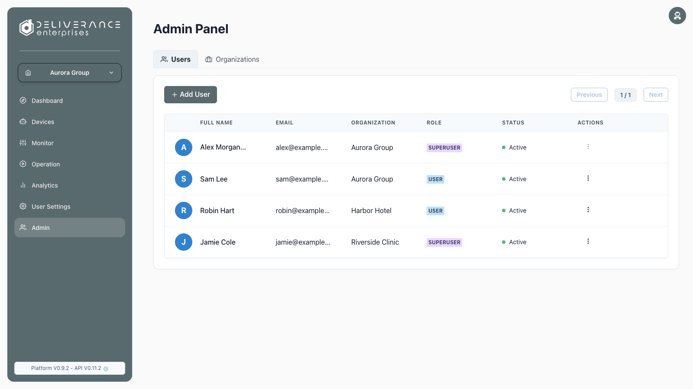
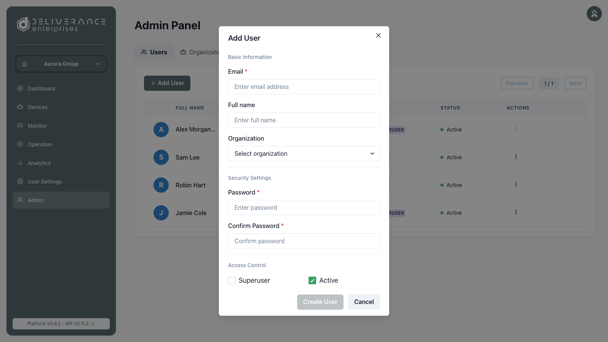
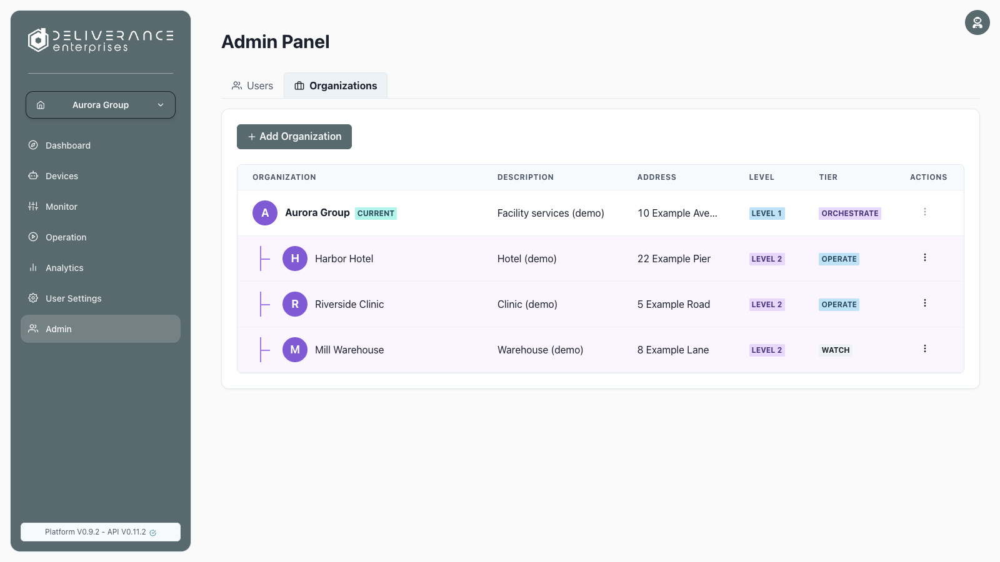
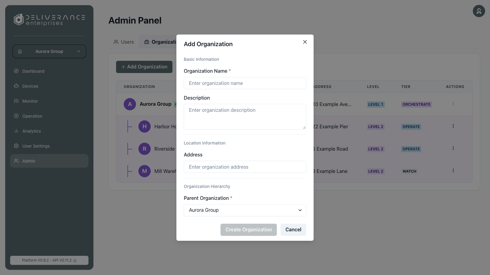
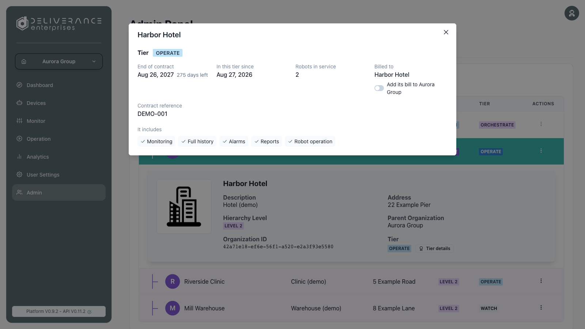

# Admin: Admin panel

Management of users and organizations. It only appears to administrators, who manage **their own organization and those below it**.

## Users

List of users: name, email, organization, role and status. The menu in each row lets you edit or delete the user.

### Add a user

- **Email** and **Full name**.
- **Organization**: the organization the user belongs to.
- **Password** and **Confirm Password**: initial password.
- **Superuser**: administrator of their organization and those below it.
- **Active**: if unchecked, the user cannot log in.

## Organizations

The organizations by hierarchy, with their level and tier. Your own is marked as *Current* and its actions are disabled.

### Add an organization

Name, description, address and **Parent Organization**, the organization it sits under.

## Organization tier

**Tier details** shows the contracted level (*Watch*, *Operate* or *Orchestrate*), the end of the contract, since when the organization has been in that level, the robots in service, who is billed, the contract reference and what it includes. The tier is changed by Deliverance.

**Billed to** shows who receives the bill. The administrator of the parent organization can include a child organization's bill in their own with *Add its bill to...*

Statuses: *Active*, *Ends soon*, *Expired* and *Suspended*. The end of a contract does not change anything by itself. When Deliverance **suspends** an organization, its users cannot enter the platform; its data, connectors and workflows continue.
