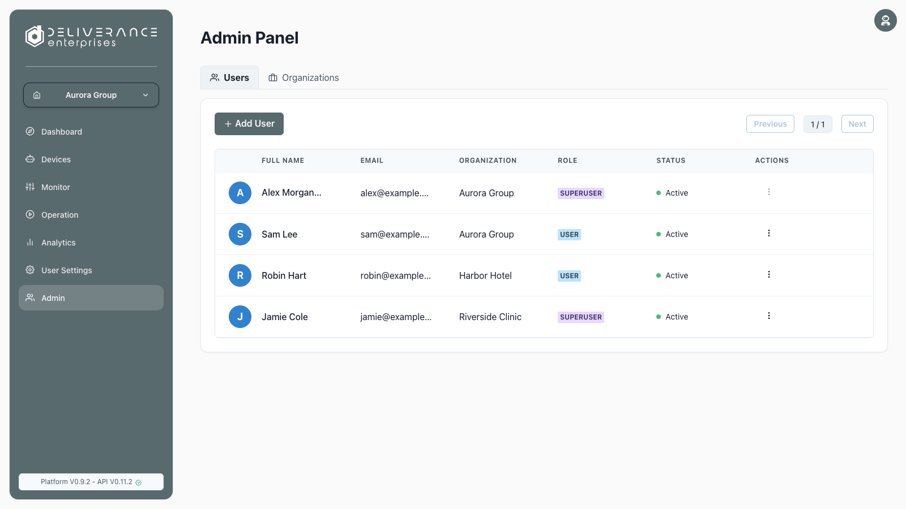
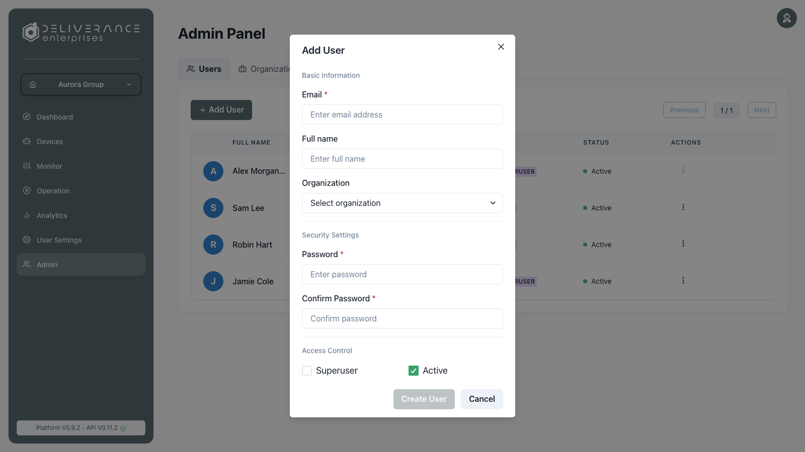
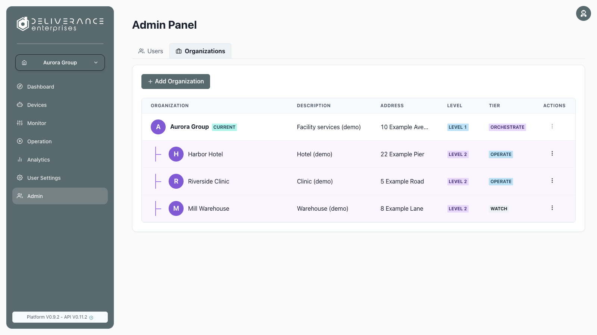
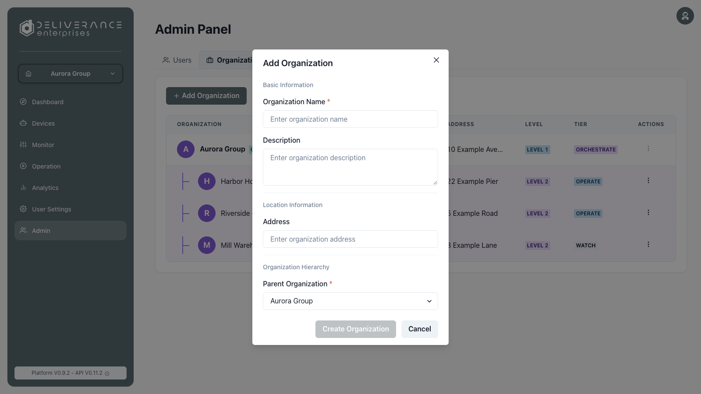
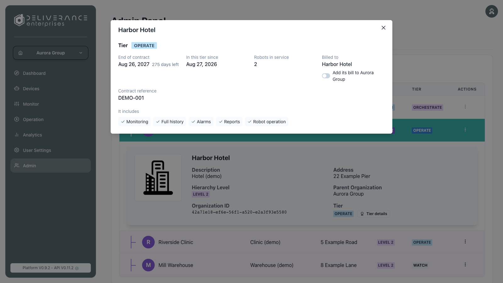

# Admin: Panel de administrador

Gestión de usuarios y organizaciones. Solo aparece a los administradores, que gestionan **su organización y las que cuelgan de ella**.

## Users

Lista de usuarios: nombre, email, organización, rol y estado. El menú de cada fila permite editarlo o borrarlo.

### Añadir un usuario

- **Email** y **Full name**.
- **Organization**: a qué organización pertenece.
- **Password** y **Confirm Password**: contraseña inicial.
- **Superuser**: administrador de su organización y de las que cuelgan de ella.
- **Active**: si se desmarca, no podrá iniciar sesión.

## Organizations

Las organizaciones por jerarquía, con su nivel y su tier. La propia está marcada como *Current* y sus acciones están desactivadas.

### Añadir una organización

Nombre, descripción, dirección y **Parent Organization**, la organización de la que cuelga.

## Tier de una organización

**Tier details** muestra el nivel contratado (*Watch*, *Operate* u *Orchestrate*), el fin de contrato, desde cuándo está en ese nivel, los robots en servicio, a quién se factura, la referencia del contrato y lo que incluye. El tier lo cambia Deliverance.

**Billed to** indica quién recibe la factura. El administrador de la organización padre puede incluir en la suya la de una organización hija con *Add its bill to...*

Estados: *Active*, *Ends soon*, *Expired* y *Suspended*. Que un contrato termine no cambia nada por sí solo. Cuando Deliverance **suspende** una organización, sus usuarios no pueden entrar en la plataforma; sus datos, conectores y workflows continúan.
