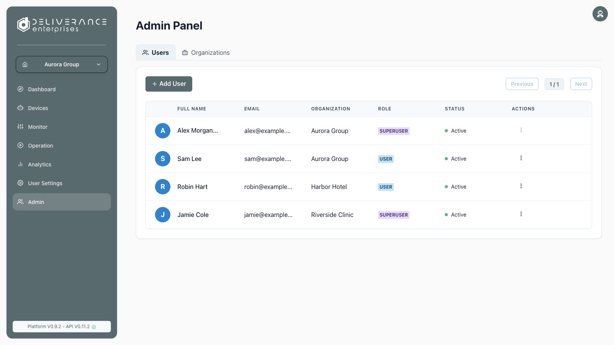
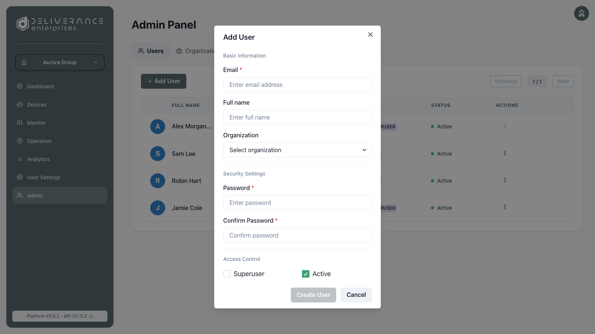
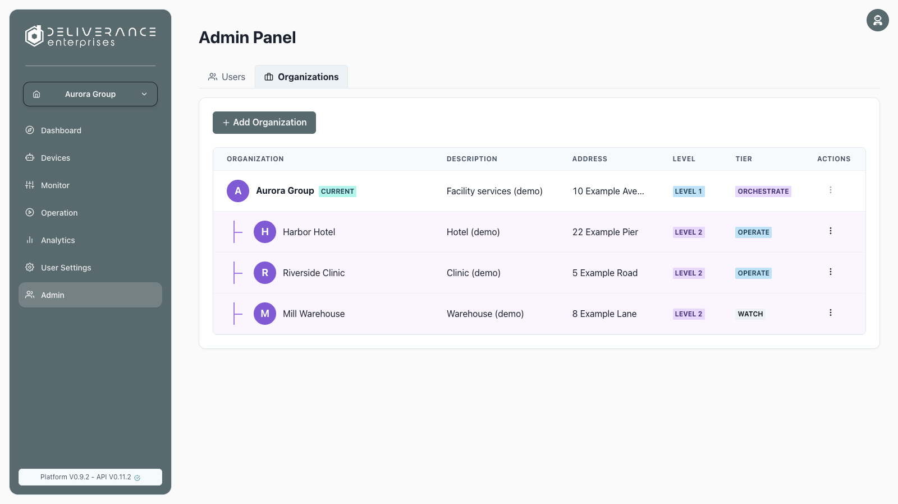
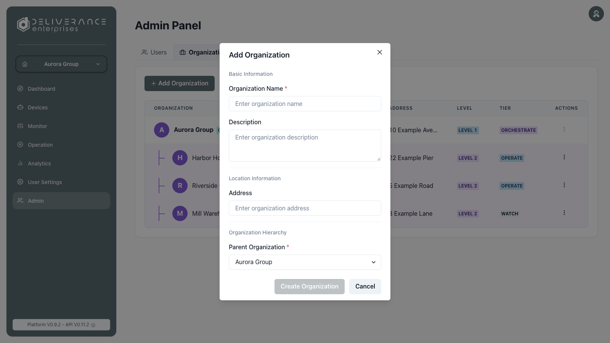
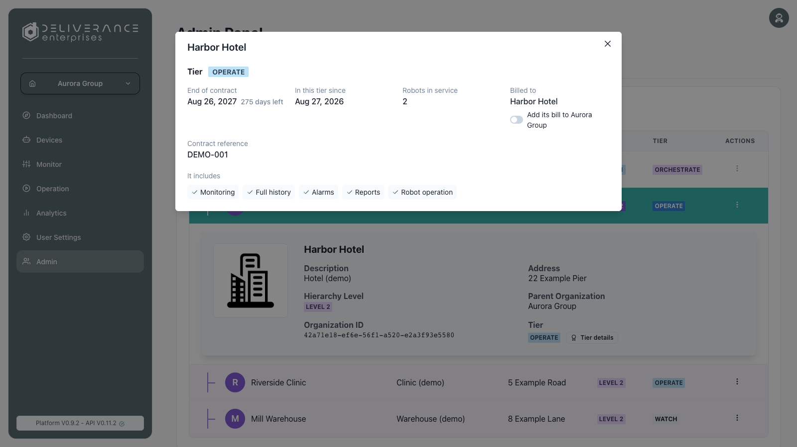

# 管理（Admin）：管理员面板 {#admin-admin-panel}

管理用户和组织。仅对管理员显示，管理员管理 **其所属组织及该组织的下级组织**。

## 用户（Users） {#users}

用户列表：姓名、电子邮箱、组织、角色和状态。每行的菜单可用于编辑或删除用户。

### 添加用户 {#add-a-user}

- **电子邮箱**（**Email**）和 **姓名**（**Full name**）。
- **组织**（**Organization**）：用户所属的组织。
- **密码**（**Password**）和 **确认密码**（**Confirm Password**）：初始密码。
- **超级用户**（**Superuser**）：其所属组织及该组织的下级组织的管理员。
- **启用**（**Active**）：如果取消勾选，该用户将无法登录。

## 组织（Organizations） {#organizations}

按层级显示的组织，包括其层级和等级。所属组织标记为 *当前*（*Current*），其操作不可用。

### 添加组织 {#add-an-organization}

名称、描述、地址和 **上级组织**（**Parent Organization**），即该组织隶属的组织。

## 组织等级 {#organization-tier}

**等级详情**（**Tier details**）显示签约的级别（*Watch*、*Operate* 或 *Orchestrate*）、合同结束日期、从何时起处于该级别、在役机器人、账单归属方、合同编号以及包含的内容。等级由 Deliverance 更改。

**账单归属**（**Billed to**）表示由谁接收账单。上级组织的管理员可以通过 *账单并入……*（*Add its bill to...*）将下级组织的账单并入自己组织的账单。

状态：*有效*（*Active*）、*即将到期*（*Ends soon*）、*已到期*（*Expired*）和 *已暂停*（*Suspended*）。合同到期本身不会改变任何内容。当 Deliverance **暂停** 某个组织时，其用户无法进入平台；其数据、连接器和工作流继续运行。
