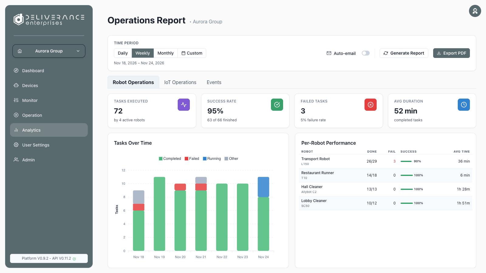
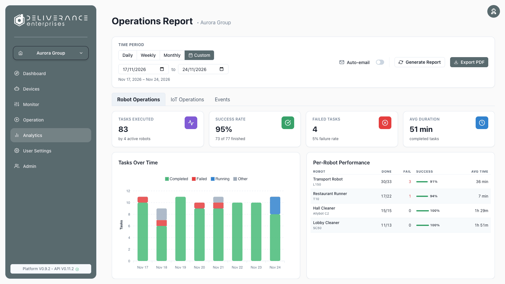
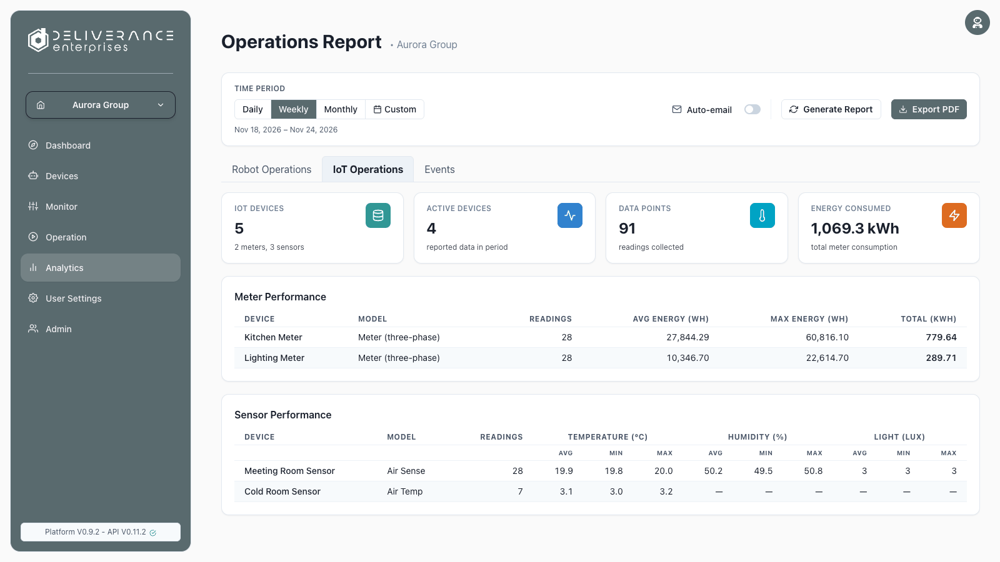
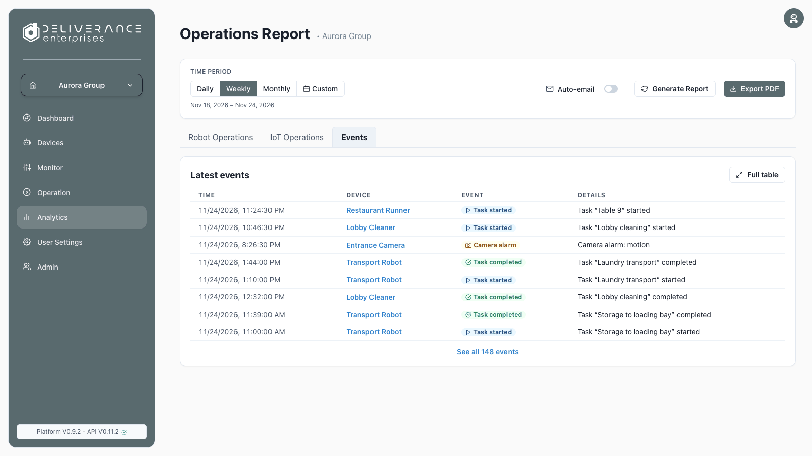
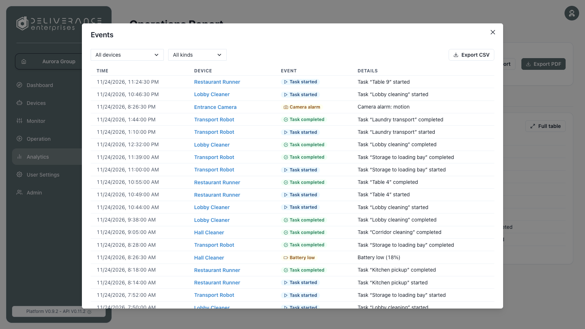

# Analytics: Operation statistics

Detailed report on the operations of the selected organization.

## Period and reports

- **Daily**, **Weekly**, **Monthly** or **Custom** (a date range). The report loads by itself; **Generate Report** reloads it.
- **Export PDF** opens the browser's print dialog to save it.
- **Auto-email** turns on periodic email delivery at the frequency of the selected period. It changes both the organization's setting and the user's; each user controls whether they receive it in [User Settings](user-settings.md).

## Robot Operations

Tasks executed, success rate, failed tasks, average duration, tasks over time and performance per robot.

## IoT Operations

Number of devices and how many have sent data, readings collected, energy consumed, and performance per meter and per sensor.

## Events

The latest events of the period. Clicking a device opens it in Monitor. **Full table** opens the complete list, with filters by device and by type, and **Export CSV**:

