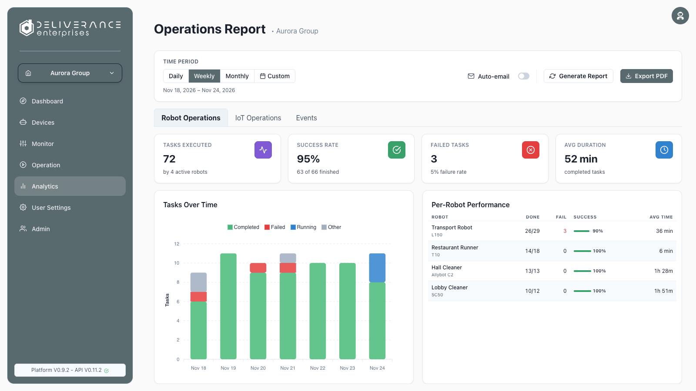
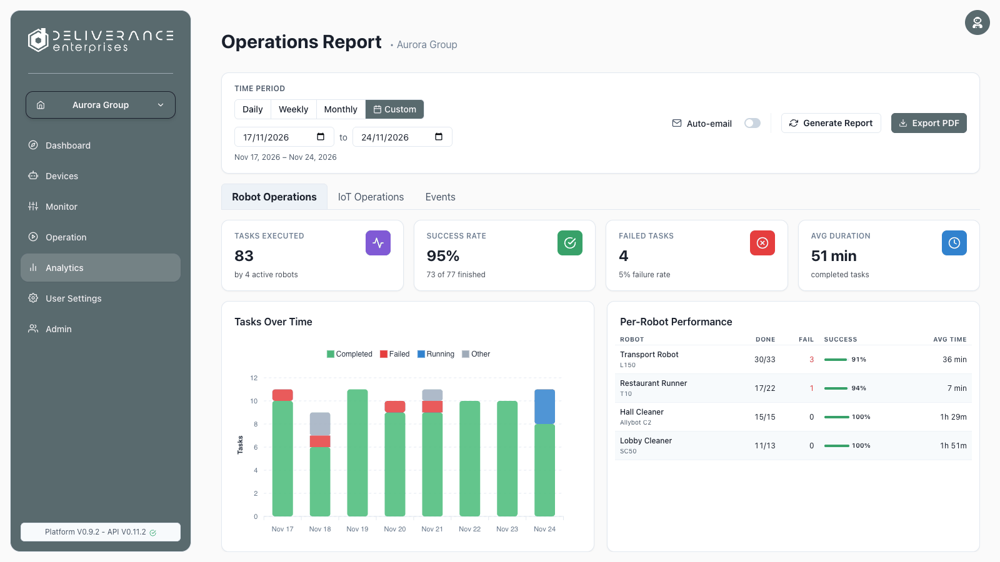
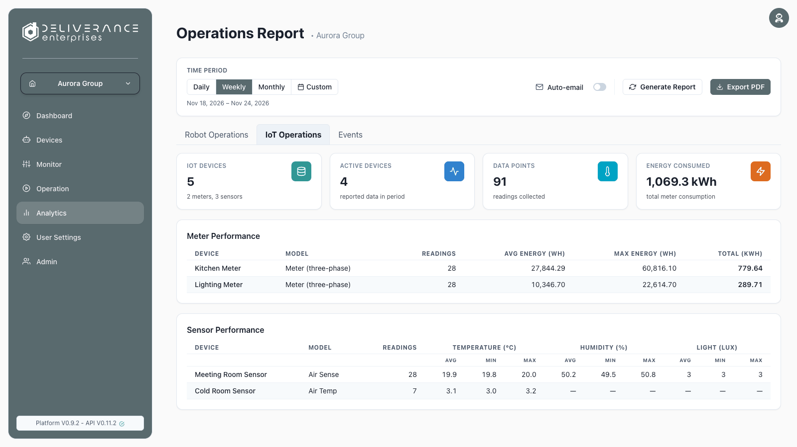
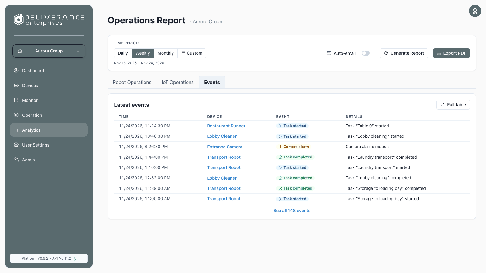
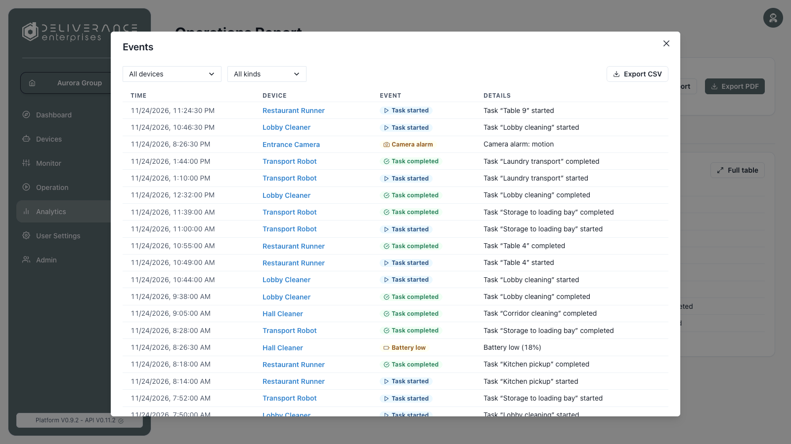

# Analytics: Estadísticas de operación {#analytics-operation-statistics}

Informe detallado de la operativa de la organización seleccionada.

## Periodo e informes {#period-and-reports}

- **Daily**, **Weekly**, **Monthly** o **Custom** (un intervalo de fechas). El informe se carga solo; **Generate Report** lo recarga.
- **Export PDF** abre la impresión del navegador para guardarlo.
- **Auto-email** activa el envío periódico por email con la frecuencia del periodo elegido. Cambia el ajuste de la organización y el del usuario; cada usuario controla si lo recibe en [User Settings](user-settings.md).

## Robot Operations {#robot-operations}

Tareas ejecutadas, tasa de éxito, fallidas, duración media, evolución de tareas en el tiempo y rendimiento por robot.

## IoT Operations {#iot-operations}

Número de dispositivos y cuántos han enviado datos, lecturas recogidas, energía consumida, y rendimiento por medidor y por sensor.

## Events {#events}

Los últimos eventos del periodo. Pulsar un dispositivo lo abre en Monitor. **Full table** abre la lista completa, con filtro por dispositivo y por clase, y **Export CSV**:

