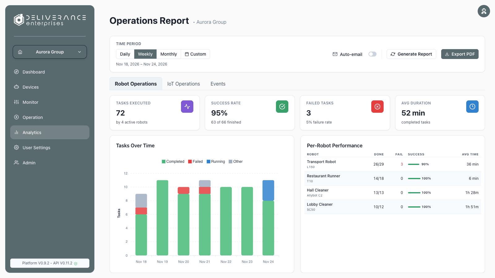
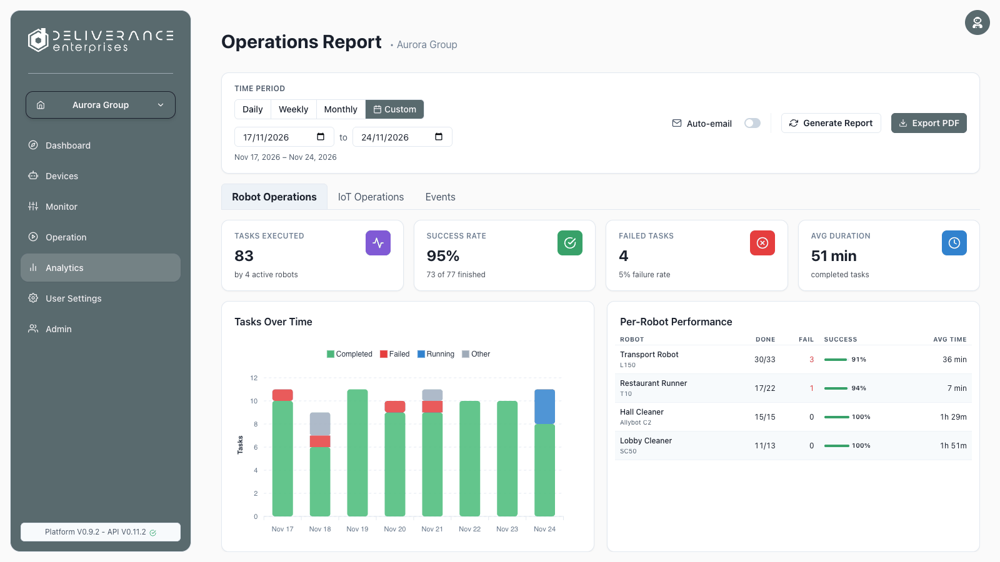
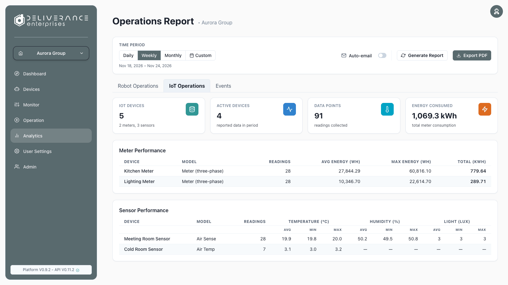
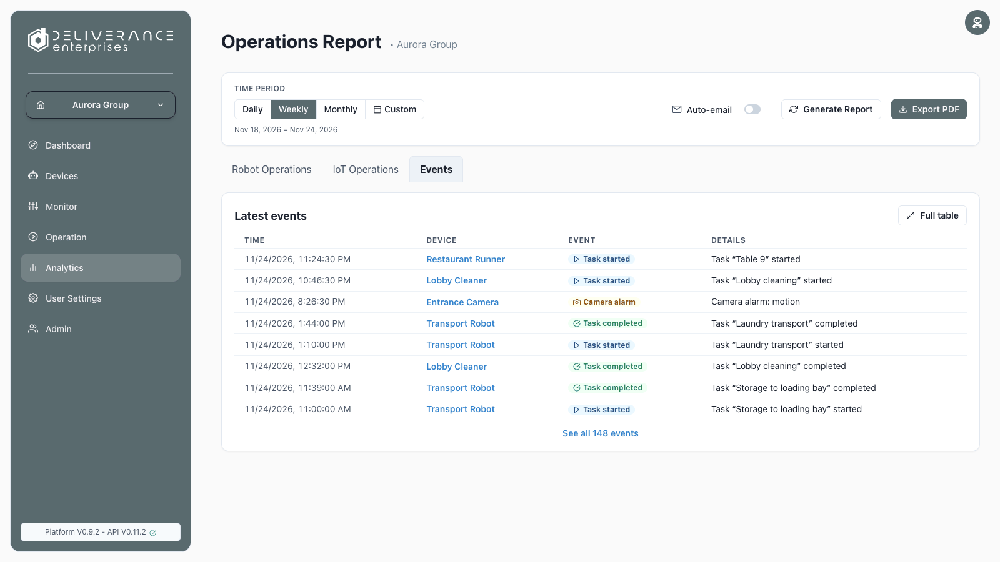
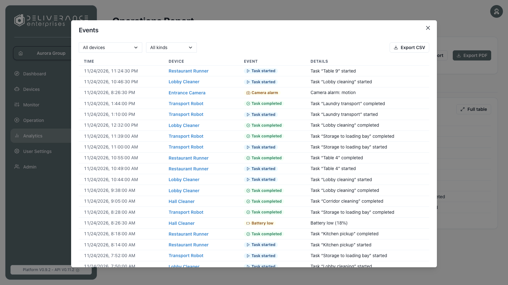

# 分析（Analytics）：运营统计 {#analytics-operation-statistics}

所选组织运营情况的详细报告。

## 时段与报告 {#period-and-reports}

- **每日**（**Daily**）、**每周**（**Weekly**）、**每月**（**Monthly**）或 **自定义**（**Custom**，一个日期区间）。报告会自动加载；**生成报告**（**Generate Report**）可重新加载。
- **导出 PDF**（**Export PDF**）打开浏览器的打印功能以保存报告。
- **自动邮件**（**Auto-email**）启用按所选时段的频率定期发送邮件。它会同时更改组织的设置和用户的设置；每个用户可在[用户设置](user-settings.md)（User Settings）中控制自己是否接收。

## 机器人运营（Robot Operations） {#robot-operations}

已执行的任务、成功率、失败数、平均时长、任务随时间的变化以及各机器人的表现。

## IoT 运营（IoT Operations） {#iot-operations}

设备数量及其中已发送数据的数量、采集的读数、消耗的能量，以及各电表和各传感器的表现。

## 事件（Events） {#events}

该时段的最近事件。点击设备会在监控（Monitor）中打开它。**完整表格**（**Full table**）打开完整列表，可按设备和类型筛选，并提供 **导出 CSV**（**Export CSV**）：

