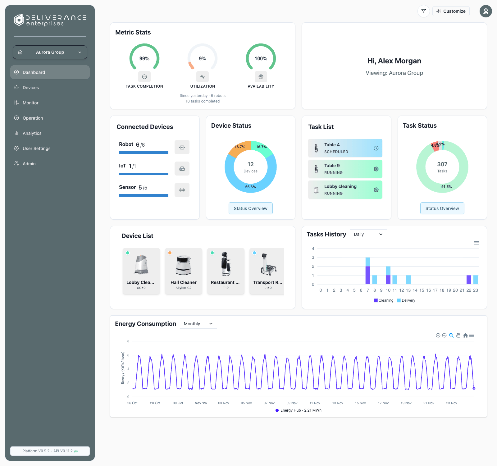
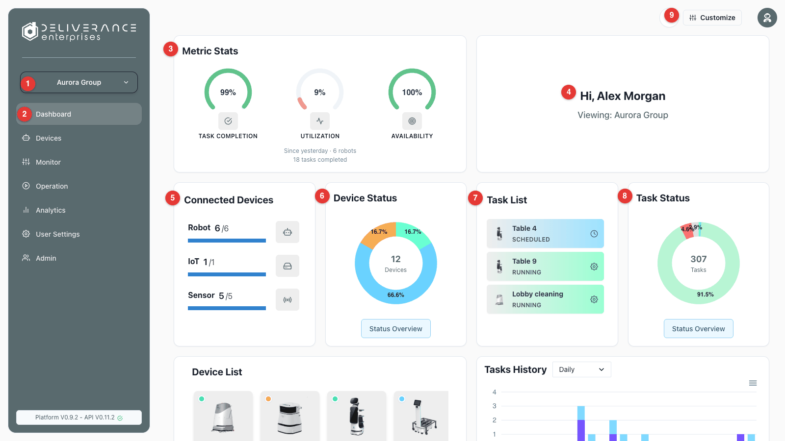
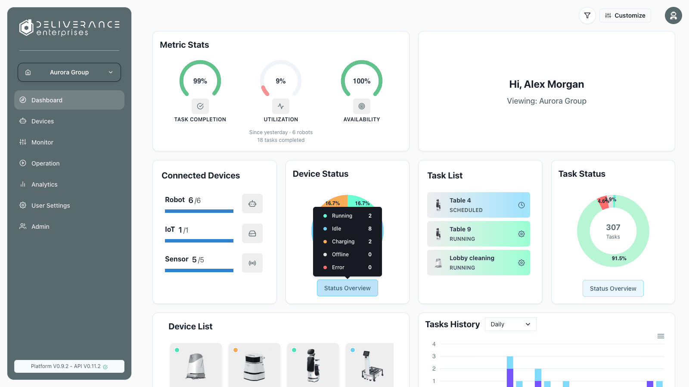
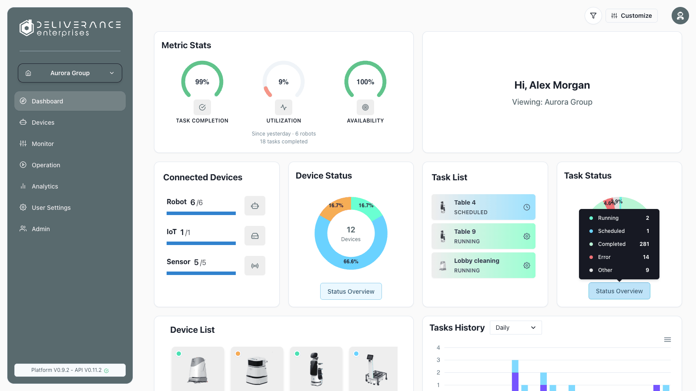
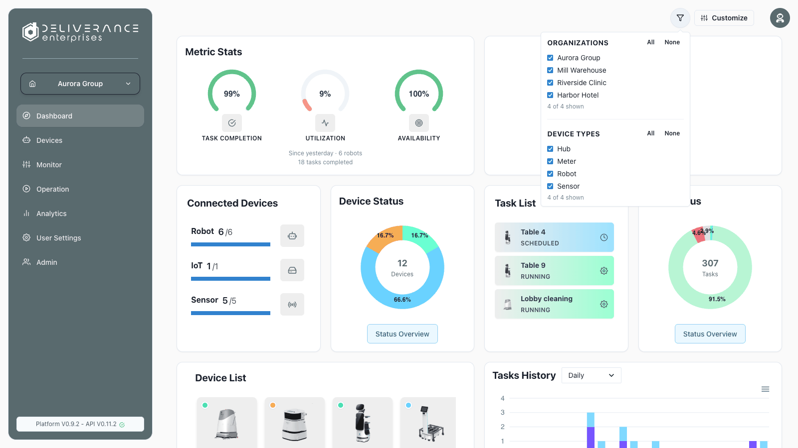
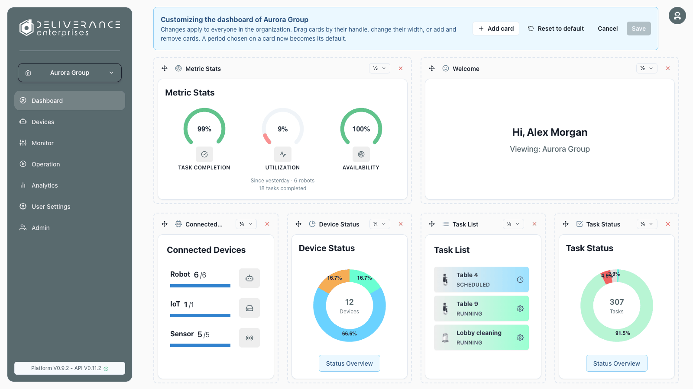
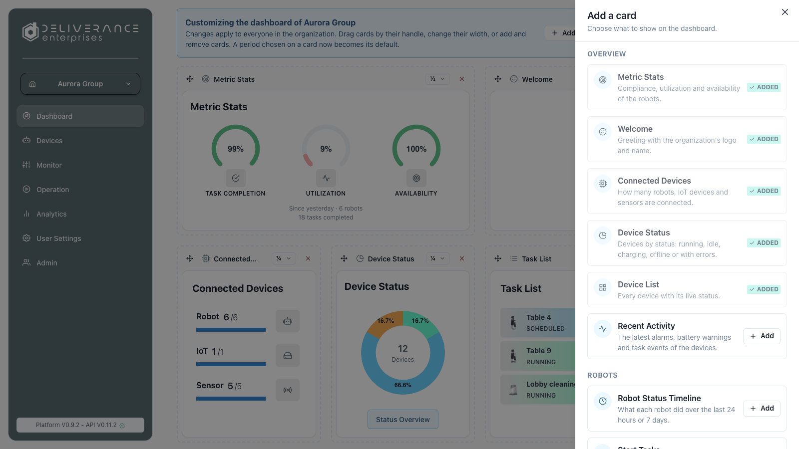

# Dashboard: Control panel

Control panel for the operations of the selected organization and those below it.

## Panel elements

1. **Selection of the organization** you are working on.
2. **Side navigation bar**.
3. **Metric Stats**: robot indicators since yesterday (see below).
4. **Welcome**: greeting and the organization being viewed.
5. **Connected Devices**: count by Robot, IoT and Sensor. The icon opens the list. A device counts as connected when it is running, idle or charging.
6. **Device Status**: devices by status.
7. **Task List**: latest robot tasks. Clicking one opens its detail.
8. **Task Status**: tasks of the last 30 days by status.
9. **Filters** (funnel icon) and **Customize**.

Further down are **Device List** (clicking a device opens its detail), **Tasks History** and **Energy Consumption**, the last two with a daily, weekly or monthly period.

## Metrics

| Metric | What it measures |
| --- | --- |
| **Task completion** | Mean completion of finished tasks. Cancelled tasks do not count; failed and expired tasks count as 0. |
| **Utilization** | Time working over time available and not charging. |
| **Availability** | Time in which the robot is not offline, in fault or stopped, over total time. |

Green from 75% and yellow from 50%. A robot that has been offline for 7 days is considered *out of service* and does not count.

## Status Overview

Expands the number of devices or tasks in each status:

## Filters

They let you show only some organizations and device types. They are saved per user.

## Customize the panel

**Customize** lets you move the cards, change their width (¼, ½, ¾ or full), remove them and add others. The changes apply to **all users of the organization** when you click **Save**. An administrator can do it, or a user on their own organization. If someone else has saved first, you can choose which version to keep.

Cards that can be added:

- **Recent Activity**: the latest alarms, battery warnings and task events.
- **Robot Status Timeline**: what each robot has done in 24 hours or 7 days.
- **Start Tasks**: start robot tasks (only administrators see it).
- **Camera View**: the picture from a camera.
