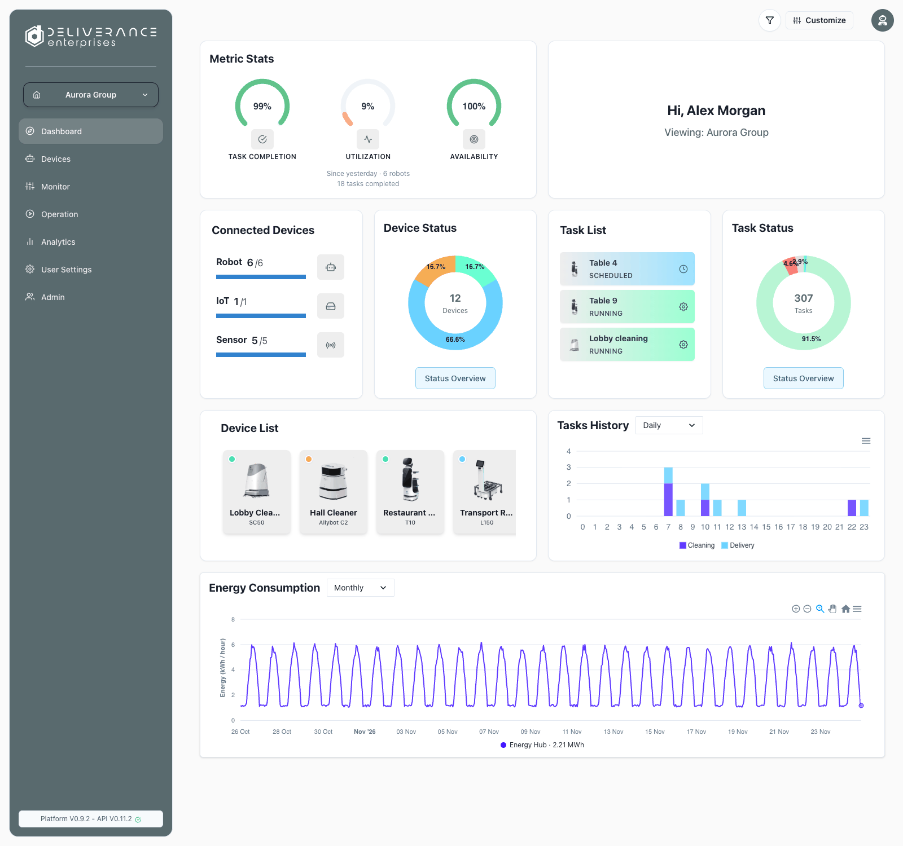
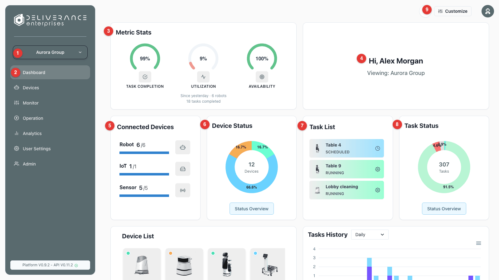
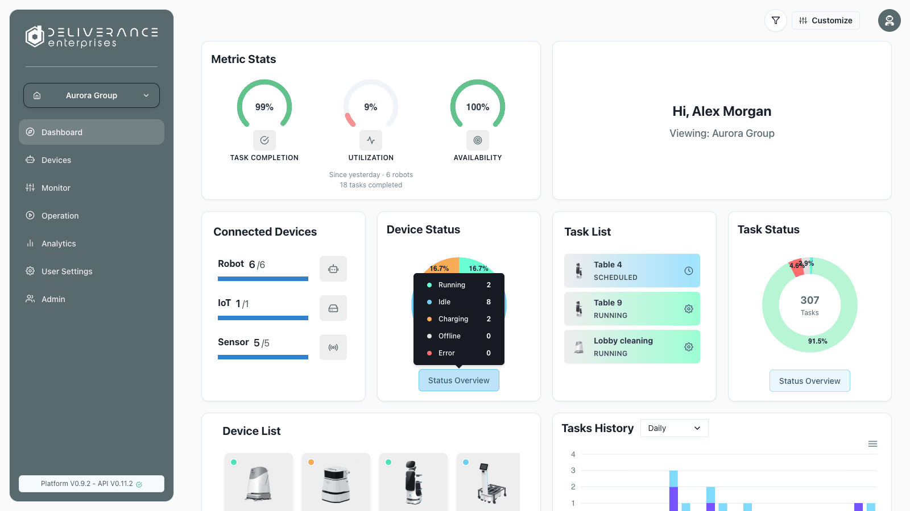
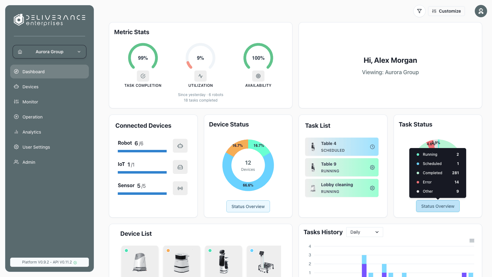
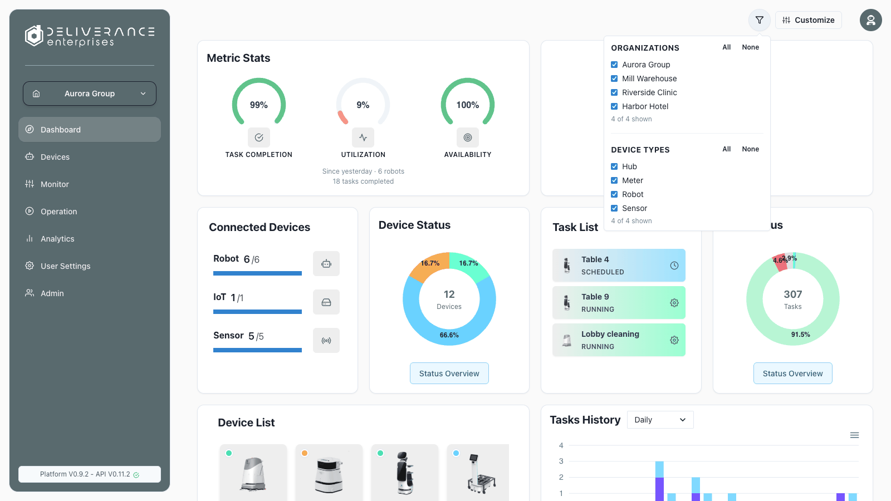
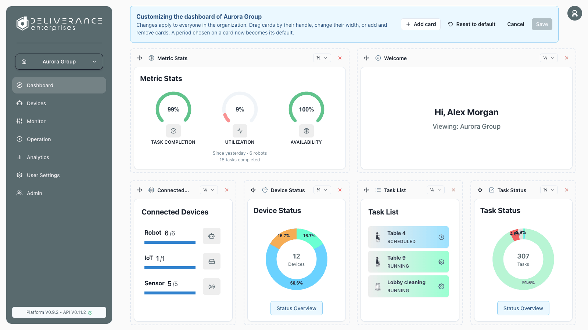
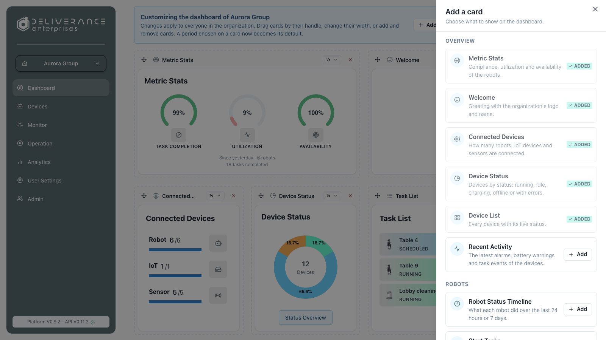

# Dashboard: Panel de control

Panel de control de la operativa de la organización seleccionada y de las que cuelgan de ella.

## Elementos del panel

1. **Selección de la organización** sobre la que se trabaja.
2. **Barra de navegación lateral**.
3. **Metric Stats**: indicadores de los robots desde ayer (ver abajo).
4. **Welcome**: saludo y organización que se está viendo.
5. **Connected Devices**: recuento por Robot, IoT y Sensor. El icono abre la lista. Se cuenta como conectado un dispositivo en marcha, en reposo o cargando.
6. **Device Status**: dispositivos por estado.
7. **Task List**: últimas tareas de los robots. Al pulsar una se abre su detalle.
8. **Task Status**: tareas de los últimos 30 días por estado.
9. **Filters** (icono de embudo) y **Customize**.

Más abajo están **Device List** (pulsar un dispositivo abre su detalle), **Tasks History** y **Energy Consumption**, estas dos con periodo diario, semanal o mensual.

## Métricas

| Métrica | Qué mide |
| --- | --- |
| **Task completion** | Media de lo completado en las tareas terminadas. Las canceladas no cuentan; las fallidas y caducadas cuentan como 0. |
| **Utilization** | Tiempo trabajando sobre el tiempo disponible y sin cargar. |
| **Availability** | Tiempo en que el robot no está desconectado, averiado ni parado, sobre el tiempo total. |

En verde a partir del 75 % y en amarillo a partir del 50 %. Un robot sin conexión durante 7 días se considera fuera de servicio (*out of service*) y no cuenta.

## Status Overview

Despliega el número de dispositivos o tareas en cada estado:

## Filtros

Permiten mostrar solo algunas organizaciones y tipos de dispositivo. Se guardan por usuario.

## Personalizar el panel

**Customize** permite mover las tarjetas, cambiar su ancho (¼, ½, ¾ o completo), quitarlas y añadir otras. Los cambios se aplican a **todos los usuarios de la organización** al pulsar **Save**. Puede hacerlo un administrador, o un usuario sobre su propia organización. Si otra persona ha guardado antes, se puede elegir con qué versión quedarse.

Tarjetas que se pueden añadir:

- **Recent Activity**: las últimas alarmas, avisos de batería y eventos de tareas.
- **Robot Status Timeline**: qué ha hecho cada robot en 24 horas o 7 días.
- **Start Tasks**: arrancar tareas de los robots (solo la ven los administradores).
- **Camera View**: la imagen de una cámara.
