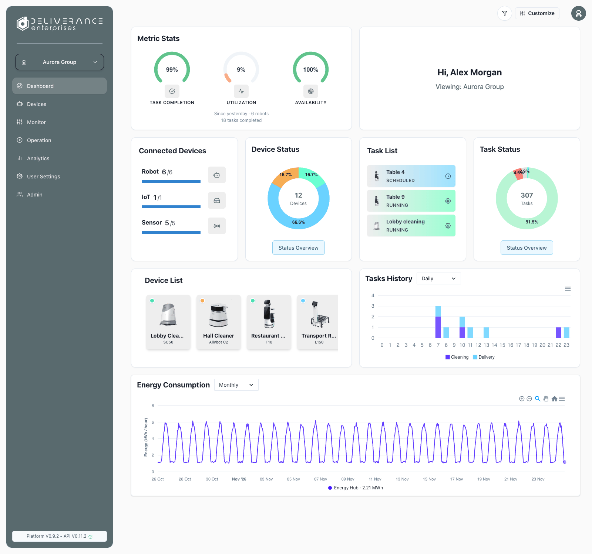
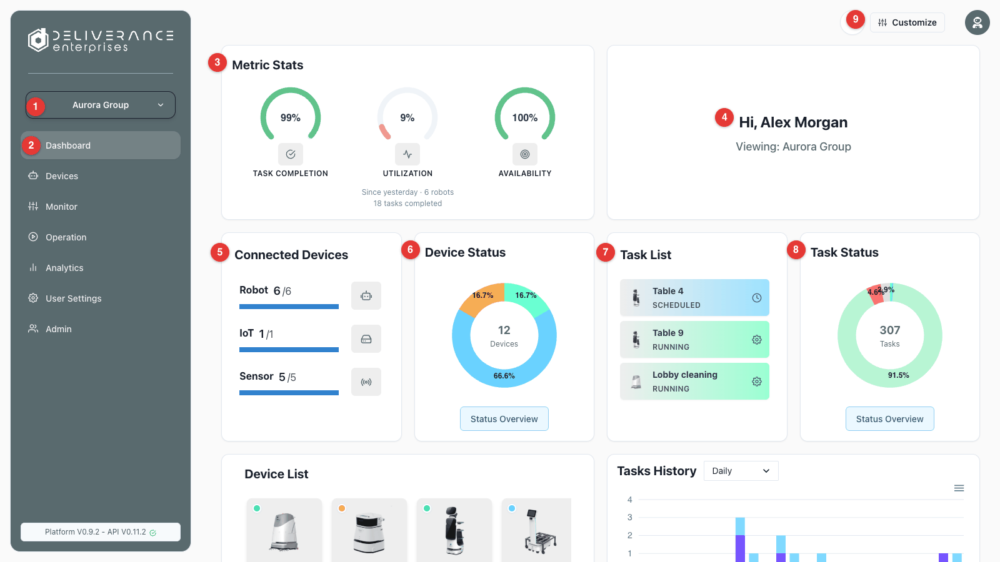
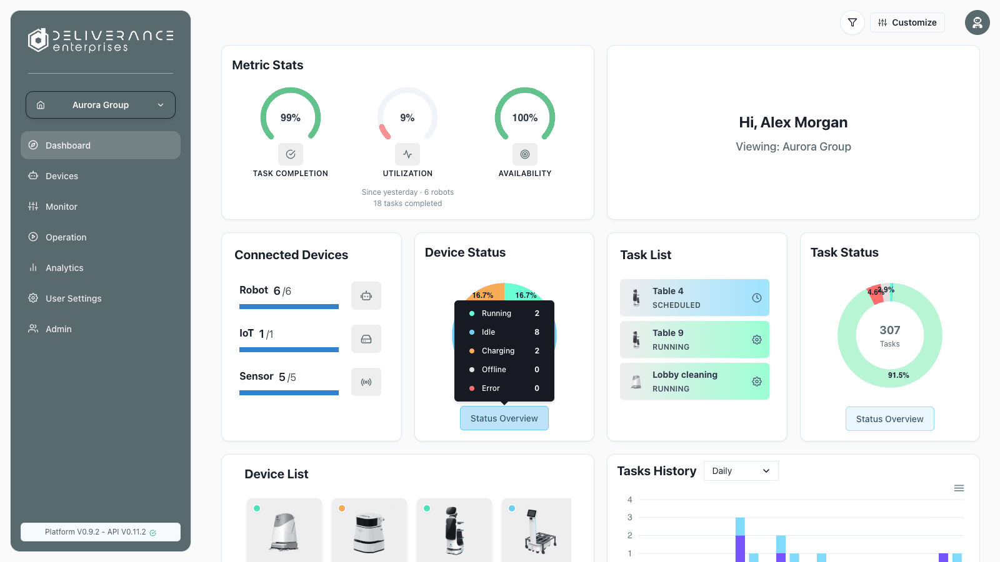
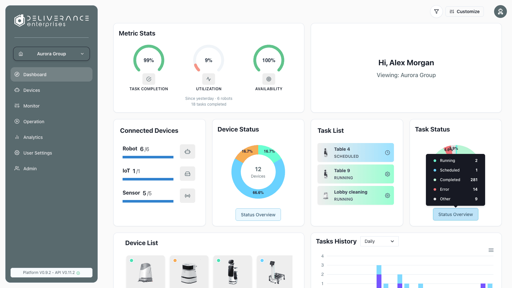
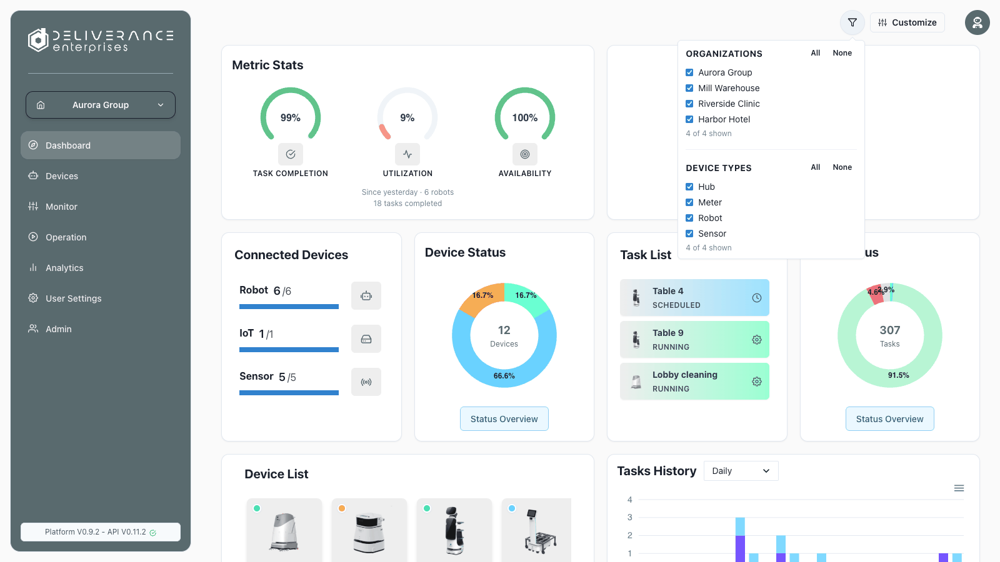
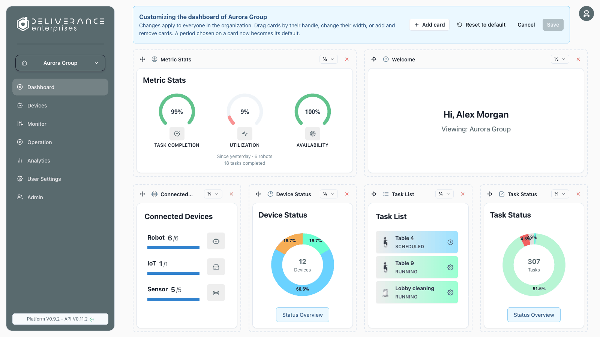
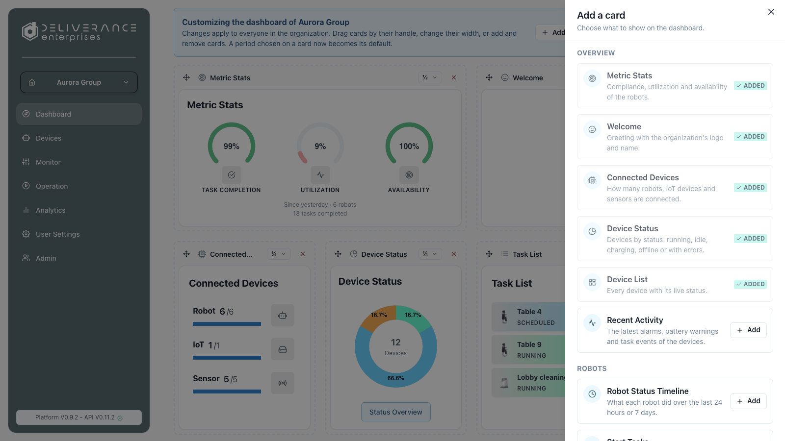

# 仪表板（Dashboard）：控制面板 {#dashboard-control-panel}

所选组织及其下级组织运营情况的控制面板。

## 面板元素 {#panel-elements}

1. **组织选择**：当前操作的组织。
2. **侧边导航栏**。
3. **指标统计**（**Metric Stats**）：自昨天以来的机器人指标（见下文）。
4. **欢迎**（**Welcome**）：问候语和正在查看的组织。
5. **已连接设备**（**Connected Devices**）：按机器人（Robot）、IoT 和传感器（Sensor）统计的数量。点击图标打开列表。运行中、空闲或充电中的设备计为已连接。
6. **设备状态**（**Device Status**）：按状态统计的设备。
7. **任务列表**（**Task List**）：机器人的最近任务。点击任务可打开其详情。
8. **任务状态**（**Task Status**）：最近 30 天按状态统计的任务。
9. **Filters**（漏斗图标）和 **自定义**（**Customize**）。

再往下是 **设备列表**（**Device List**，点击设备可打开其详情）、**任务历史**（**Tasks History**）和 **能耗**（**Energy Consumption**），后两者可选每日、每周或每月时段。

## 指标 {#metrics}

| 指标 | 衡量内容 |
| --- | --- |
| **任务完成率**（**Task completion**） | 已结束任务的平均完成度。已取消的任务不计入；失败和过期的任务按 0 计算。 |
| **利用率**（**Utilization**） | 工作时间占可用且未充电时间的比例。 |
| **可用率**（**Availability**） | 机器人未断开连接、无故障且未停止的时间占总时间的比例。 |

达到 75% 起显示为绿色，达到 50% 起显示为黄色。连续 7 天未连接的机器人视为停用（*out of service*），不计入。

## 状态概览（Status Overview） {#status-overview}

展开显示处于各状态的设备或任务数量：

## 筛选 {#filters}

可以只显示部分组织和设备类型。筛选按用户保存。

## 自定义面板 {#customize-the-panel}

**自定义** 可以移动卡片、更改其宽度（¼、½、¾ 或全宽）、移除卡片以及添加其他卡片。点击 **保存**（**Save**）后，更改会应用于 **该组织的所有用户**。管理员可以执行此操作，用户也可以在其所属组织上执行。如果其他人先保存了更改，可以选择保留哪个版本。

可添加的卡片：

- **最近动态**（**Recent Activity**）：最近的告警、电量提醒和任务事件。
- **机器人状态时间线**（**Robot Status Timeline**）：每台机器人在 24 小时或 7 天内的活动。
- **启动任务**（**Start Tasks**）：启动机器人的任务（仅管理员可见）。
- **摄像头画面**（**Camera View**）：某个摄像头的图像。
