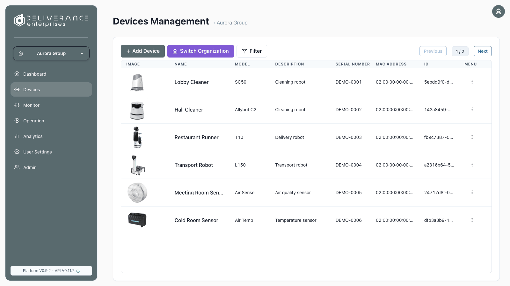
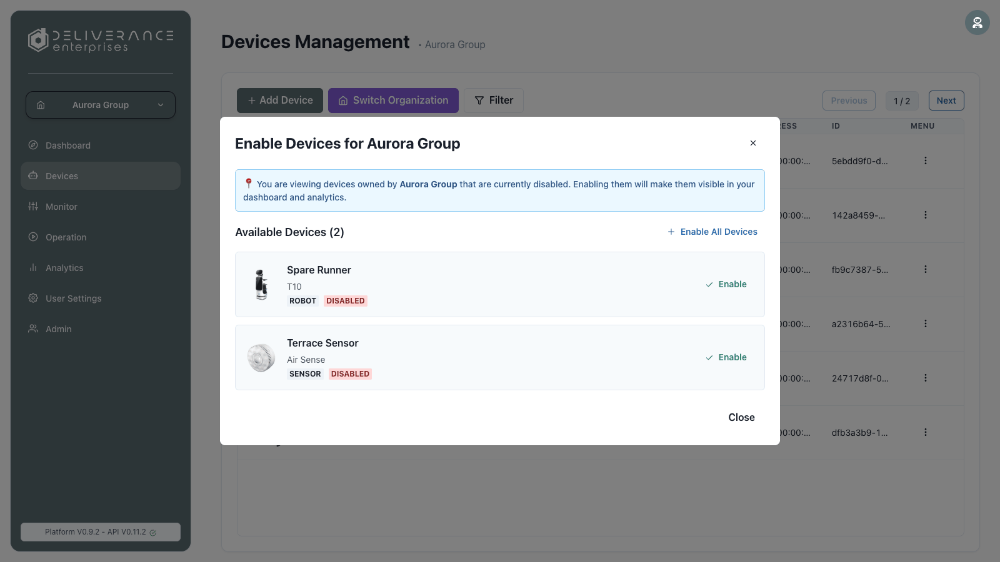
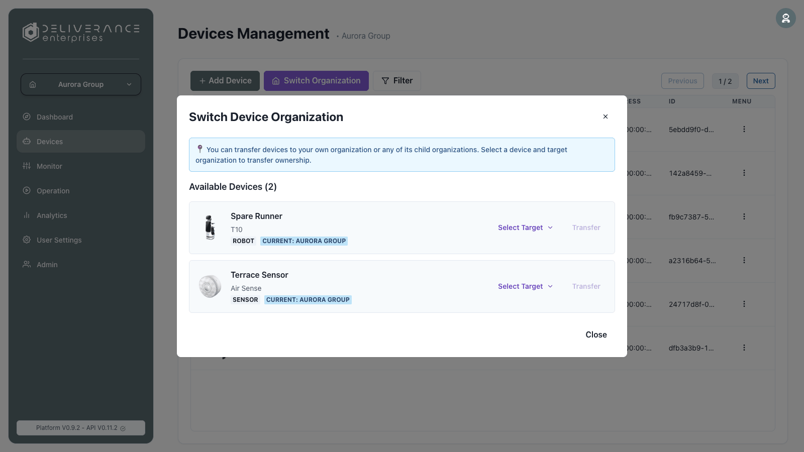
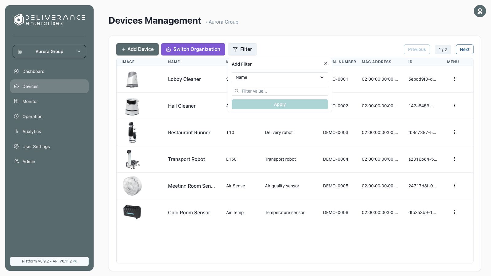
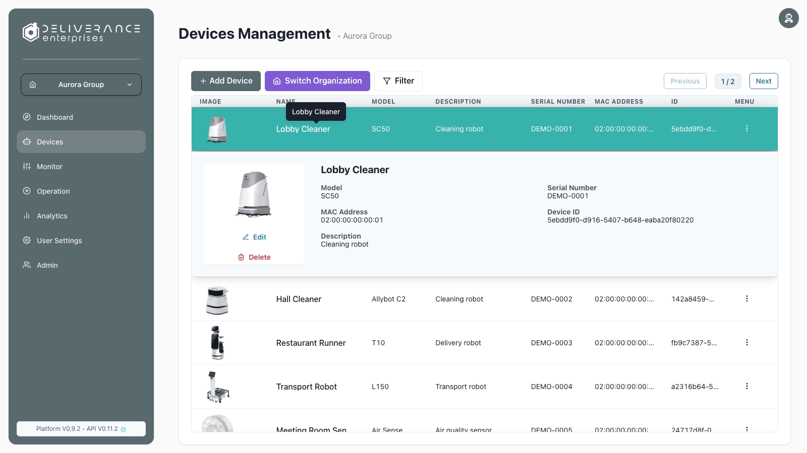
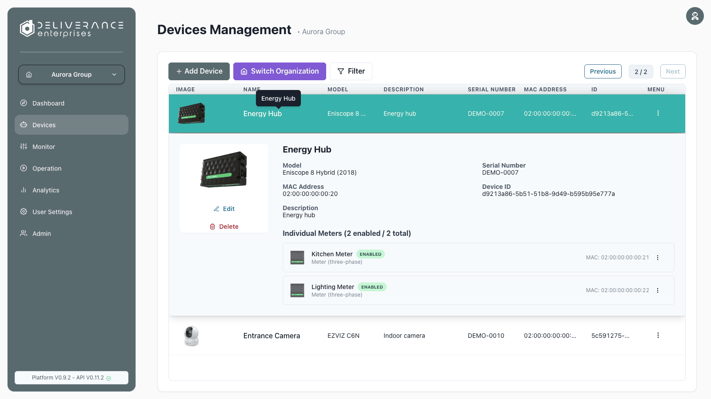
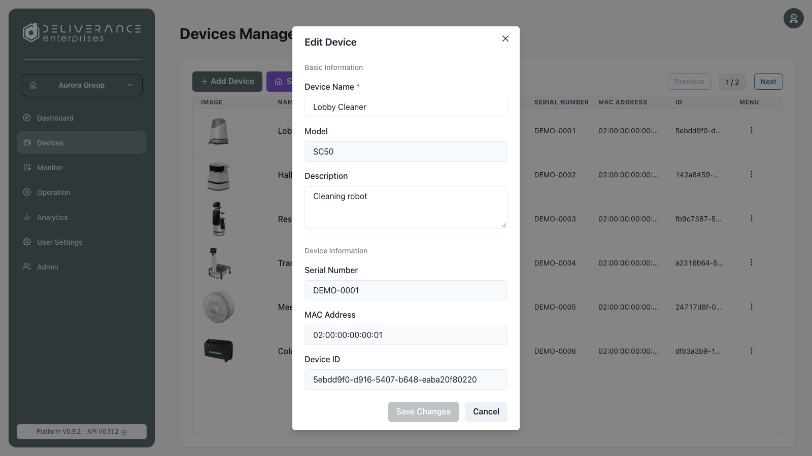

# Devices: Device management

Enable and manage devices across organizations.

Each row shows image, name, model, description, serial number, MAC address and ID. The row menu lets you **edit** or **disable** the device.

## Enable a device

**+ Add Device** opens the list of devices that belong to the organization but are disabled. Once enabled (**Enable**, or **Enable All Devices** for all of them) they appear in Dashboard, Monitor and Analytics.

## Assign a device to another organization

**Switch Organization** (administrators only) transfers a device to your own organization or one of its children: choose the destination in **Select Target** and confirm with **Transfer**. Transferring a hub also transfers its meters.

## Filter the list

**Filter** narrows the list by *Name*, *Model*, *Serial Number*, *MAC Address*, *Description* or *ID*.

## Device detail

Selecting a row expands its details, with the **Edit** and **Delete** actions. A device that already has data cannot be deleted: it has to be disabled.

## Hubs and energy meters

A hub's details list its meters (*Individual Meters*), which can be edited and enabled separately or all at once. Disabling a hub disables its meters.

## Edit a device

You can change the name and description. For meters, also the wiring (**Wiring**: monophase or three-phase) and the name of each channel (**Channel names**).
