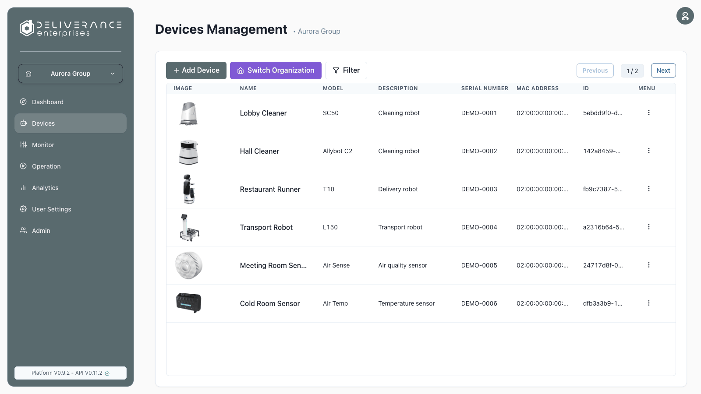
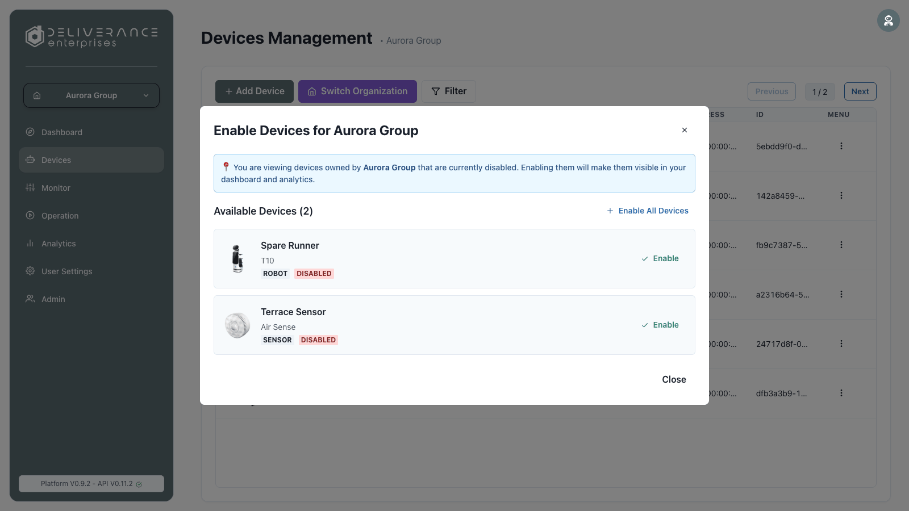
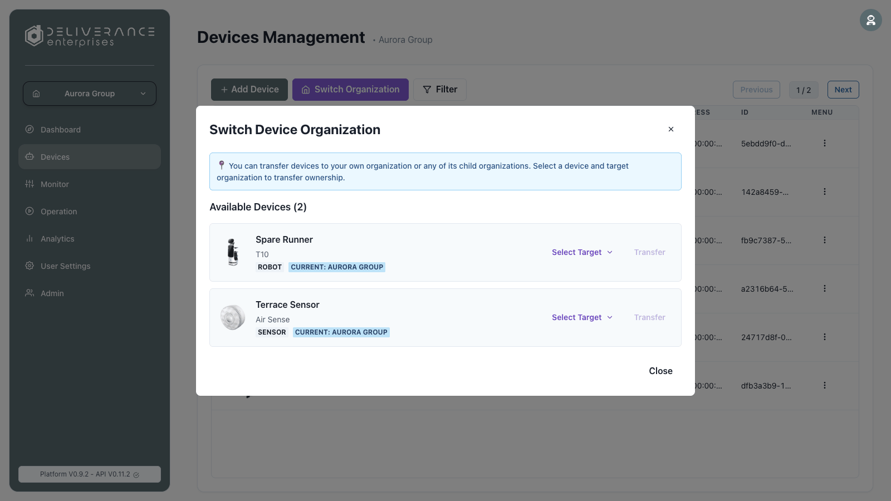
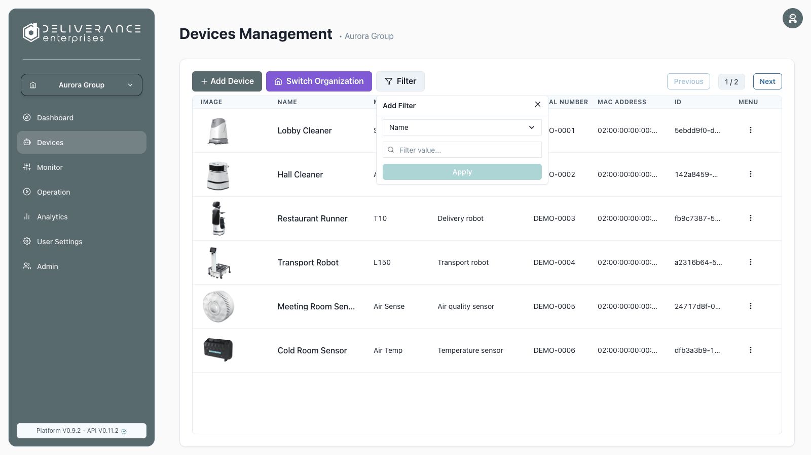
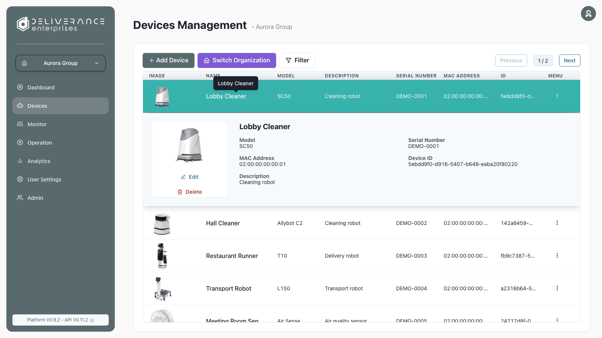
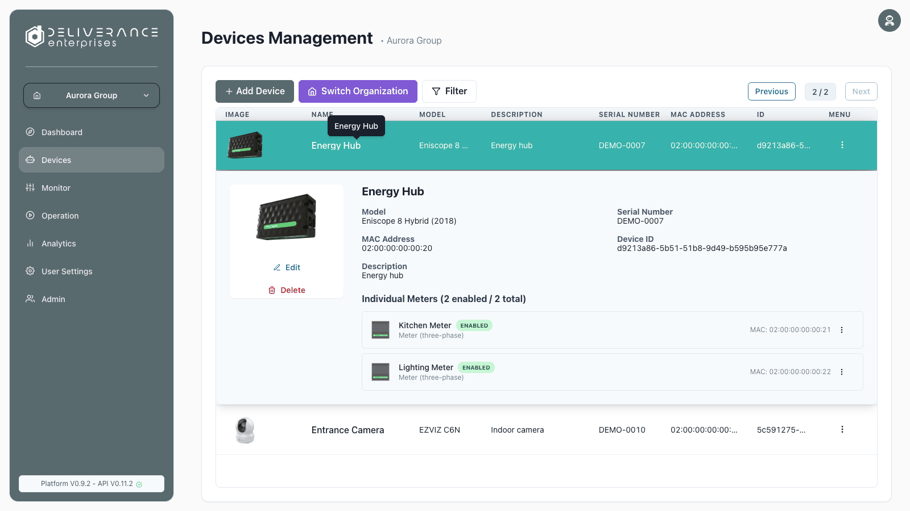
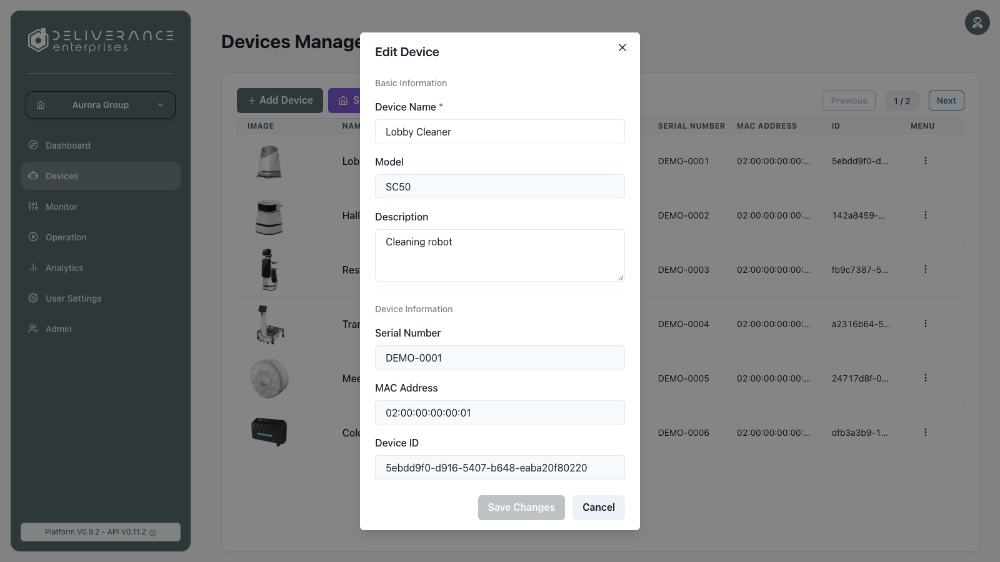

# Devices: Gestión de dispositivos {#devices-device-management}

Habilita y gestiona dispositivos entre organizaciones.

Cada fila muestra imagen, nombre, modelo, descripción, número de serie, dirección MAC e ID. El menú de la fila permite **editar** o **deshabilitar** el dispositivo.

## Activar un dispositivo {#enable-a-device}

**+ Add Device** abre la lista de dispositivos que pertenecen a la organización pero están deshabilitados. Al activarlos (**Enable**, o **Enable All Devices** para todos) aparecen en el Dashboard, Monitor y Analytics.

## Asignar un dispositivo a otra organización {#assign-a-device-to-another-organization}

**Switch Organization** (solo administradores) transfiere un dispositivo a la organización propia o a una de sus hijas: se elige el destino en **Select Target** y se confirma con **Transfer**. Al transferir un hub se transfieren también sus medidores.

## Filtrar el listado {#filter-the-list}

**Filter** acota la lista por *Name*, *Model*, *Serial Number*, *MAC Address*, *Description* o *ID*.

## Detalle de dispositivo {#device-detail}

Al seleccionar una fila se despliega su ficha con las acciones **Edit** y **Delete**. Un dispositivo que ya tiene datos no se puede eliminar: hay que deshabilitarlo.

## Hubs y medidores de energía {#hubs-and-energy-meters}

La ficha de un hub lista sus medidores (*Individual Meters*), que se pueden editar y habilitar por separado o todos a la vez. Deshabilitar un hub deshabilita sus medidores.

## Editar un dispositivo {#edit-a-device}

Se pueden cambiar el nombre y la descripción. En los medidores, además, el cableado (**Wiring**: monofásico o trifásico) y el nombre de cada canal (**Channel names**).
