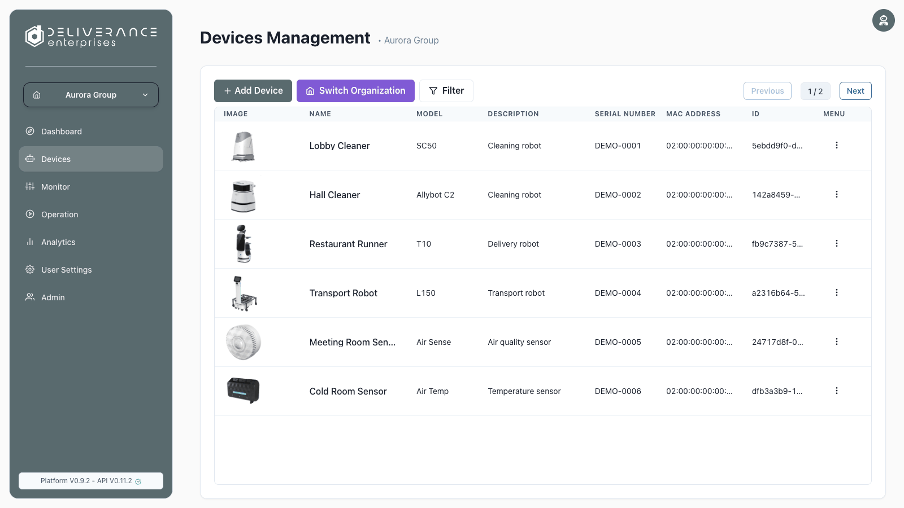
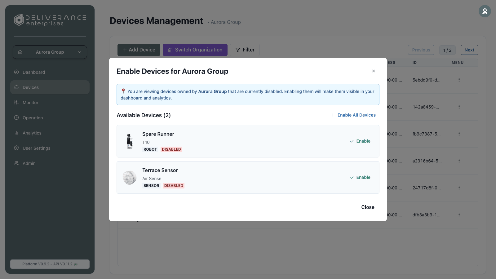
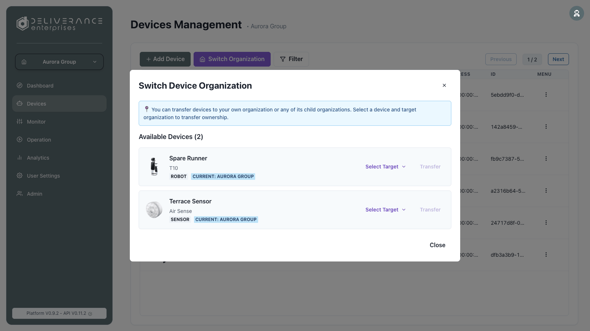
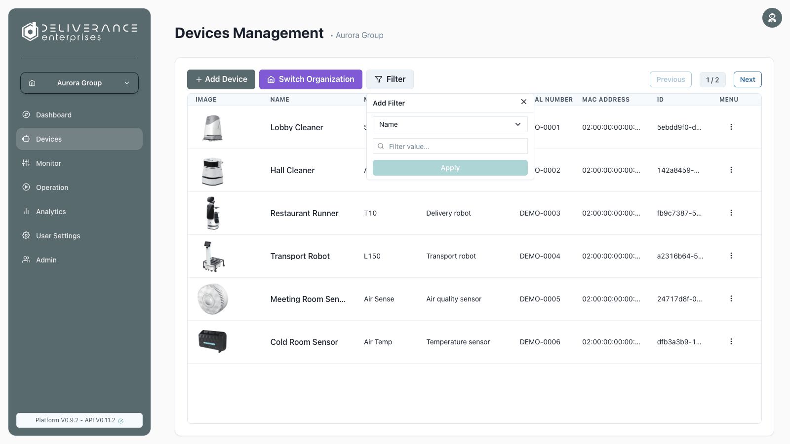
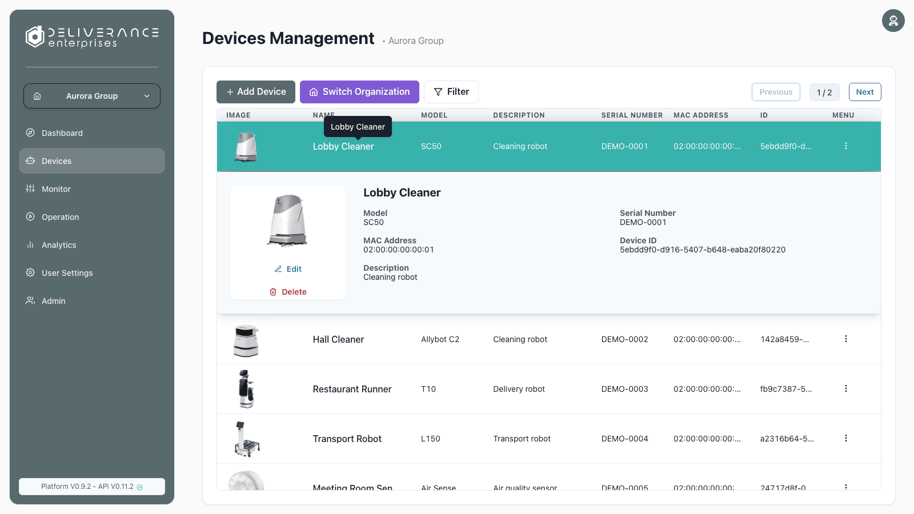
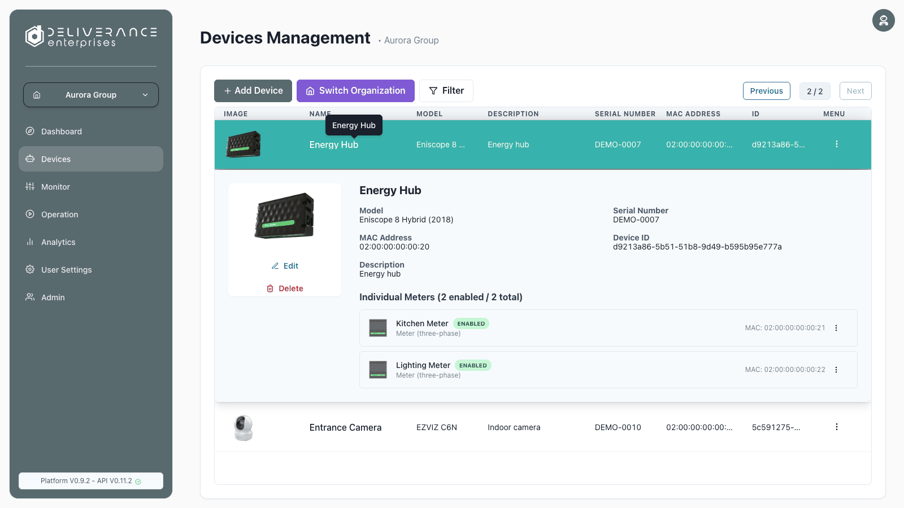
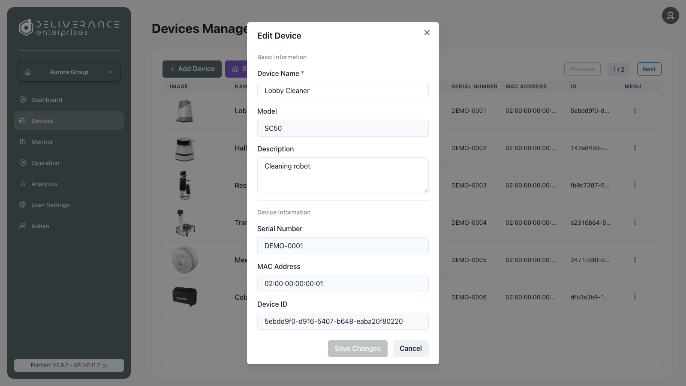

# 设备（Devices）：设备管理 {#devices-device-management}

在组织之间启用和管理设备。

每行显示图片、名称、型号、描述、序列号、MAC 地址和 ID。该行的菜单可用于 **编辑** 或 **停用** 设备。

## 启用设备 {#enable-a-device}

**+ Add Device** 打开属于该组织但处于停用状态的设备列表。启用后（**启用**（**Enable**），或用 **启用全部设备**（**Enable All Devices**）启用全部），设备会出现在仪表板（Dashboard）、监控（Monitor）和分析（Analytics）中。

## 将设备分配给其他组织 {#assign-a-device-to-another-organization}

**切换组织**（**Switch Organization**，仅管理员）将设备转移到所属组织或其某个下级组织：在 **选择目标**（**Select Target**）中选择目的地，并用 **转移**（**Transfer**）确认。转移集线器时，其电表也会一并转移。

## 筛选列表 {#filter-the-list}

**筛选**（**Filter**）可按 *名称*（*Name*）、*型号*（*Model*）、*序列号*（*Serial Number*）、*MAC 地址*（*MAC Address*）、*描述*（*Description*）或 *ID* 缩小列表范围。

## 设备详情 {#device-detail}

选择一行会展开其资料卡，其中包含 **编辑**（**Edit**）和 **删除**（**Delete**）操作。已有数据的设备不能删除，必须将其停用。

## 集线器与电表 {#hubs-and-energy-meters}

集线器的资料卡列出其电表（*单个电表*，*Individual Meters*），可以单独或全部一起编辑和启用。停用集线器会停用其电表。

## 编辑设备 {#edit-a-device}

可以更改名称和描述。对于电表，还可以更改接线方式（**Wiring**：单相或三相）以及每个通道的名称（**Channel names**）。
