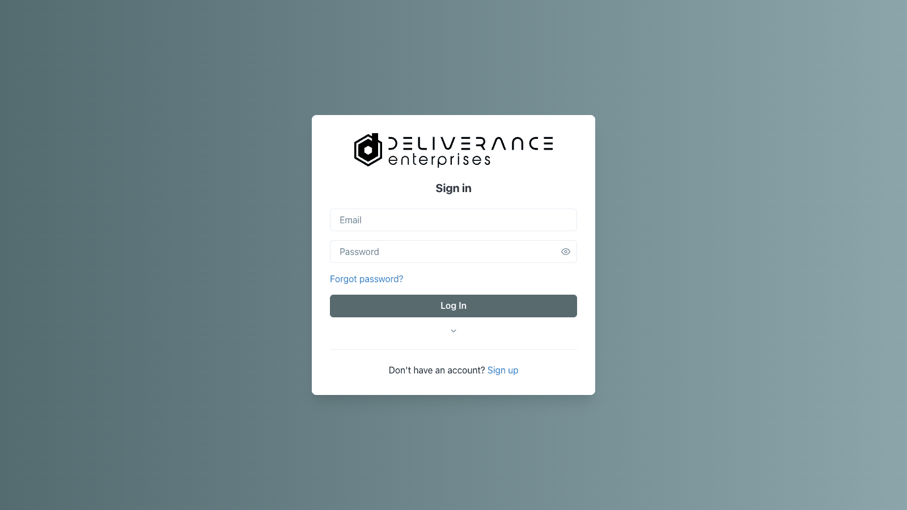
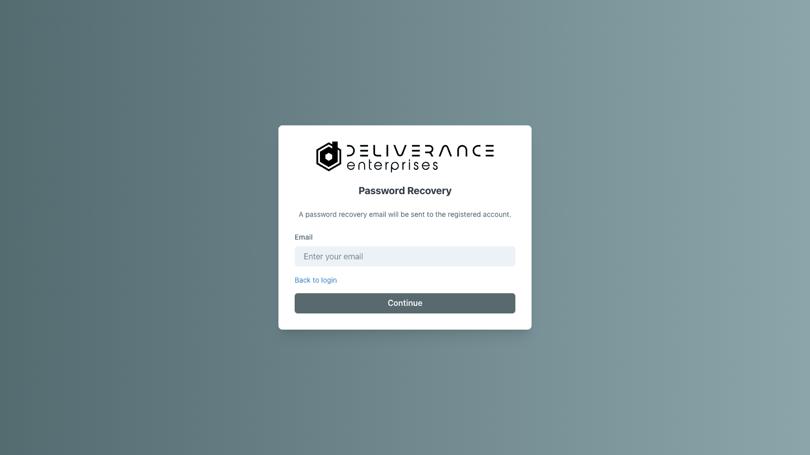

# Login

Identification and access to the platform.

## Log in

1. Enter your email and password in the form.
2. Click **Log In**.

You can create an account from **Sign up**. An administrator then has to assign it to an organization before it shows any data.

## Recover your password

**Forgot password?** asks for your email and sends a link to set a new password.

## Expired password and suspended organization

- Passwords are 8 to 40 characters long and **expire 180 days** after being changed. If yours has expired, the login asks for the current one and a new one (*Update password*).
- *Your organization is suspended. Contact Deliverance.* means that the organization is suspended and none of its users can enter.
