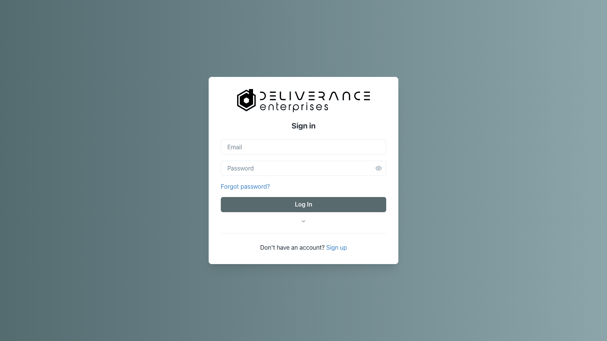
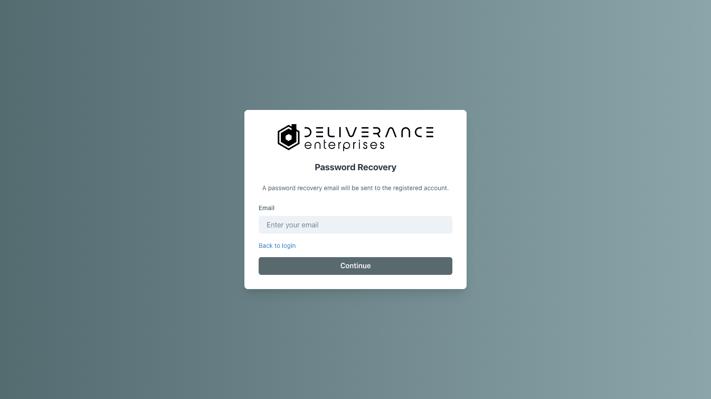

# Login

Identificación y acceso a la plataforma.

## Iniciar sesión

1. Introduce tu email y contraseña en el formulario.
2. Pulsa **Log In**.

Desde **Sign up** se puede crear una cuenta. Un administrador tiene que asignarla después a una organización para que muestre datos.

## Recuperar la contraseña

**Forgot password?** pide el email y envía un enlace para establecer una contraseña nueva.

## Contraseña caducada y organización suspendida

- Las contraseñas tienen entre 8 y 40 caracteres y **caducan a los 180 días** de cambiarse. Si está caducada, el login pide la actual y una nueva (*Update password*).
- *Your organization is suspended. Contact Deliverance.* significa que la organización está suspendida y ninguno de sus usuarios puede entrar.
