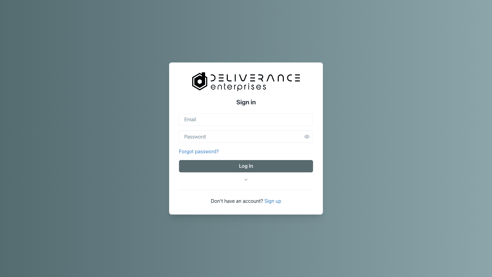
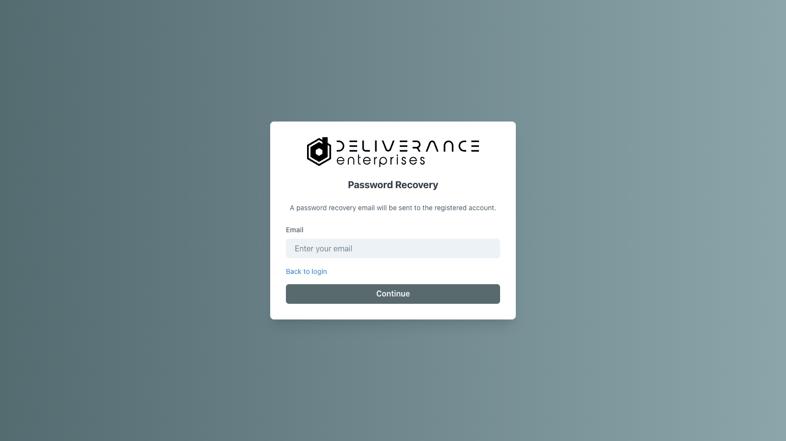

# 登录 {#login}

身份识别与平台访问。

## 登录平台 {#log-in}

1. 在表单中输入电子邮箱和密码。
2. 点击 **登录**（**Log In**）。

通过 **注册**（**Sign up**）可以创建账户。之后必须由管理员将其分配到某个组织，账户才会显示数据。

## 找回密码 {#recover-your-password}

**忘记密码？**（**Forgot password?**）要求输入电子邮箱，并发送用于设置新密码的链接。

## 密码过期与组织暂停 {#expired-password-and-suspended-organization}

- 密码长度为 8 到 40 个字符，**自更改之日起 180 天后过期**。如果已过期，登录时会要求输入当前密码和新密码（*更新密码*，*Update password*）。
- *您的组织已被暂停。请联系 Deliverance。*（*Your organization is suspended. Contact Deliverance.*）表示该组织已被暂停，其任何用户都无法进入。
