# Monitor: Device operation

Monitors the operating data of the enabled devices of the selected organization. The left panel lists them and, when you select one, its detail is shown. At the top you choose between **Simple** and **Advanced** mode.

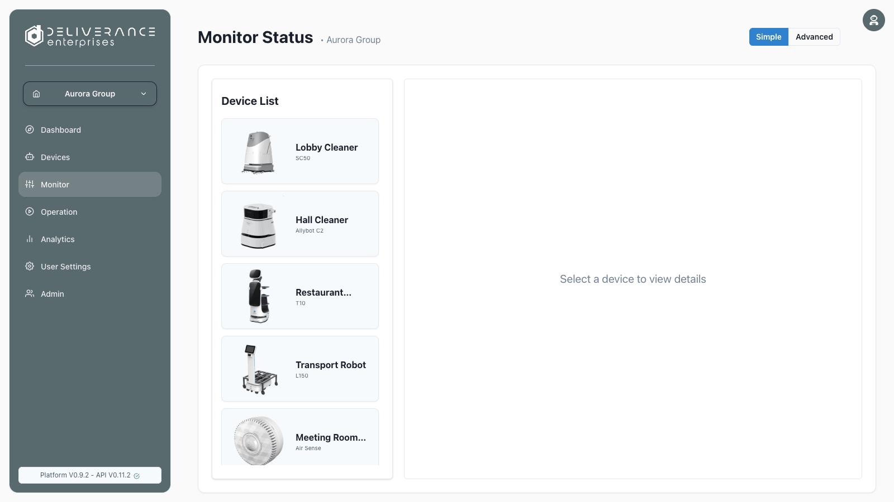

## Operation detail

The content **changes with the type of device**.

### Delivery robot

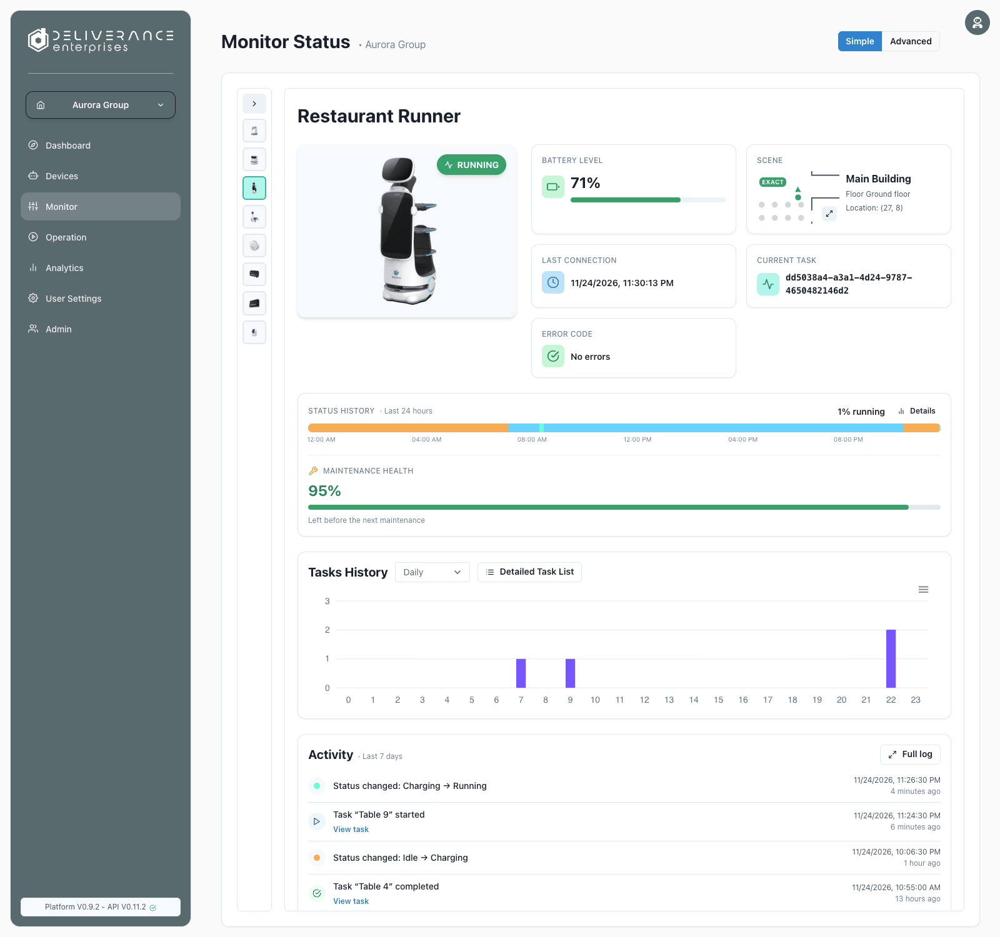

Status, battery, scene, last connection, current task, error code, *Maintenance health* (what is left before the next maintenance), task history and activity.

### Cleaning robot

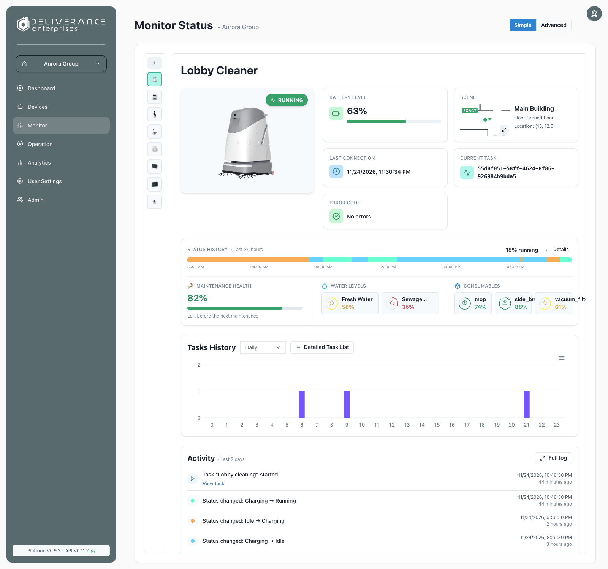

Adds the water levels (fresh and sewage) and the consumables (mop, filters, brushes...), each with its percentage.

### Sensor

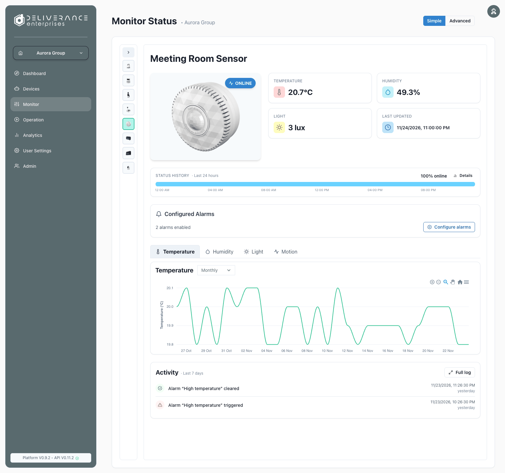

Measured magnitudes, date of the last reading and charts per magnitude (*Temperature*, *Humidity*, *Light*, *Motion*) with a period selector. A temperature-only sensor shows only that chart.

### Energy meter

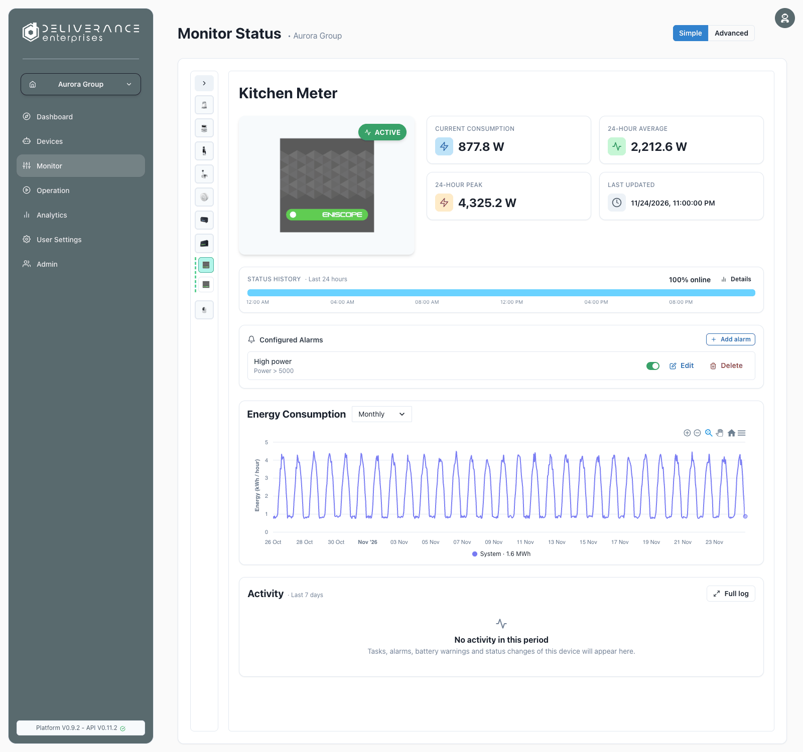

Current consumption, average and peak of the last 24 hours, and the **Energy Consumption** chart. A hub shows its meters; clicking one opens it.

### Camera

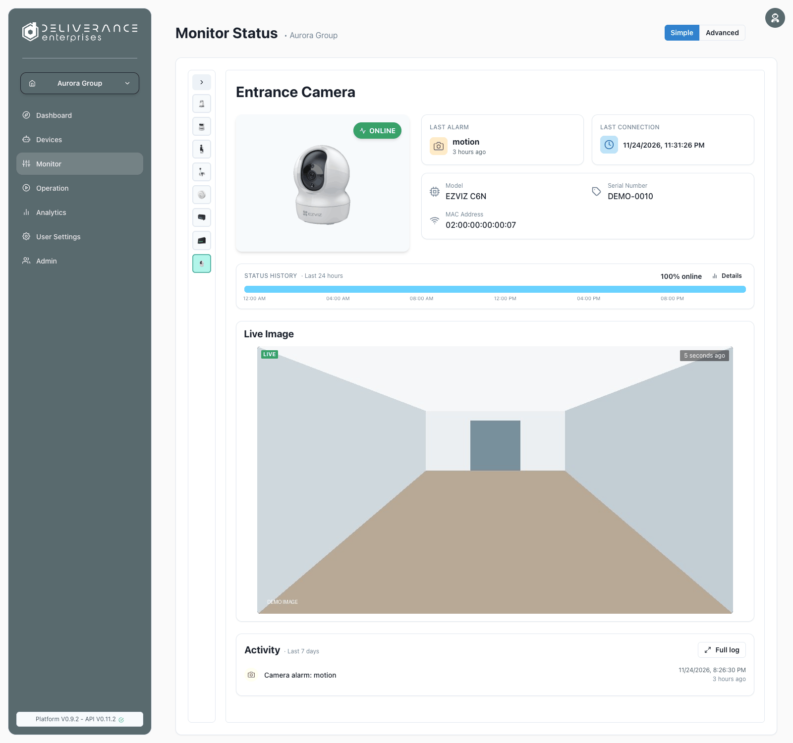

Last alarm, last connection and **Live Image**: still pictures refreshed every few seconds, not video. If the latest is more than 30 seconds old, *Not live* is shown. Messages tell you if the camera is offline or has not sent a picture.

## Robot scene and map

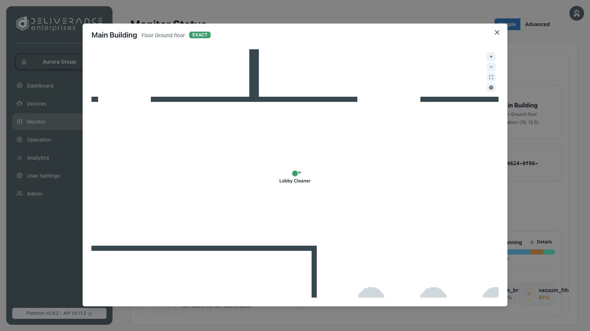

The **Scene** card shows the robot on its map, with the building and floor; the expand button opens the whole map. The label shows how reliable the position is:

| Label | Meaning |
| --- | --- |
| **Exact** | Scale given by the manufacturer. |
| **Calibrated** | Calibrated by a user; the error is shown. |
| **Estimated** | Calculated from known points of the map. |
| **Rough** | Approximate position. |
| **Not calibrated** | The map is shown, without the robot's position. |

## Status history

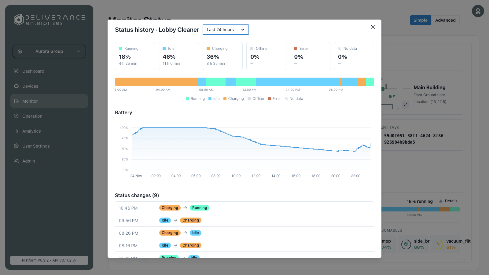

The **Status history** strip summarizes the last 24 hours. **Details** (or the device's status label) opens the history of 24 hours, 7 or 30 days, with the time in each status, the battery and the changes.

## Activity

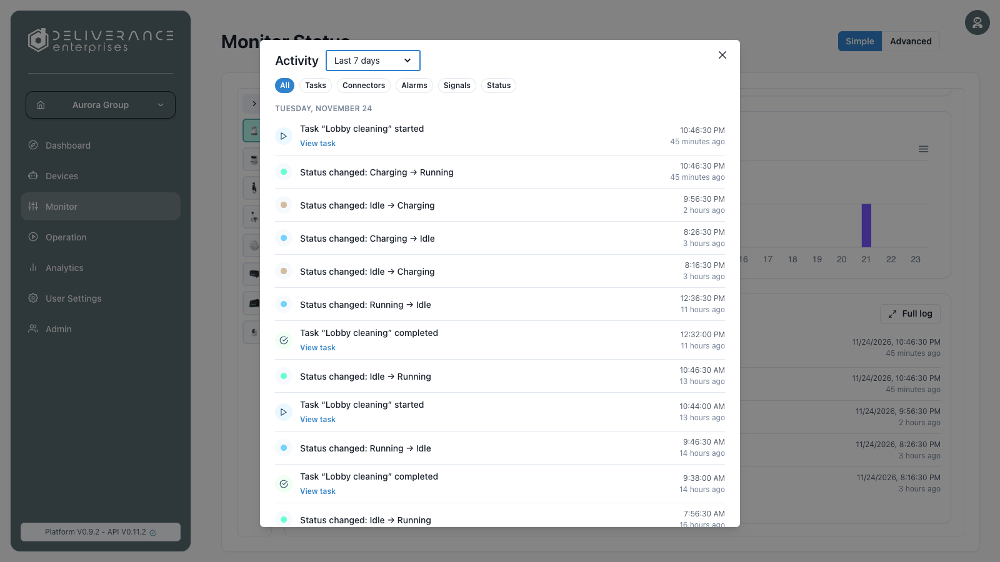

**Activity** shows the latest things that have happened to the device. **Full log** opens the log with filters: *Tasks*, *Connectors*, *Alarms*, *Signals* and *Status*. **View task** opens the corresponding task.

## Alarms

Sensors and meters have a **Configured Alarms** block, where each alarm can be enabled, edited or deleted. **Add alarm** creates one:

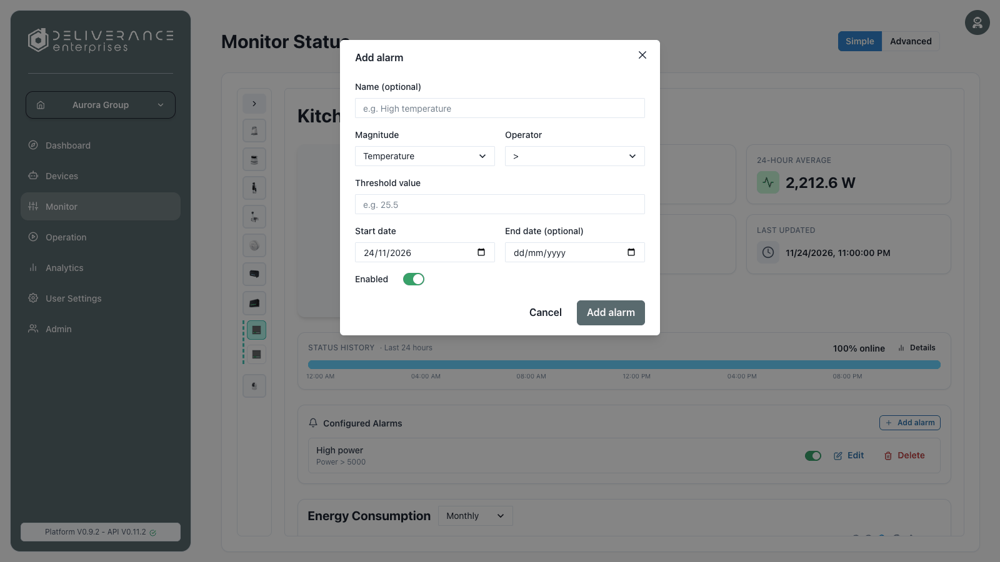

- **Name**: descriptive name (optional).
- **Magnitude**: which value is watched.
- **Operator** and **Threshold value**: the condition that triggers it. *Present* and *Absent* do not use a threshold.
- **Start date** and **End date** (optional): period in which it applies.
- **Enabled**: turn it off without deleting it.

When it goes off, it is recorded in the activity and the users of the organization with *Alarm Notifications* turned on are notified by email.

## Robot tasks

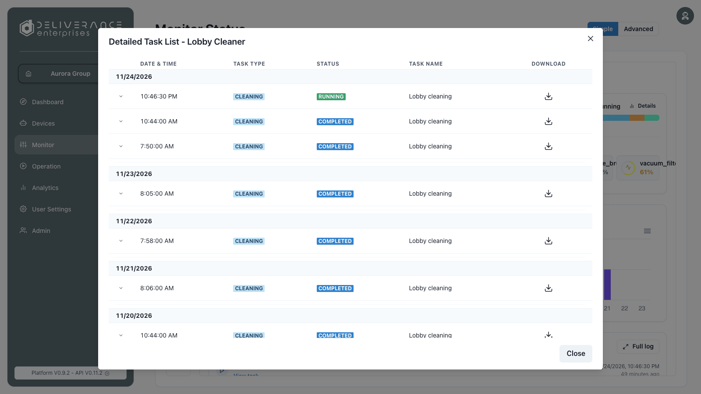

**Detailed Task List** lists the tasks with date, type, status and name. **Download** lets you print the report or save it as PDF. Clicking a task expands its report, whose content depends on the robot:

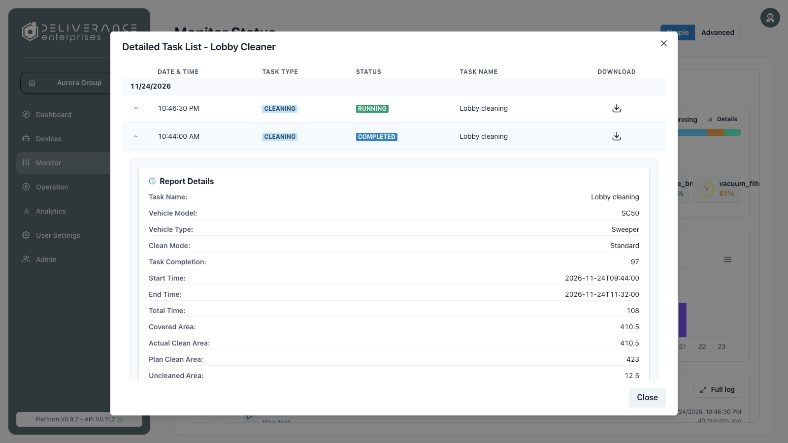

## Advanced mode

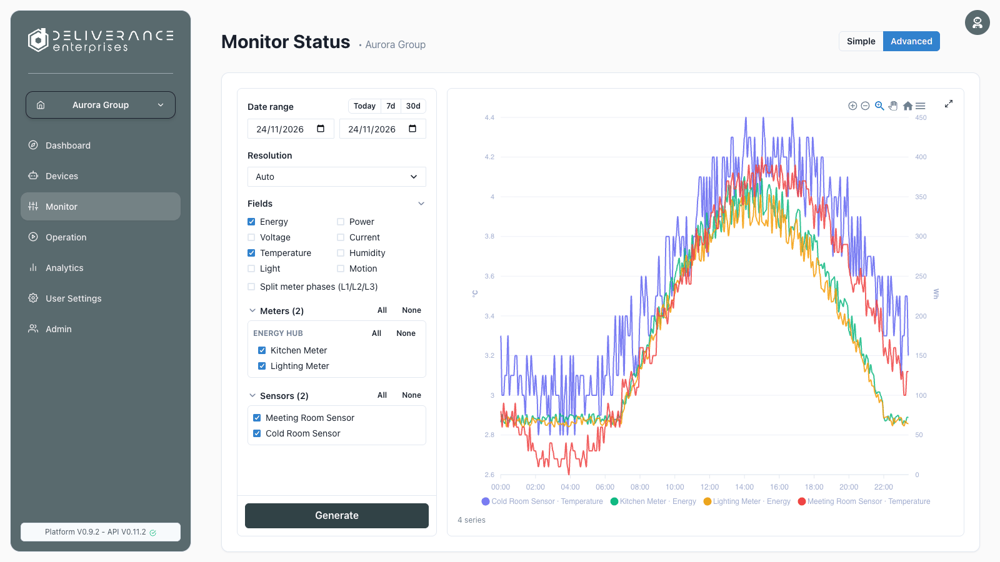

**Advanced** compares the readings of several meters and sensors in one chart: choose the range, the resolution, the magnitudes (*Fields*) and the devices, and click **Generate**. *Split meter phases* separates L1, L2 and L3.
