# Monitor: Operación del dispositivo

Monitoriza los datos operativos de los dispositivos habilitados de la organización seleccionada. El panel izquierdo los lista y, al seleccionar uno, muestra su detalle. Arriba se elige entre los modos **Simple** y **Advanced**.

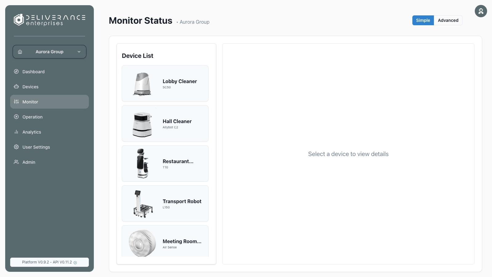

## Detalle de operación

El contenido **cambia según el tipo de dispositivo**.

### Robot de reparto

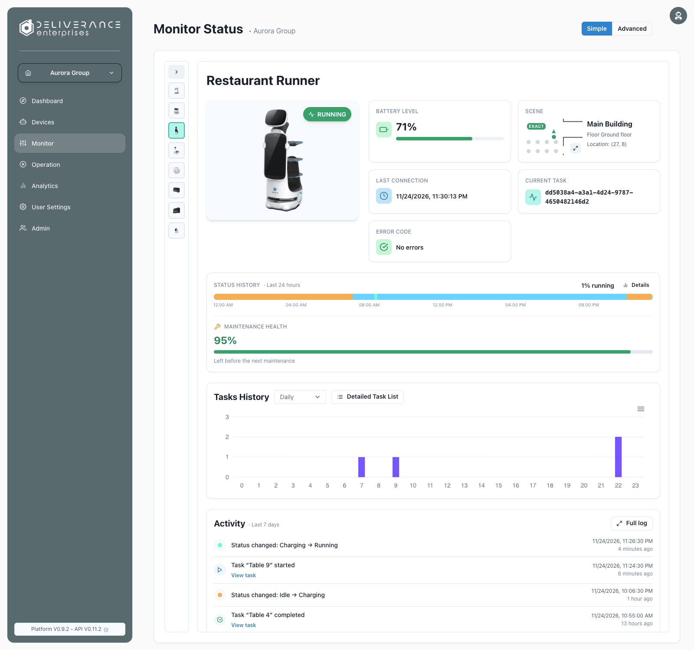

Estado, batería, escena, última conexión, tarea en curso, código de error, salud de mantenimiento (*Maintenance health*, lo que queda hasta el próximo mantenimiento), histórico de tareas y actividad.

### Robot de limpieza

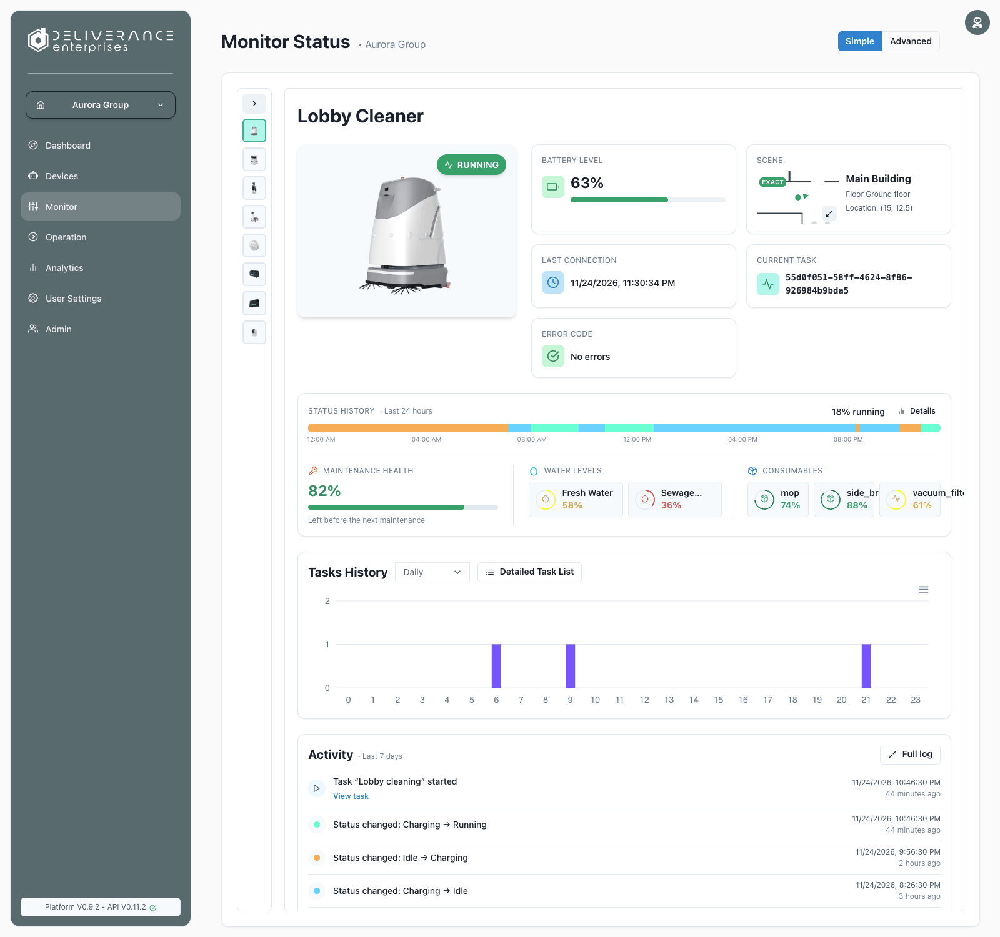

Añade los niveles de agua (limpia y sucia) y los consumibles (mopa, filtros, cepillos...), cada uno con su porcentaje.

### Sensor

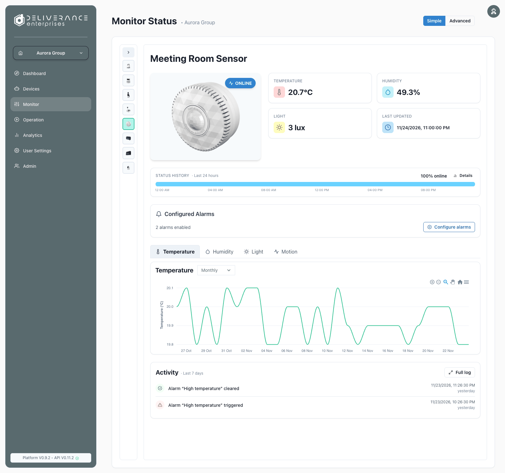

Magnitudes medidas, fecha de la última lectura y gráficas por magnitud (*Temperature*, *Humidity*, *Light*, *Motion*) con selector de periodo. Un sensor solo de temperatura muestra únicamente esa gráfica.

### Medidor de energía

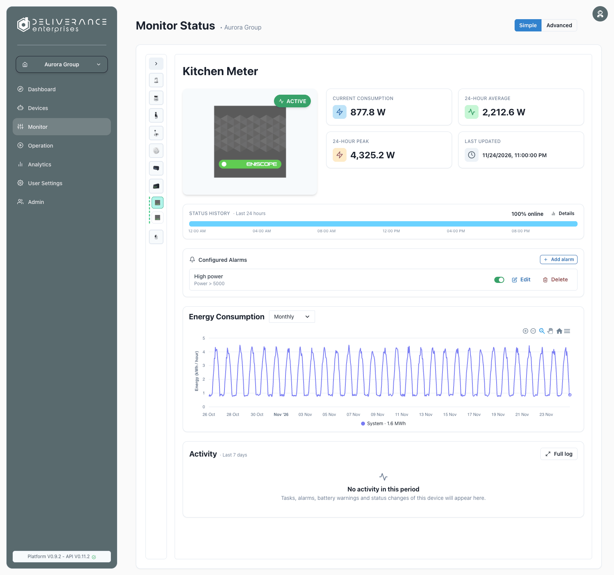

Consumo actual, media y pico de las últimas 24 horas, y la gráfica **Energy Consumption**. Un hub muestra sus medidores; al pulsar uno se abre.

### Cámara

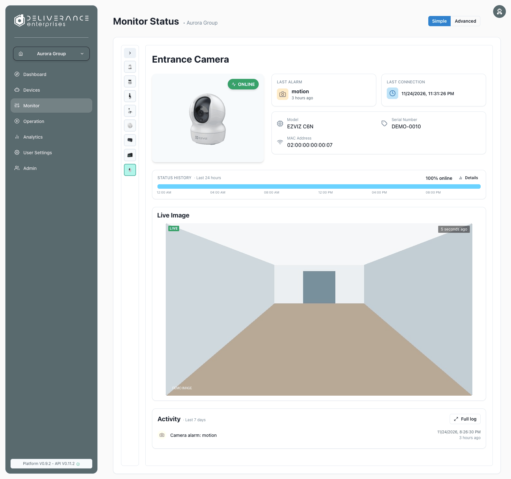

Última alarma, última conexión y **Live Image**: imágenes fijas que se renuevan cada pocos segundos, no vídeo. Si la última tiene más de 30 segundos se indica *Not live*. Los mensajes avisan si la cámara está desconectada o no ha enviado imagen.

## Escena y mapa del robot

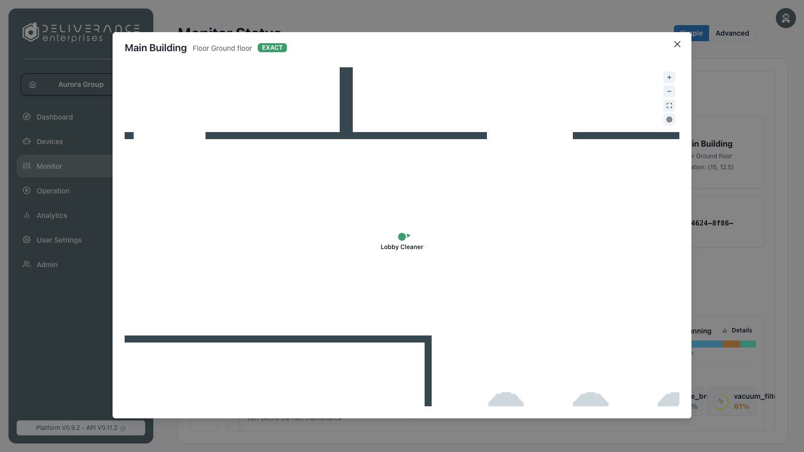

La tarjeta **Scene** muestra el robot sobre su mapa, con el edificio y la planta; el botón de ampliar abre el mapa completo. La etiqueta indica la fiabilidad de la posición:

| Etiqueta | Significado |
| --- | --- |
| **Exact** | Escala dada por el fabricante. |
| **Calibrated** | Calibrado por un usuario; se indica el error. |
| **Estimated** | Calculado a partir de puntos conocidos del mapa. |
| **Rough** | Posición aproximada. |
| **Not calibrated** | El mapa se ve, sin posición del robot. |

## Histórico de estado

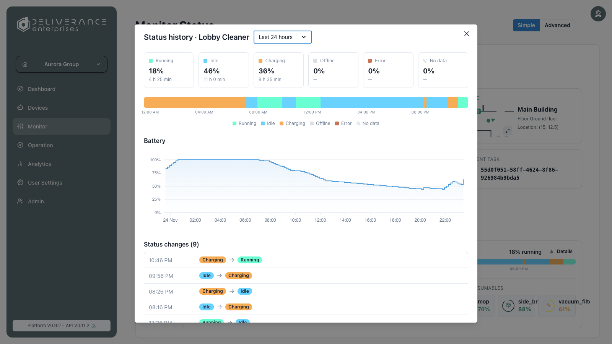

La franja **Status history** resume las últimas 24 horas. **Details** (o la etiqueta de estado del dispositivo) abre el histórico de 24 horas, 7 o 30 días, con el tiempo en cada estado, la batería y los cambios.

## Actividad

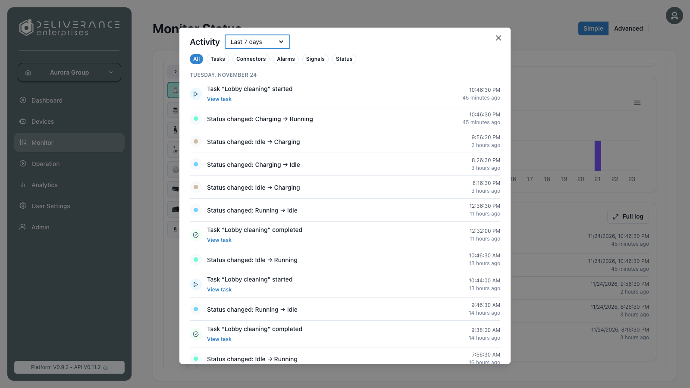

**Activity** muestra lo último que le ha ocurrido al dispositivo. **Full log** abre el registro con filtros: *Tasks*, *Connectors*, *Alarms*, *Signals* y *Status*. **View task** abre la tarea correspondiente.

## Alarmas

Los sensores y medidores tienen un bloque **Configured Alarms**, donde cada alarma se puede activar, editar o borrar. **Add alarm** crea una:

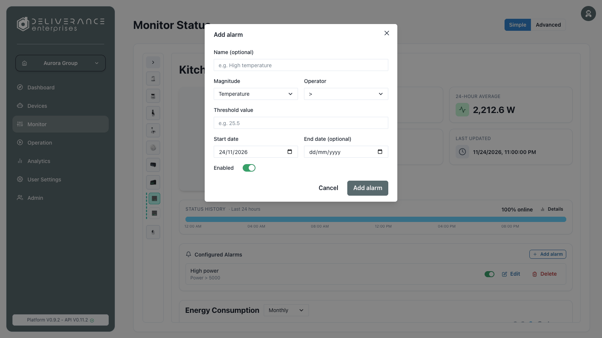

- **Name**: nombre descriptivo (opcional).
- **Magnitude**: qué dato se vigila.
- **Operator** y **Threshold value**: la condición que la dispara. *Present* y *Absent* no usan umbral.
- **Start date** y **End date** (opcional): periodo de vigencia.
- **Enabled**: desactivarla sin borrarla.

Cuando salta, queda en la actividad y se avisa por email a los usuarios de la organización con *Alarm Notifications* activado.

## Tareas del robot

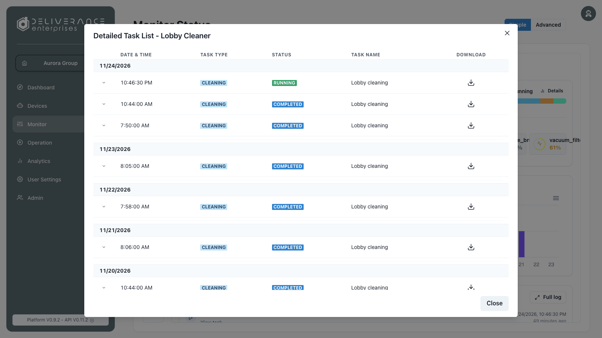

**Detailed Task List** lista las tareas con fecha, tipo, estado y nombre. **Download** permite imprimir o guardar el informe en PDF. Al pulsar una tarea se despliega su informe, cuyo contenido depende del robot:

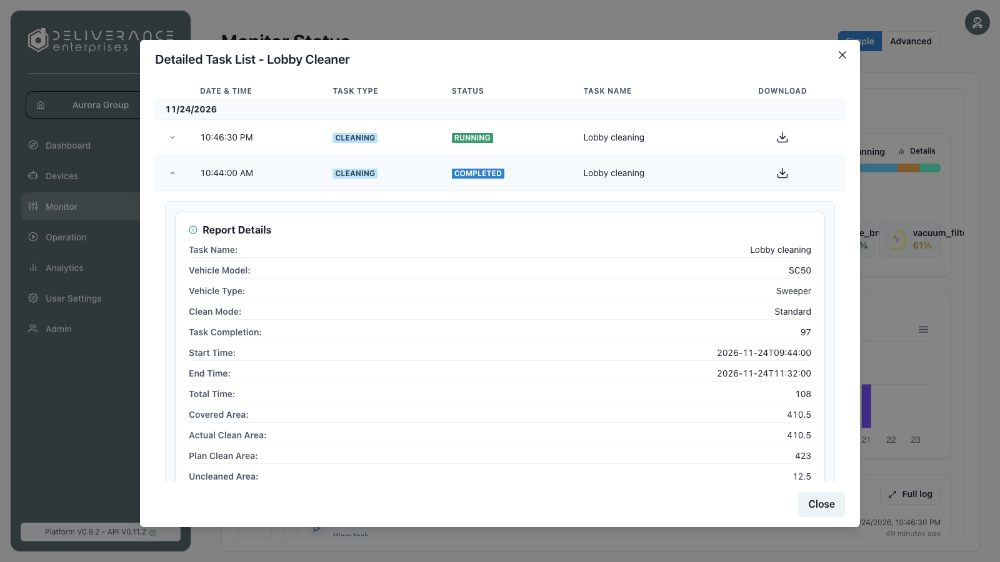

## Modo avanzado

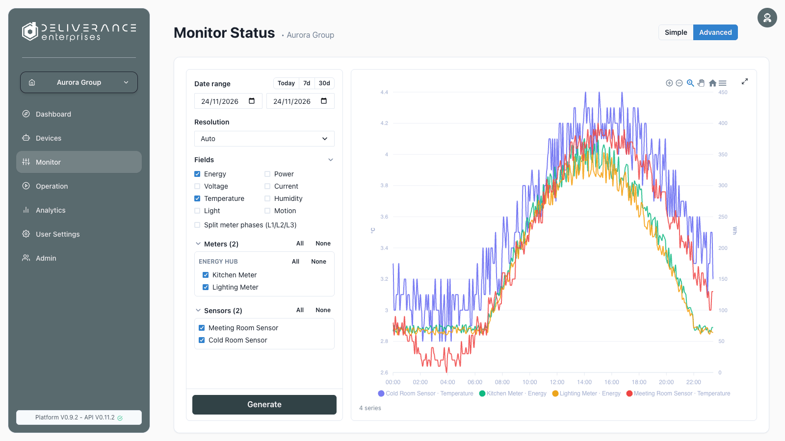

**Advanced** compara en una gráfica las lecturas de varios medidores y sensores: se elige el intervalo, la resolución, las magnitudes (*Fields*) y los dispositivos, y se pulsa **Generate**. *Split meter phases* separa L1, L2 y L3.
