# 监控（Monitor）：设备运行 {#monitor-device-operation}

监控所选组织中已启用设备的运行数据。左侧面板列出设备，选择其中一台会显示其详情。在顶部可选择 **简单**（**Simple**）或 **高级**（**Advanced**）模式。

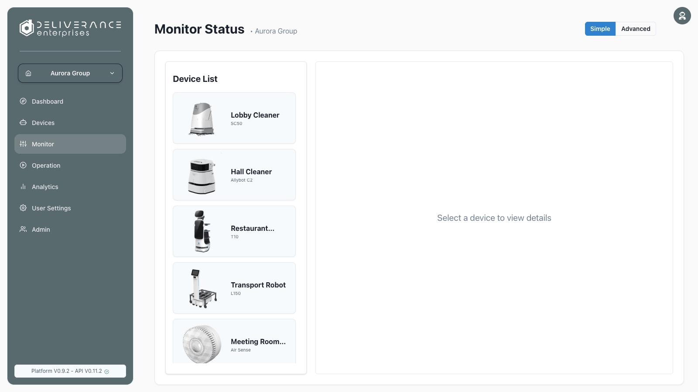

## 运行详情 {#operation-detail}

内容 **因设备类型而异**。

### 配送机器人 {#delivery-robot}

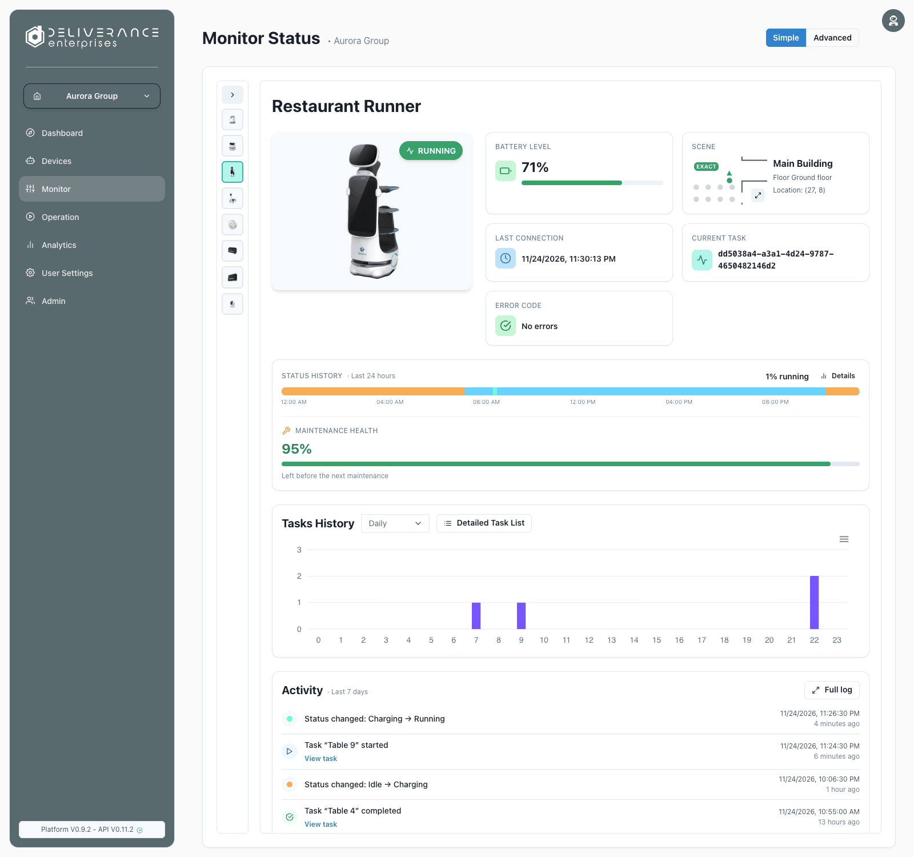

状态、电量、场景、上次连接、当前任务、错误代码、维护健康度（*Maintenance health*，距下次维护的剩余量）、任务历史和动态。

### 清洁机器人 {#cleaning-robot}

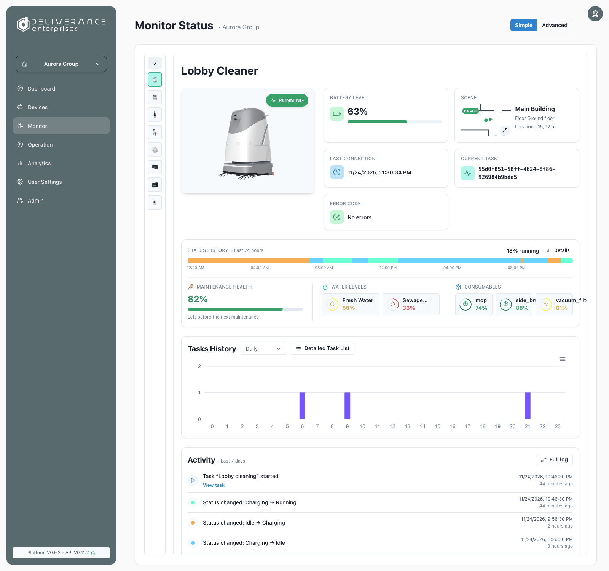

另外显示水位（清水和污水）和耗材（拖布、滤网、刷子等），每项均带百分比。

### 传感器 {#sensor}

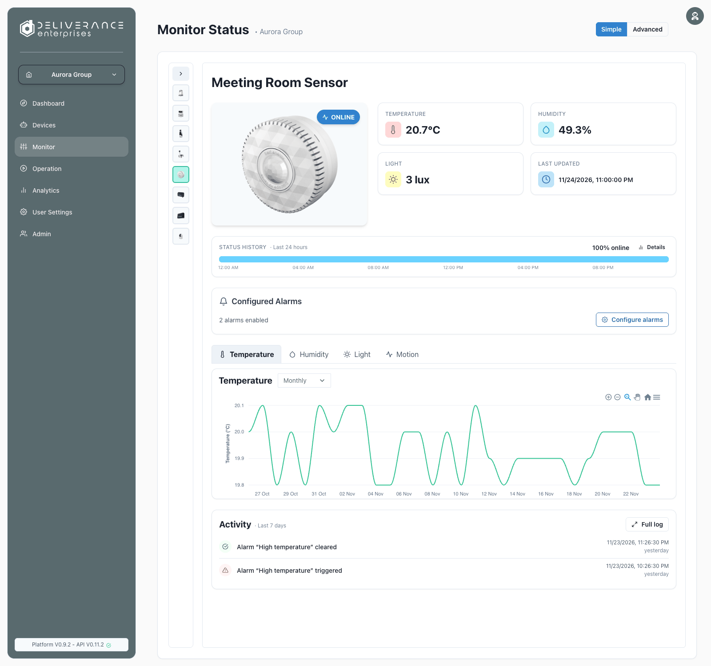

测量的指标、最近一次读数的日期以及各指标的图表：*温度*（*Temperature*）、*湿度*（*Humidity*）、*光照*（*Light*）、*移动*（*Motion*），带时段选择器。仅测温度的传感器只显示该图表。

### 电表 {#energy-meter}

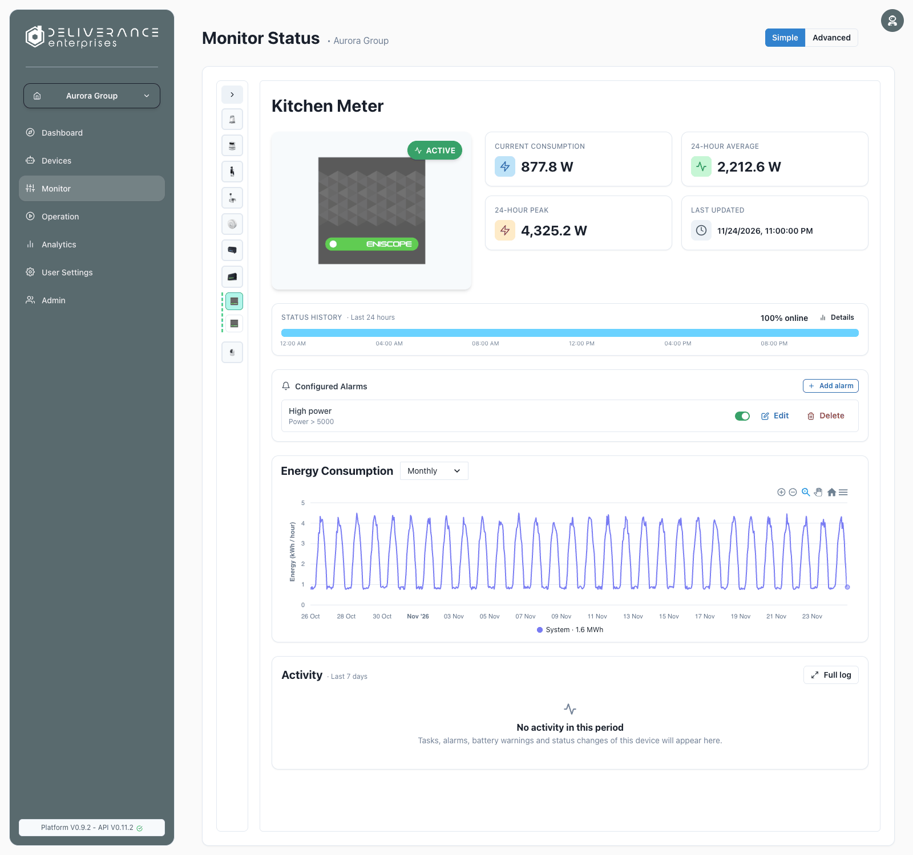

当前能耗、最近 24 小时的平均值和峰值，以及 **能耗**（**Energy Consumption**）图表。集线器显示其电表；点击其中一个即可打开。

### 摄像头 {#camera}

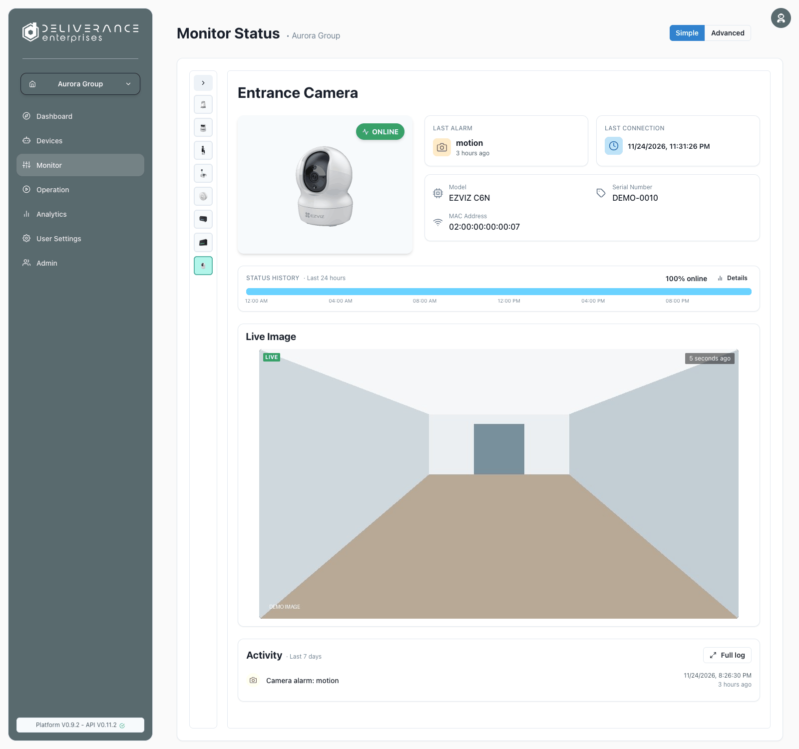

最近一次告警、上次连接和 **实时画面**（**Live Image**）：每隔几秒刷新一次的静态图像，不是视频。如果最近一张图像超过 30 秒，会显示 *非实时*（*Not live*）。如果摄像头断开连接或未发送图像，会有消息提示。

## 机器人的场景与地图 {#robot-scene-and-map}

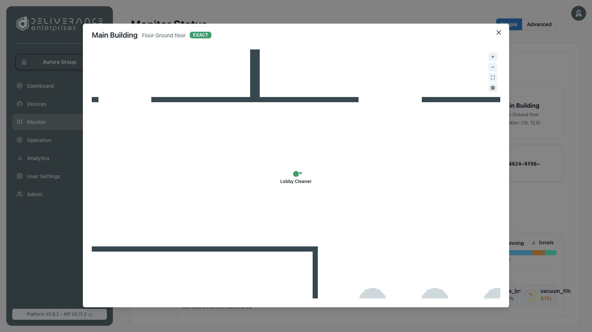

**场景**（**Scene**）卡片在地图上显示机器人，并注明建筑和楼层；放大按钮可打开完整地图。标签表示位置的可靠程度：

| 标签 | 含义 |
| --- | --- |
| **精确**（**Exact**） | 比例由制造商提供。 |
| **已标定**（**Calibrated**） | 由用户标定；会注明误差。 |
| **估算**（**Estimated**） | 根据地图上的已知点计算。 |
| **粗略**（**Rough**） | 近似位置。 |
| **未标定**（**Not calibrated**） | 显示地图，但不显示机器人的位置。 |

## 状态历史 {#status-history}

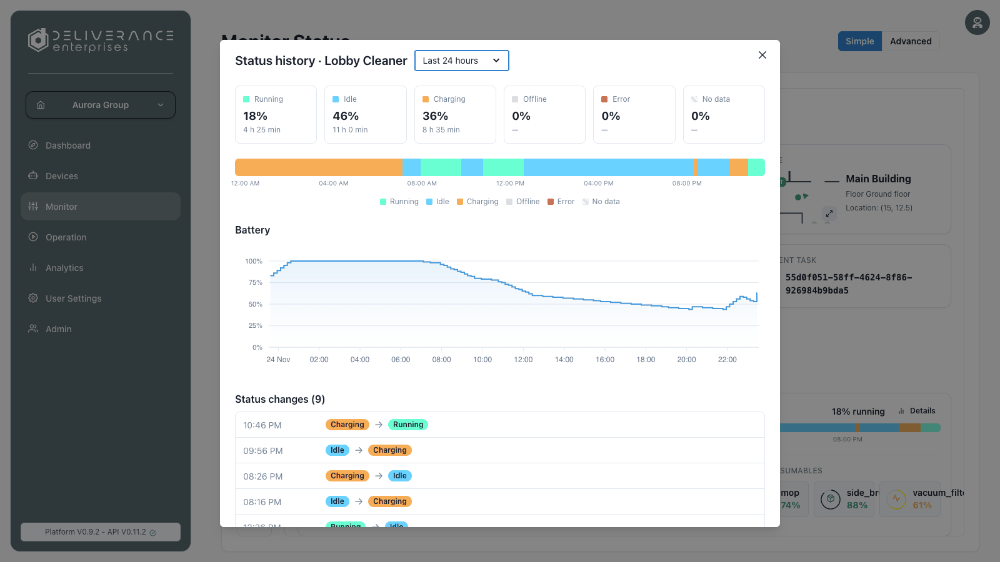

**状态历史**（**Status history**）条带汇总最近 24 小时的状态。**详情**（**Details**，或设备的状态标签）打开 24 小时、7 天或 30 天的历史，包括处于各状态的时间、电量和状态变化。

## 动态 {#activity}

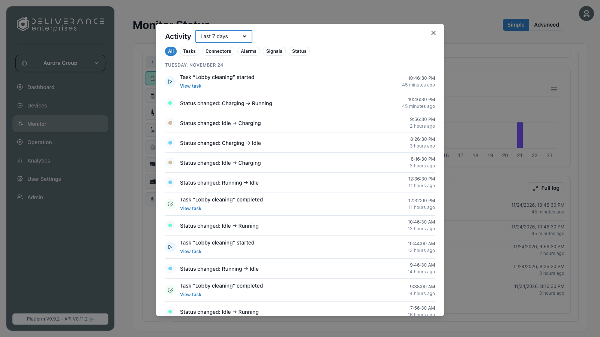

**动态**（**Activity**）显示设备最近发生的事情。**完整日志**（**Full log**）打开带筛选的日志：*任务*（*Tasks*）、*连接器*（*Connectors*）、*告警*（*Alarms*）、*信号*（*Signals*）和 *状态*（*Status*）。**查看任务**（**View task**）打开对应的任务。

## 告警 {#alarms}

传感器和电表有一个 **已配置告警**（**Configured Alarms**）区块，每个告警都可以在其中启用、编辑或删除。**添加告警**（**Add alarm**）用于创建告警：

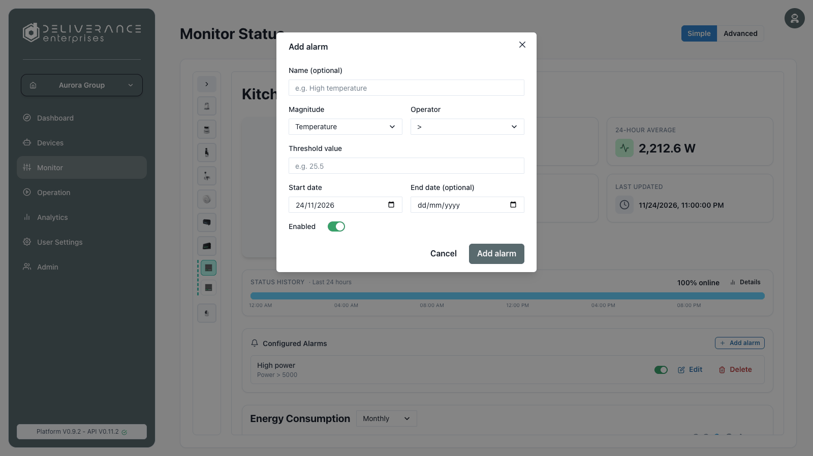

- **名称**（**Name**）：描述性名称（可选）。
- **指标**（**Magnitude**）：监视的数据。
- **运算符**（**Operator**）和 **阈值**（**Threshold value**）：触发告警的条件。*存在*（*Present*）和 *不存在*（*Absent*）不使用阈值。
- **开始日期**（**Start date**）和 **结束日期**（**End date**，可选）：有效期。
- **启用**（**Enabled**）：可在不删除告警的情况下将其停用。

告警触发后，会记录在动态中，并通过电子邮件通知组织中已启用 *告警通知*（*Alarm Notifications*）的用户。

## 机器人的任务 {#robot-tasks}

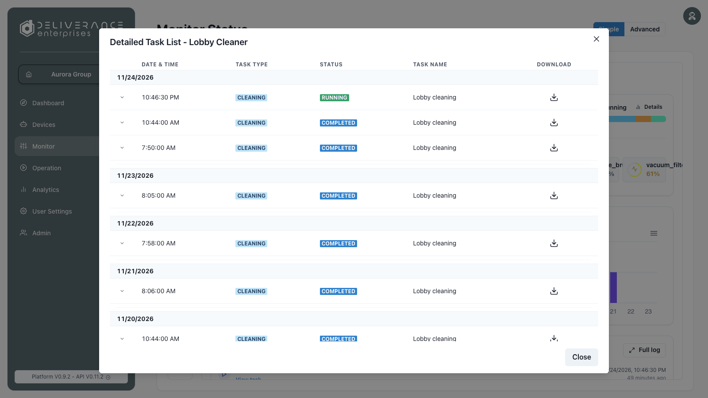

**详细任务列表**（**Detailed Task List**）列出任务的日期、类型、状态和名称。**下载**（**Download**）可打印报告或将其保存为 PDF。点击任务会展开其报告，内容取决于机器人：

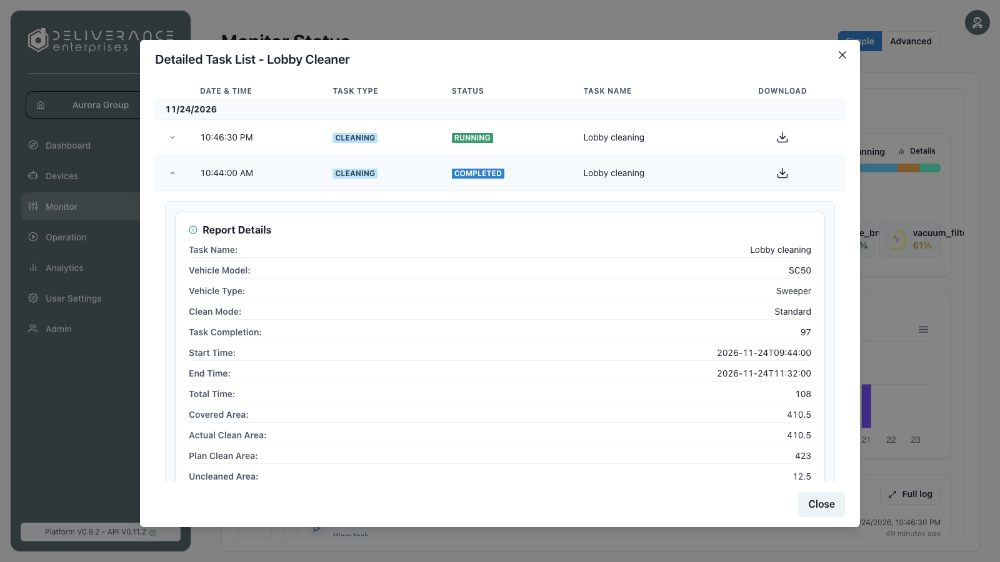

## 高级模式 {#advanced-mode}

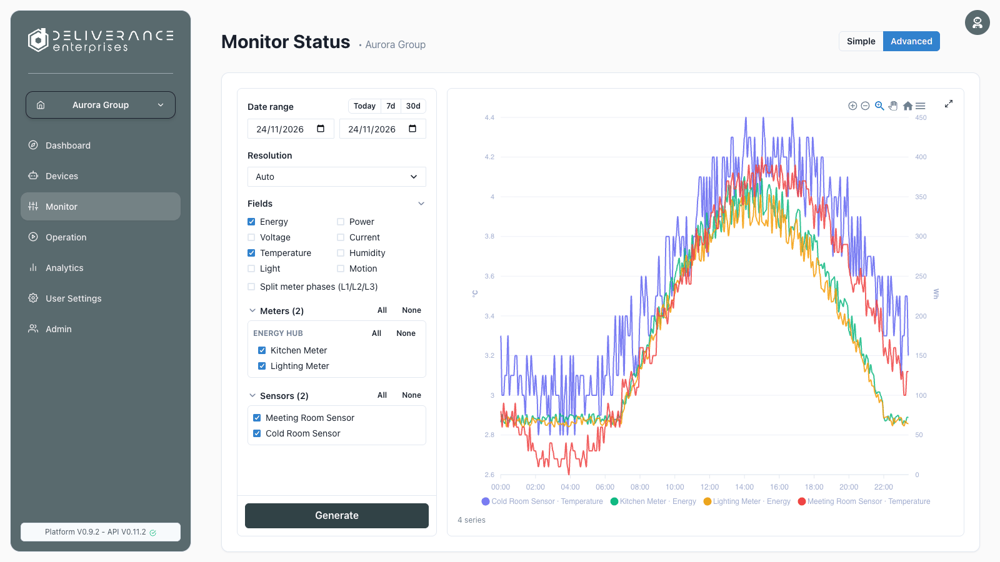

**高级** 在一张图表中比较多个电表和传感器的读数：选择区间、分辨率、指标（*字段*，*Fields*）和设备，然后点击 **生成**（**Generate**）。*拆分电表相位*（*Split meter phases*）将 L1、L2 和 L3 分开显示。
