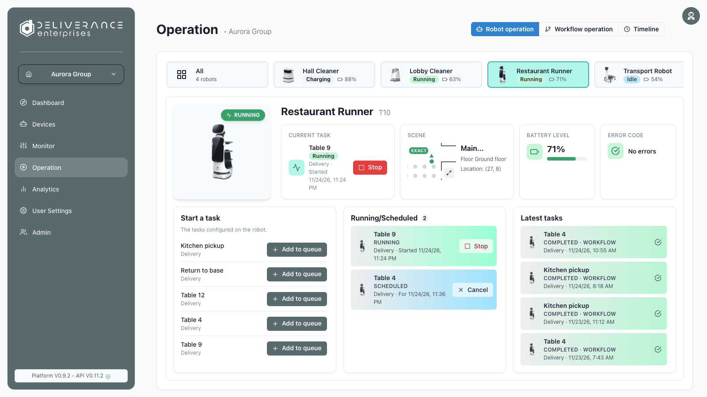
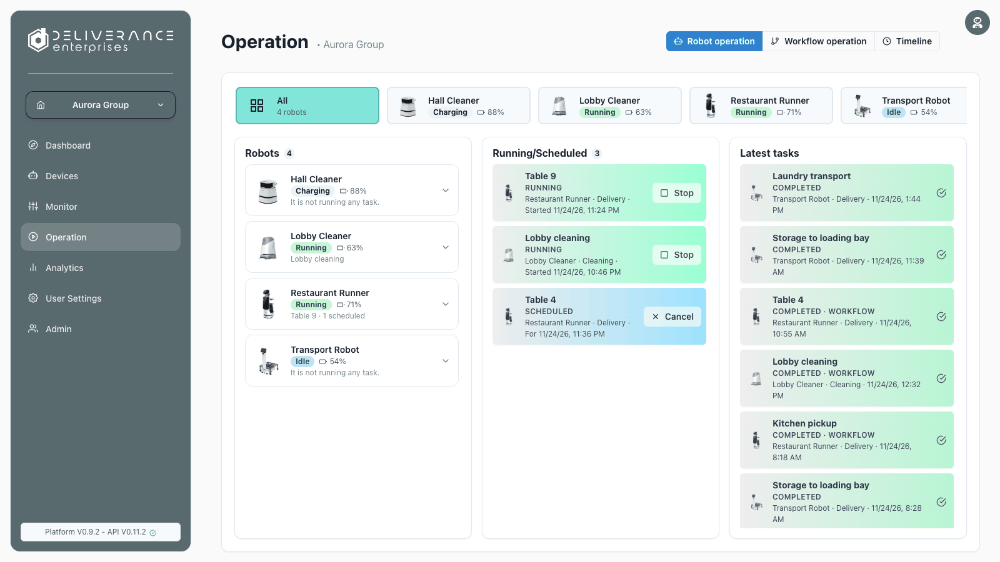
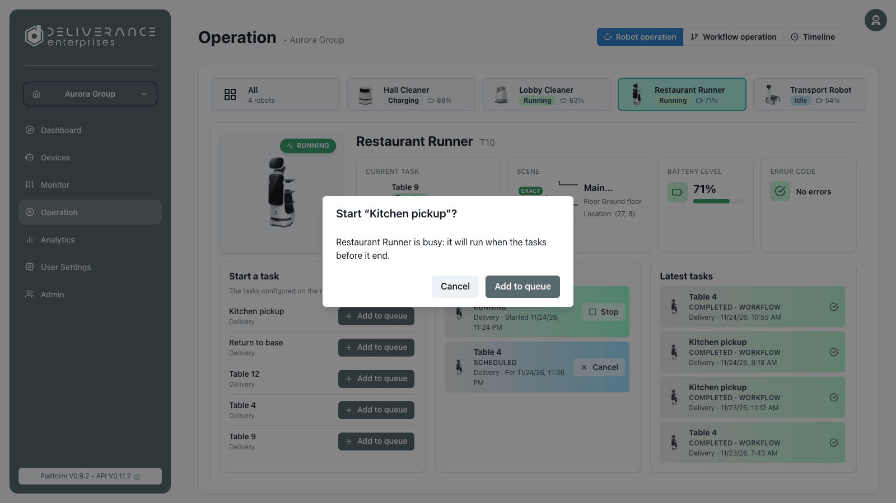
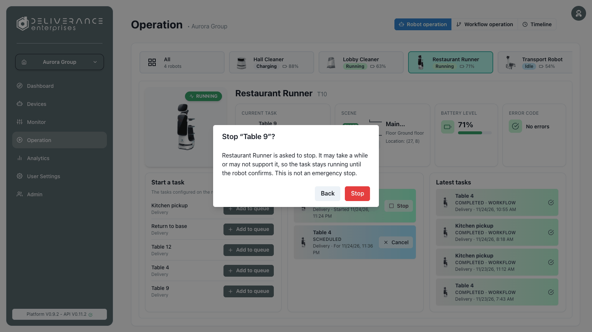
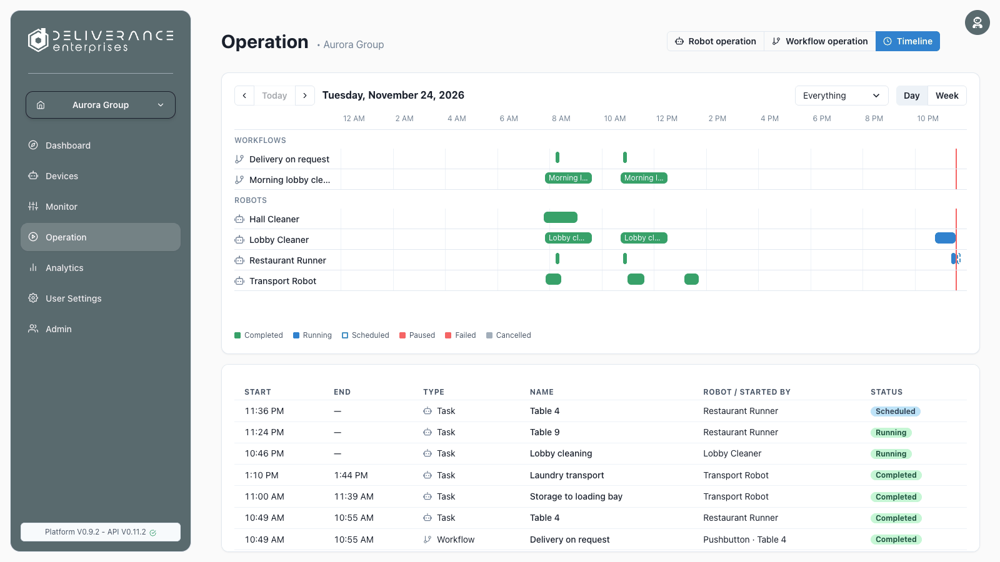

# Operation: Robot operation

Gives tasks to robots and shows what they are doing. It only appears to **administrators**. It has three views: **Robot operation**, **Workflow operation** (see [Workflows](workflows.md)) and **Timeline**.

## Robot operation

Choose the robot at the top. Below it are the current task, the scene, the battery and the error code, and three panels: **Start a task**, **Running/Scheduled** and **Latest tasks**. The *Workflow* label marks tasks launched by a workflow.

**All** brings all the robots together:

### Start a task

The list contains the tasks configured on the robot or, if the robot does not report them, those it has run in the last 90 days. **Start** starts the task and, if the robot is busy, **Add to queue** leaves it waiting. Confirmation is always requested.

!!! warning "A real robot may move"
    Once you confirm, the robot will start as soon as it can. Check first that the area is clear.

A scheduled task that does not start shows why it is waiting: the robot is busy, offline, in an emergency, in fault, paused or charging. If its deadline passes without it running, it is marked *Not executed*.

### Stop or cancel

- **Stop** (running task): the robot is asked to stop. The task stays running, marked *Stop requested*, until the robot confirms it.
- **Cancel** (scheduled task): the robot will not run it.

!!! danger "This is not an emergency stop"
    *Stop* may take time, and not all robots or connectors support it. If the robot has to stop right now, it must be stopped on site.

### Connector errors

If the robot's connector does not carry out what was requested, a **Connector error** notice appears with the name of the task:

- **...was not stopped**: the connector has not stopped the task and the robot may still be moving. You can retry with **Try again**.
- **...has not been taken**: the connector has not taken the task. It may not be running or not be ready to start tasks, or the robot rejects it.

## Timeline

Shows, by day or week, the tasks of each robot and the workflow runs, as a chart and as a table. The drop-down shows everything, only tasks or only workflows. If you are viewing another organization, only tasks are shown: workflows are those of your own.
