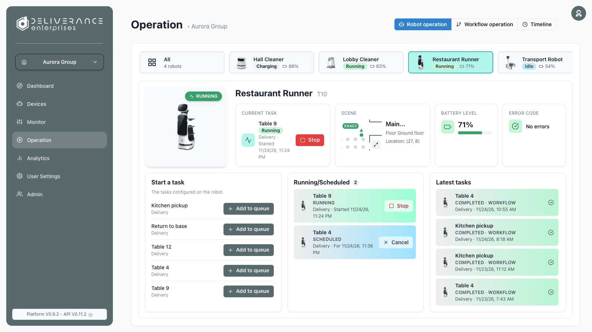
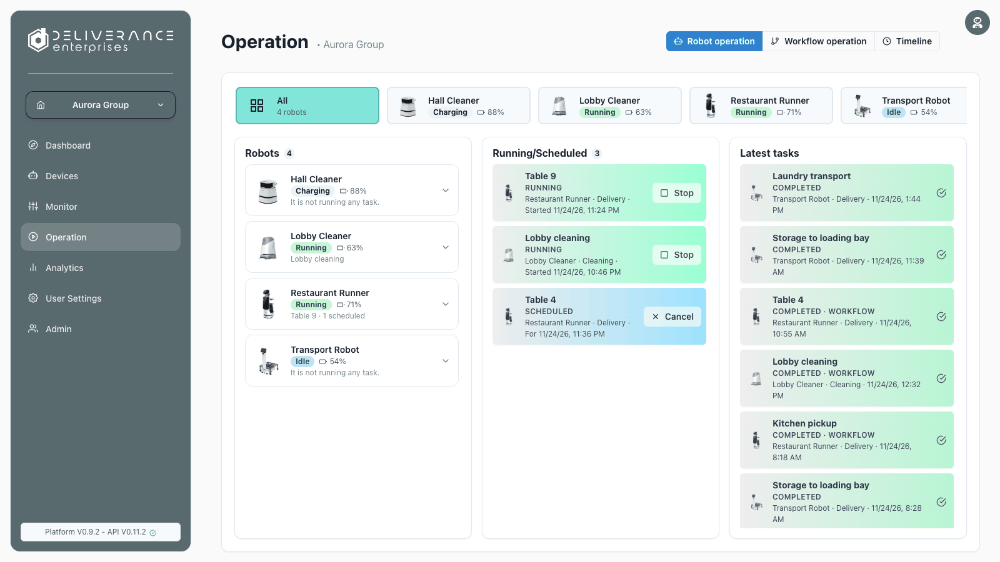
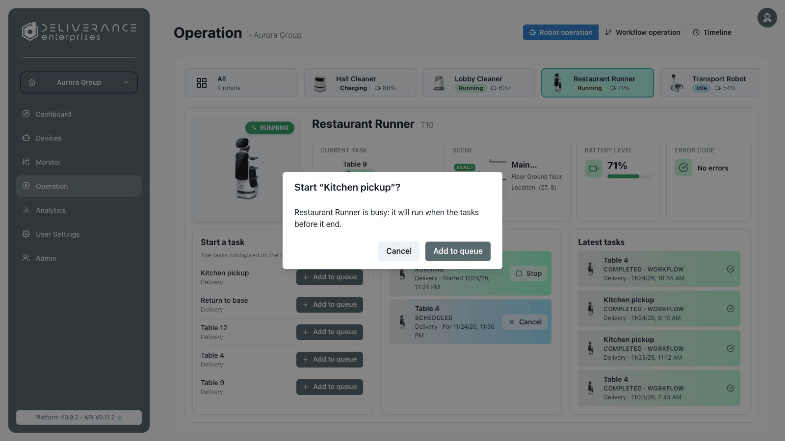
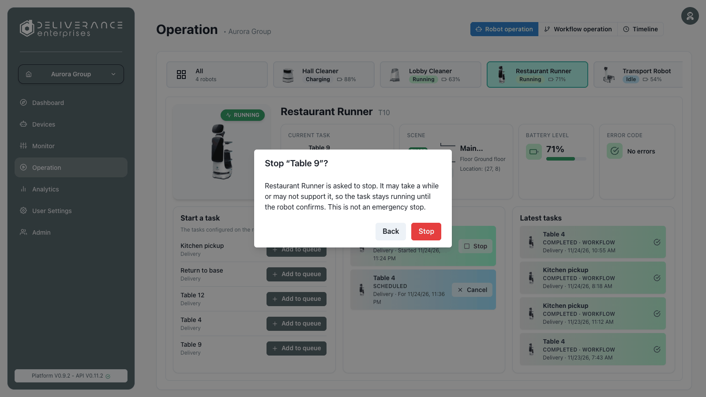
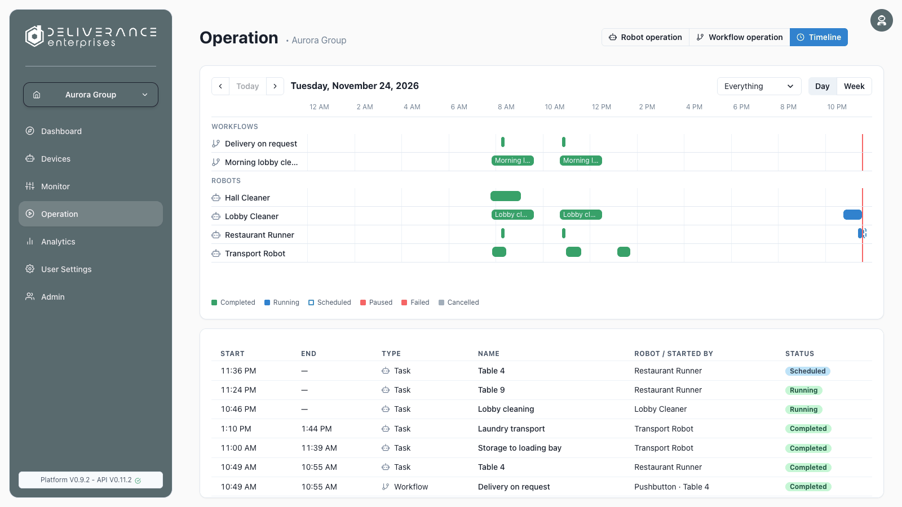

# Operation: Operación de robots {#operation-robot-operation}

Da tareas a los robots y muestra lo que hacen. Solo aparece a los **administradores**. Tiene tres vistas: **Robot operation**, **Workflow operation** (ver [Workflows](workflows.md)) y **Timeline**.

## Robot operation {#robot-operation}

Arriba se elige el robot. Debajo se ven la tarea en curso, la escena, la batería y el código de error, y tres paneles: **Start a task**, **Running/Scheduled** y **Latest tasks**. La etiqueta *Workflow* marca las tareas lanzadas por un workflow.

**All** reúne todos los robots:

### Arrancar una tarea {#start-a-task}

La lista contiene las tareas configuradas en el robot o, si el robot no las comunica, las que ha ejecutado en los últimos 90 días. **Start** la arranca y, si el robot está ocupado, **Add to queue** la deja en espera. Siempre se pide confirmación.

!!! warning "Un robot real puede moverse"
    Al confirmar, el robot empezará en cuanto pueda. Comprueba antes que la zona está despejada.

Una tarea programada que no arranca indica por qué espera: el robot está ocupado, desconectado, en emergencia, averiado, en pausa o cargando. Si se agota su plazo sin ejecutarse, queda como *Not executed*.

### Parar o cancelar {#stop-or-cancel}

- **Stop** (tarea en marcha): se pide al robot que pare. La tarea sigue en marcha, marcada *Stop requested*, hasta que el robot lo confirma.
- **Cancel** (tarea programada): el robot no la ejecutará.

!!! danger "No es una parada de emergencia"
    *Stop* puede tardar, y no todos los robots o conectores lo admiten. Si el robot tiene que detenerse ya, hay que pararlo en el lugar.

### Errores de conector {#connector-errors}

Si el conector del robot no ejecuta lo pedido, aparece un aviso **Connector error** con el nombre de la tarea:

- **...was not stopped**: el conector no ha parado la tarea y el robot puede seguir moviéndose. Se puede reintentar con **Try again**.
- **...has not been taken**: el conector no ha recogido la tarea. Puede no estar funcionando o no estar preparado para arrancar tareas, o el robot la rechaza.

## Timeline {#timeline}

Muestra por día o semana las tareas de cada robot y las ejecuciones de los workflows, en gráfico y en tabla. El desplegable muestra todo, solo tareas o solo workflows. Si se está viendo otra organización solo se muestran tareas: los workflows son los de la propia.
