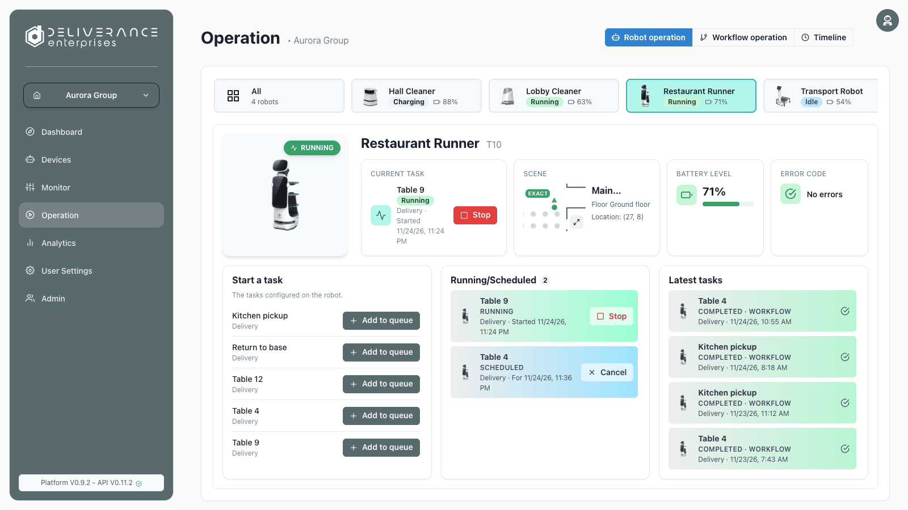
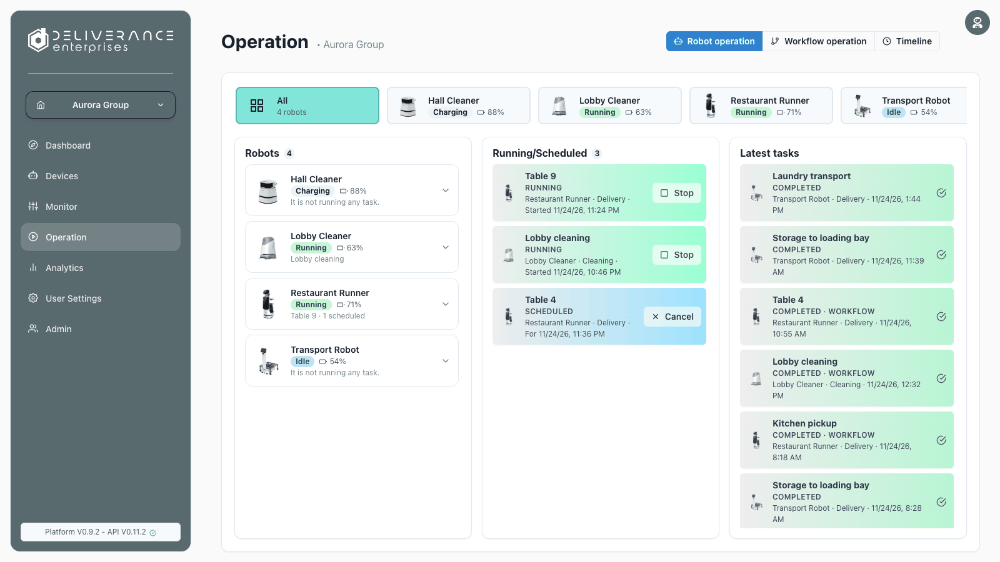
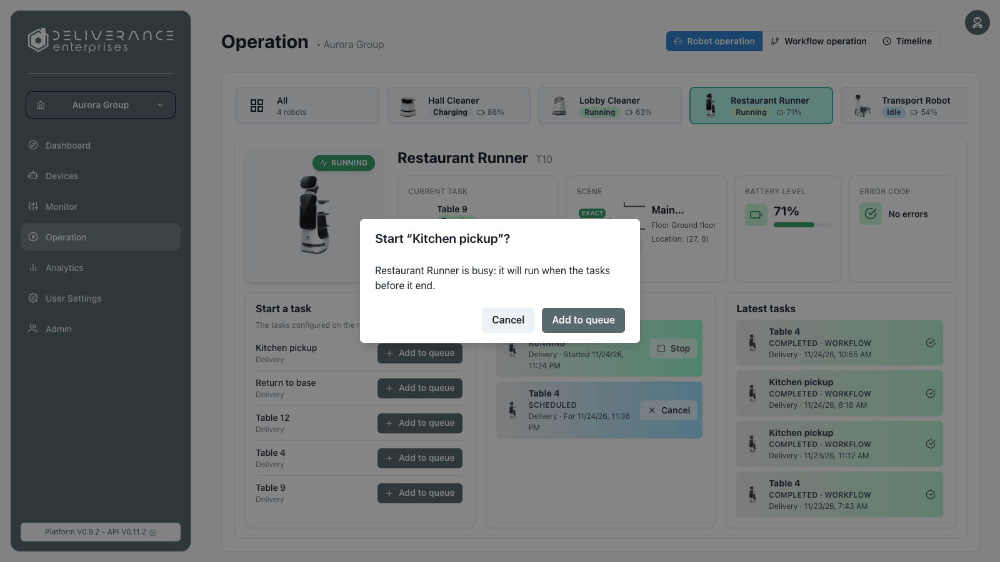
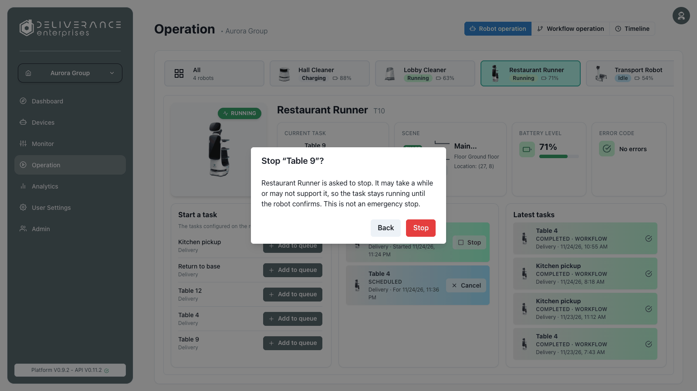
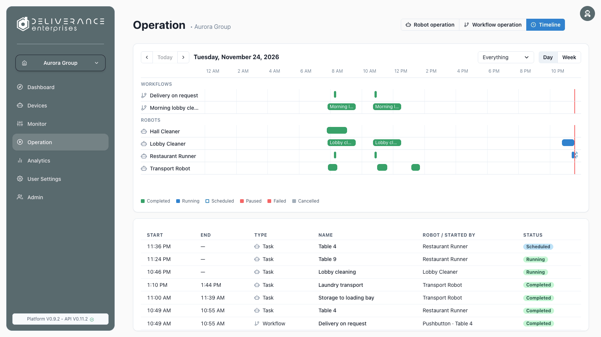

# 运行（Operation）：机器人运行 {#operation-robot-operation}

向机器人下达任务并显示其执行情况。仅对 **管理员** 显示。包含三个视图：**机器人运行**（**Robot operation**）、**工作流运行**（**Workflow operation**，见[工作流](workflows.md)）和 **时间线**（**Timeline**）。

## 机器人运行（Robot operation） {#robot-operation}

在顶部选择机器人。下方显示当前任务、场景、电量和错误代码，以及三个面板：**启动任务**（**Start a task**）、**进行中/已排程**（**Running/Scheduled**）和 **最近任务**（**Latest tasks**）。*工作流*（*Workflow*）标签标记由工作流启动的任务。

**全部**（**All**）汇集所有机器人：

### 启动任务 {#start-a-task}

列表包含机器人中配置的任务；如果机器人不上报这些任务，则包含其最近 90 天内执行过的任务。**启动**（**Start**）启动任务；如果机器人正忙，**加入队列**（**Add to queue**）会让任务等待。始终要求确认。

!!! warning "真实的机器人可能会移动"
    确认后，机器人会尽快开始执行。确认之前，先检查该区域已清空。

未启动的已排程任务会说明等待原因：机器人忙碌、离线、处于急停状态、有故障、已暂停或正在充电。如果期限届满仍未执行，任务会标记为 *未执行*（*Not executed*）。

### 停止或取消 {#stop-or-cancel}

- **停止**（**Stop**，进行中的任务）：请求机器人停止。在机器人确认之前，任务仍在进行中，并标记为 *已请求停止*（*Stop requested*）。
- **取消**（**Cancel**，已排程的任务）：机器人不会执行该任务。

!!! danger "这不是紧急停止"
    *停止* 可能需要一段时间，而且并非所有机器人或连接器都支持。如果机器人必须立即停下，必须在现场将其停止。

### 连接器错误 {#connector-errors}

如果机器人的连接器没有执行所请求的操作，会出现 **连接器错误**（**Connector error**）提示，并注明任务名称：

- **……未停止**（**...was not stopped**）：连接器没有停止任务，机器人可能仍在移动。可以用 **重试**（**Try again**）再次尝试。
- **……未被接收**（**...has not been taken**）：连接器没有接收任务。连接器可能未在运行，或未准备好启动任务，或者机器人拒绝该任务。

## 时间线（Timeline） {#timeline}

按日或按周以图表和表格显示每台机器人的任务以及工作流的运行。下拉菜单可显示全部、仅任务或仅工作流。如果正在查看其他组织，则只显示任务：工作流属于所属组织。
