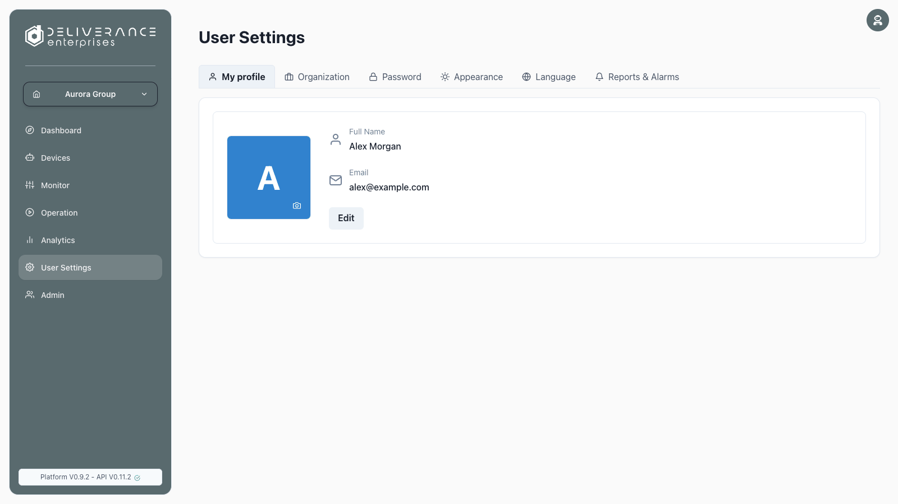
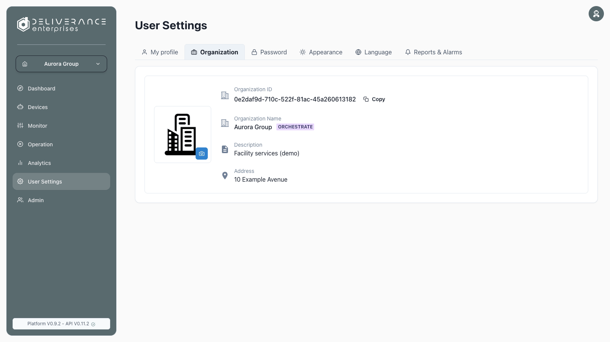
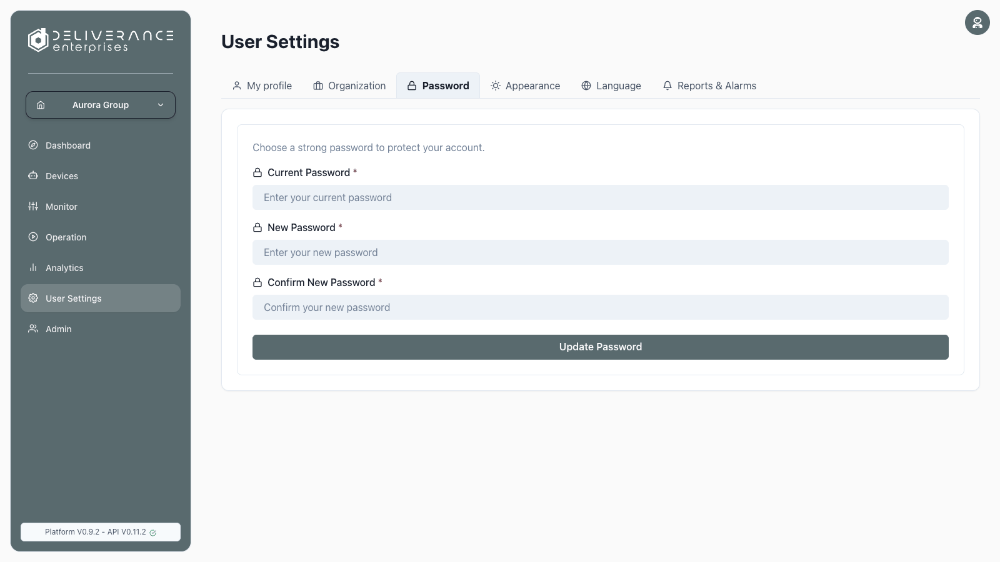
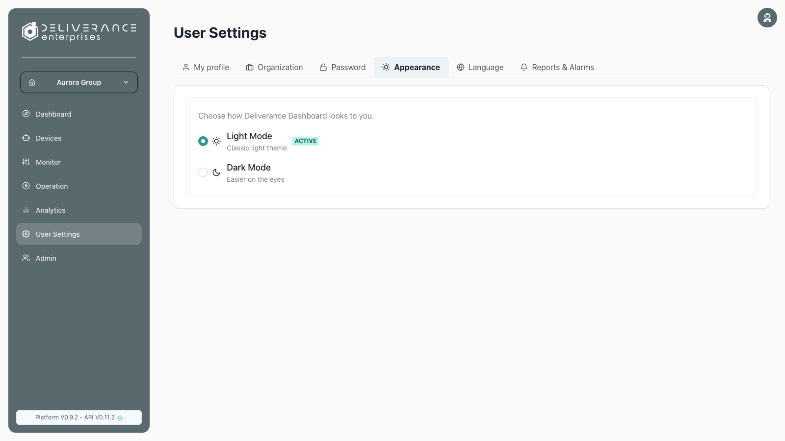
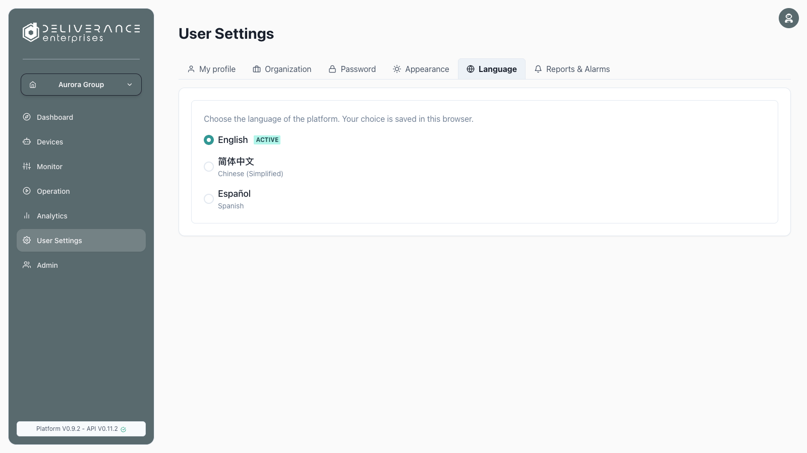
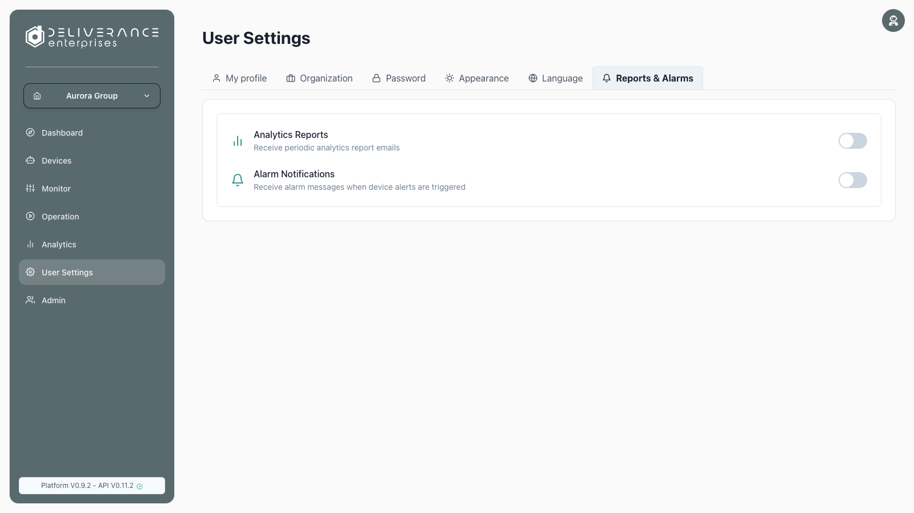
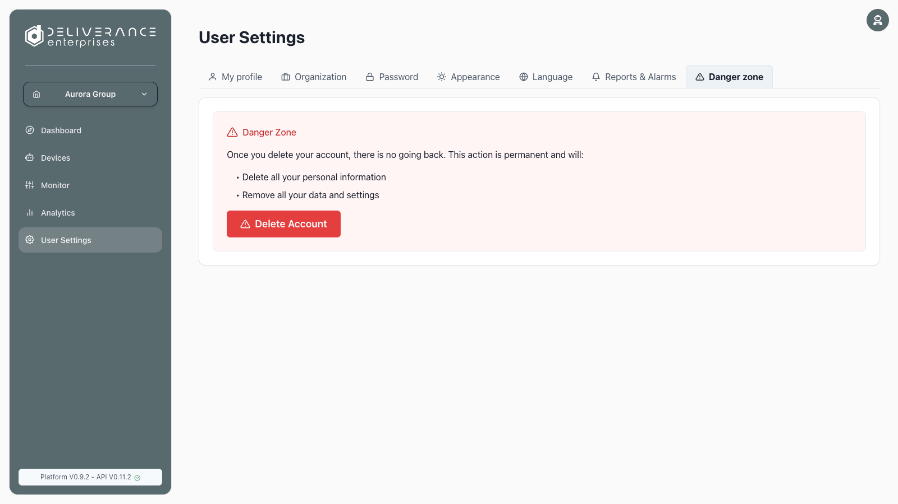

# User Settings: User information

Profile preferences and user settings.

## My profile

The user's full name, email and picture, all editable.

## Organization

ID, name, tier, description and address of the organization. Its logo can be changed here (JPEG, PNG or GIF, 5 MB maximum).

## Password

Asks for the current password and the new one twice (8 to 40 characters).

## Appearance

Interface theme: **Light Mode** or **Dark Mode**.

## Language

English, Español or 简体中文. The choice is saved with the user's account.

## Reports & Alarms

- **Analytics Reports**: periodic emails with the analytics reports.
- **Alarm Notifications**: email notice when an alarm goes off.

Alarms are configured per device in [Monitor](monitor.md#alarms); here you decide whether this user receives the notice.

## Danger zone

Deletes the account, with the user's personal data and settings. This action is permanent. It does not appear to administrators.
