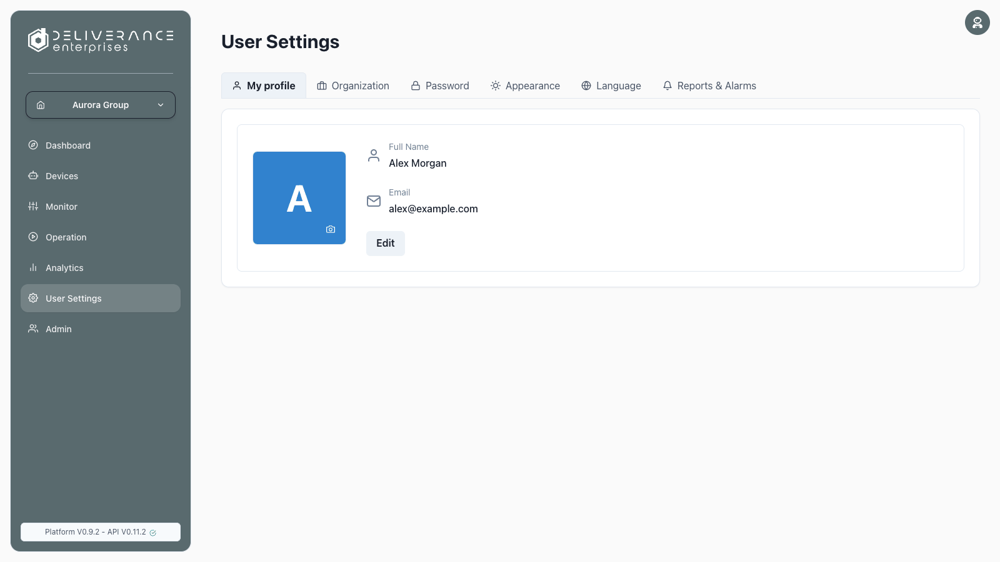
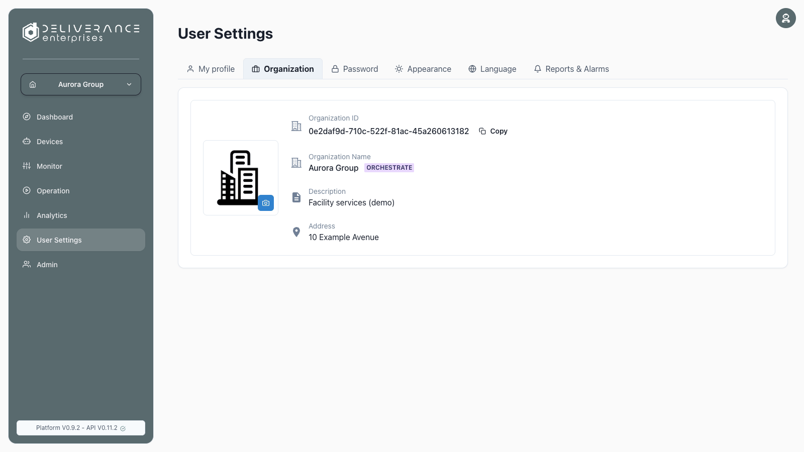
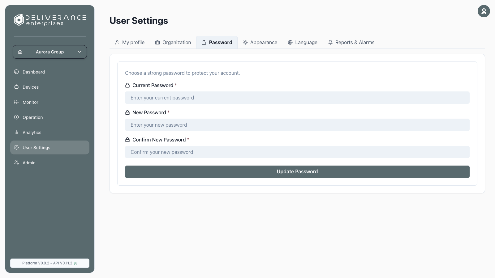
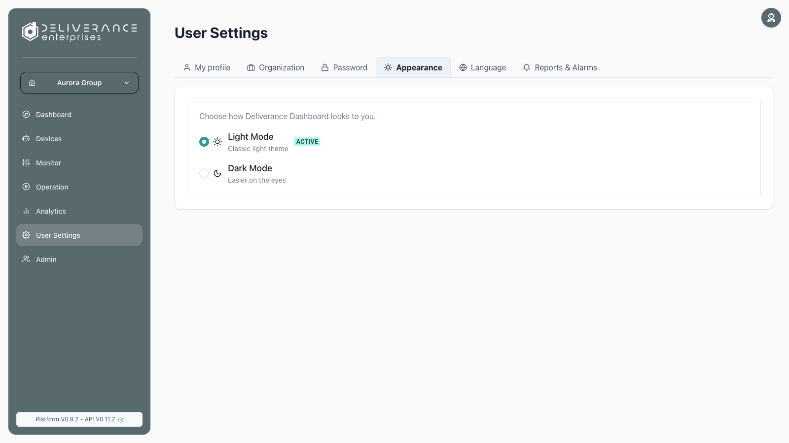
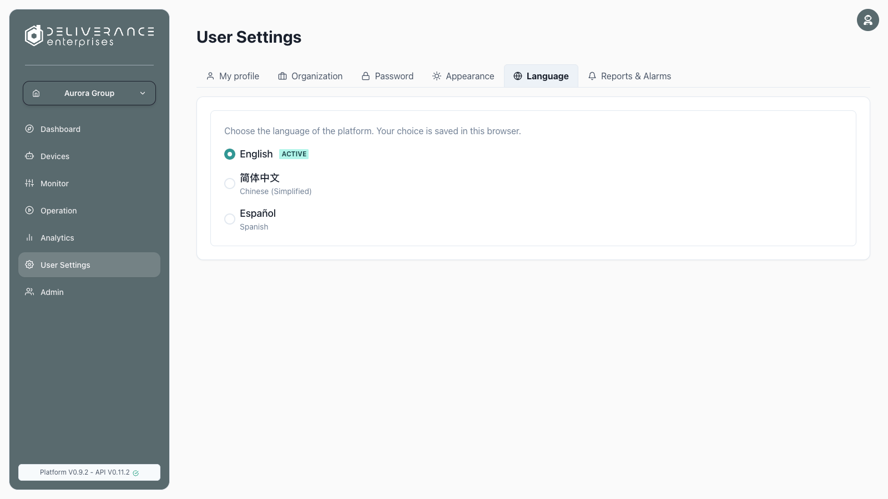
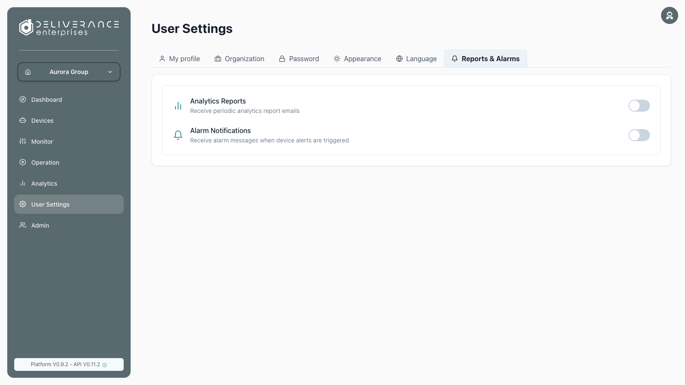
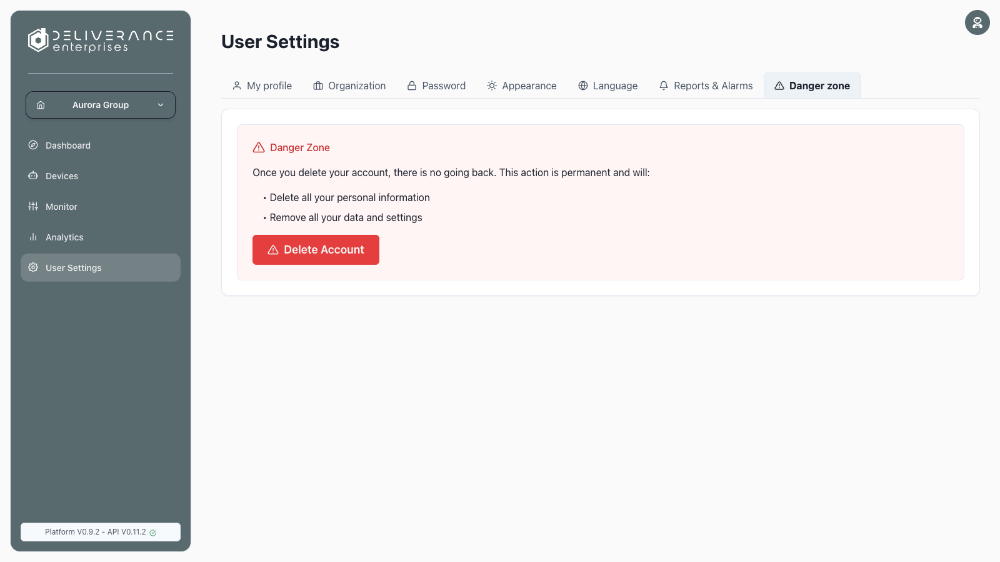

# User Settings: Información de usuario

Preferencias del perfil y configuraciones de usuario.

## My profile

Nombre completo, email e imagen del usuario, editables.

## Organization

ID, nombre, tier, descripción y dirección de la organización. Desde aquí se puede cambiar su logo (JPEG, PNG o GIF, máximo 5 MB).

## Password

Pide la contraseña actual y la nueva por duplicado (8 a 40 caracteres).

## Appearance

Tema de la interfaz: **Light Mode** o **Dark Mode**.

## Language

English, Español o 简体中文. La elección se guarda con la cuenta del usuario.

## Reports & Alarms

- **Analytics Reports**: emails periódicos con los informes de analítica.
- **Alarm Notifications**: aviso por email cuando salta una alarma.

Las alarmas se configuran por dispositivo en [Monitor](monitor.md#alarmas); aquí se decide si este usuario recibe el aviso.

## Danger zone

Elimina la cuenta, con los datos personales y ajustes del usuario. Es una acción permanente. No aparece a los administradores.
