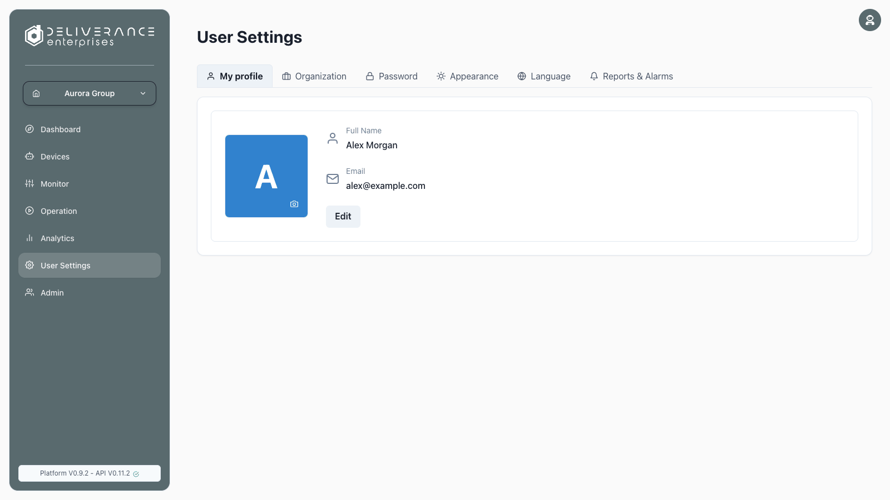
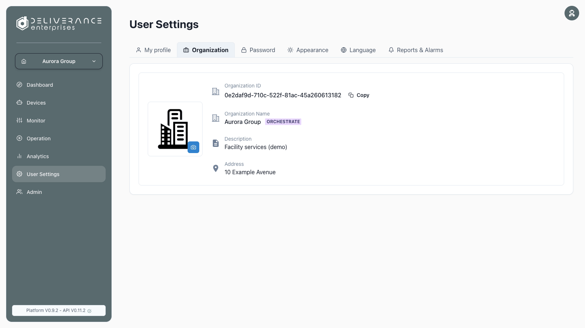
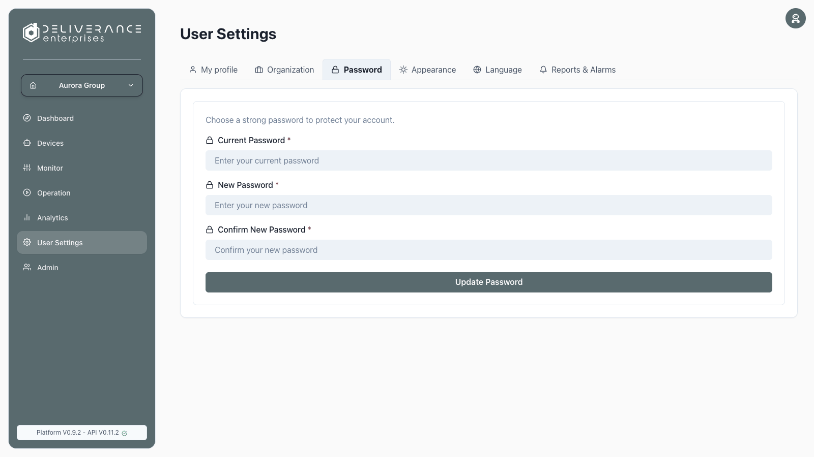
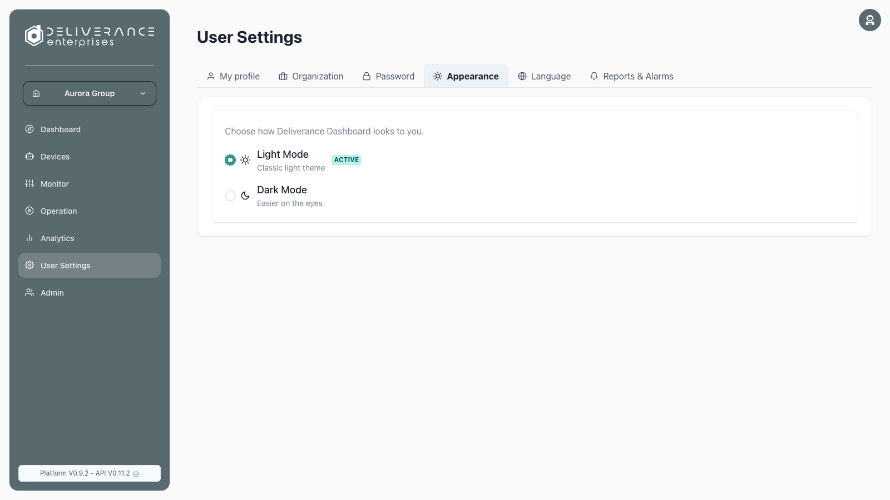
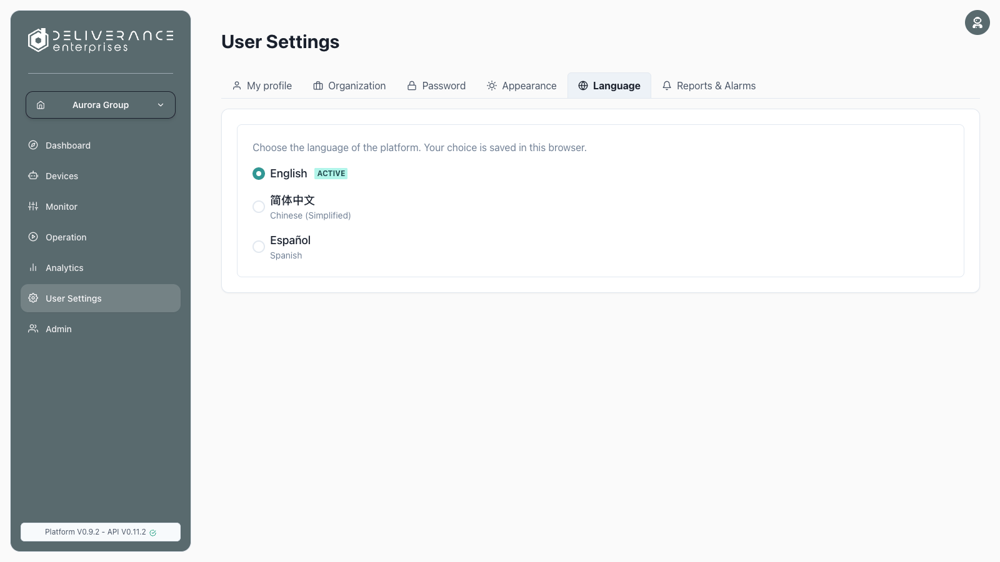
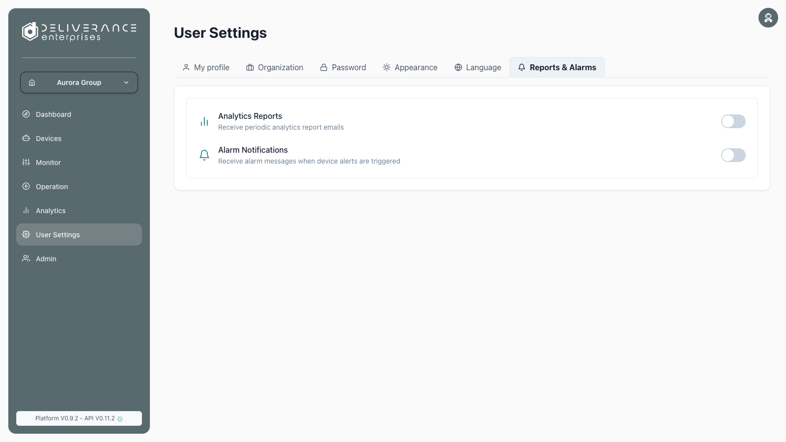
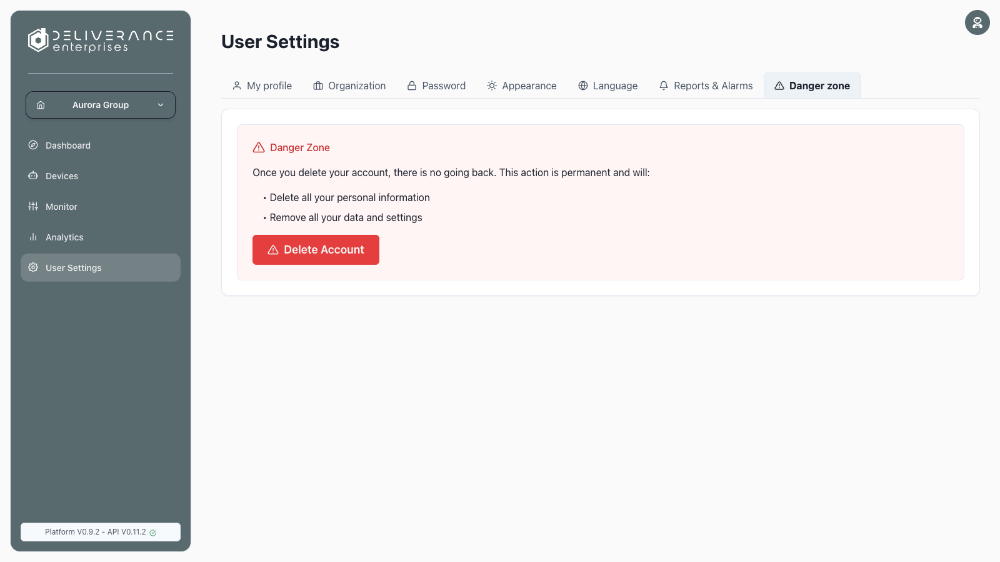

# 用户设置（User Settings）：用户信息 {#user-settings-user-information}

个人资料偏好和用户配置。

## 我的资料（My profile） {#my-profile}

用户的姓名、电子邮箱和头像，均可编辑。

## 组织（Organization） {#organization}

组织的 ID、名称、等级、描述和地址。在此可以更换组织的标志（JPEG、PNG 或 GIF，最大 5 MB）。

## 密码（Password） {#password}

要求输入当前密码，并输入两次新密码（8 到 40 个字符）。

## 外观（Appearance） {#appearance}

界面主题：**浅色模式**（**Light Mode**）或 **深色模式**（**Dark Mode**）。

## 语言（Language） {#language}

English、Español 或简体中文。所选语言随用户账户保存。

## 报告与告警（Reports & Alarms） {#reports-alarms}

- **分析报告**（**Analytics Reports**）：定期发送分析报告的电子邮件。
- **告警通知**（**Alarm Notifications**）：告警触发时通过电子邮件通知。

告警在[监控](monitor.md#alarms)（Monitor）中按设备配置；此处决定该用户是否接收通知。

## 危险区域（Danger zone） {#danger-zone}

删除账户以及用户的个人数据和设置。此操作是永久性的。不对管理员显示。
