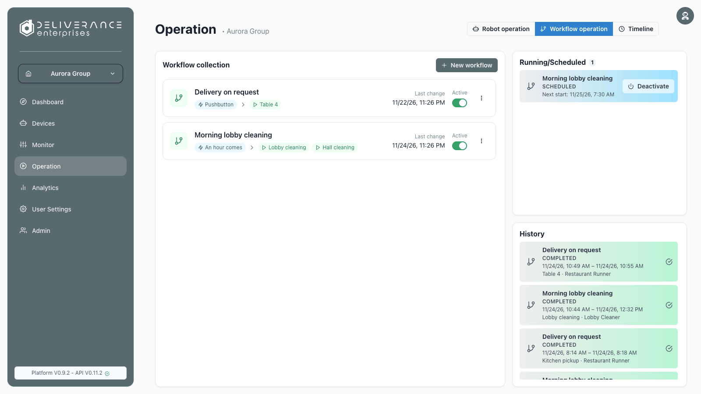
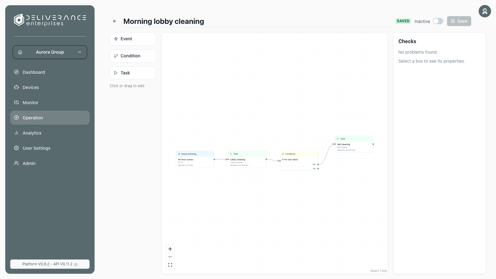
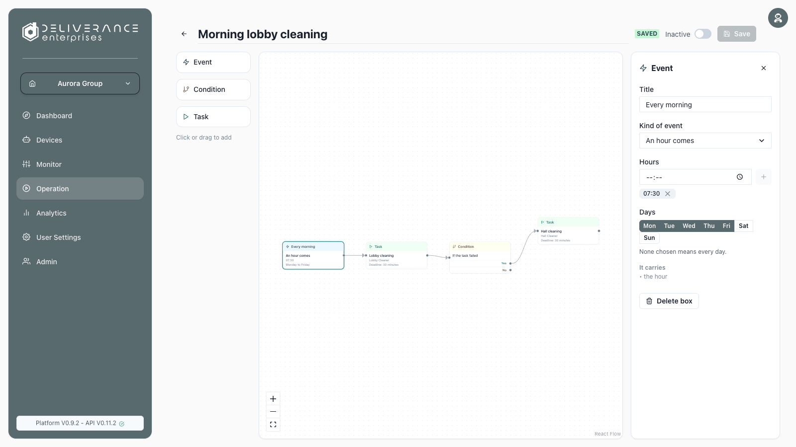
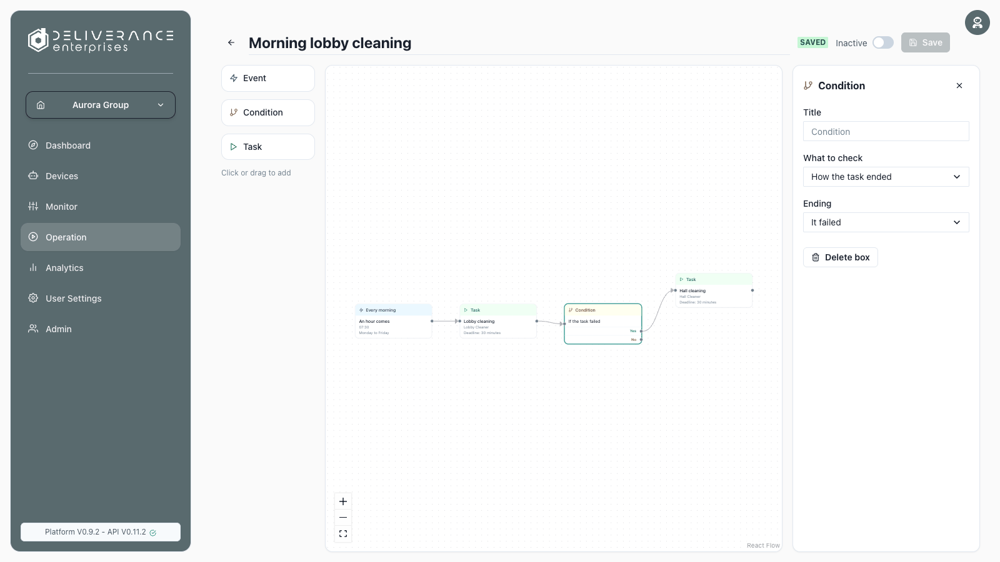
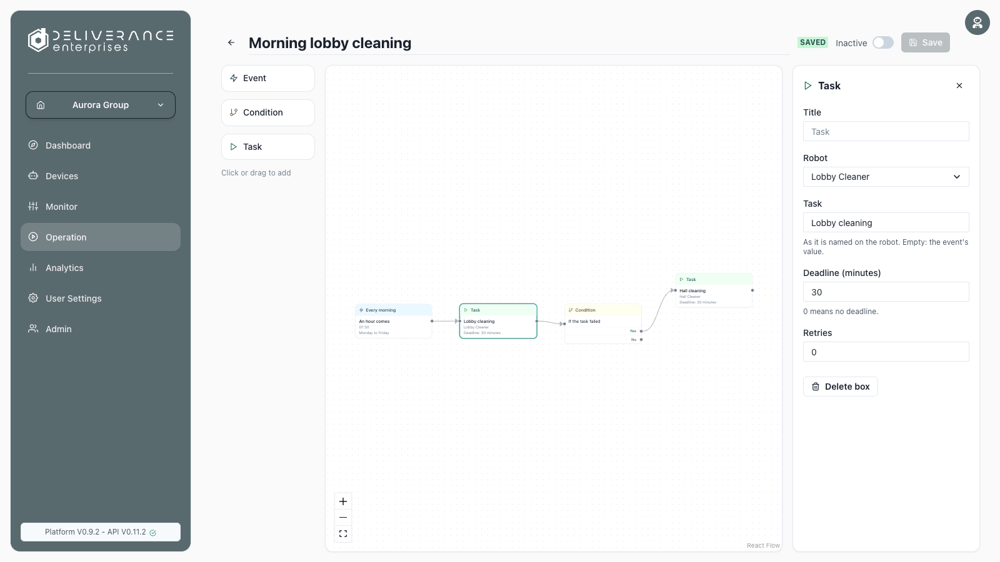

# Workflows: Automations

A workflow gives tasks to robots when something happens. It is managed in **Operation → Workflow operation** (administrators) and **always belongs to your own organization**, even if you are viewing another one.

- **Workflow collection**: the workflows, with **New workflow**, an **Active** switch and a menu to open, duplicate or delete. A workflow has to be deactivated before it can be deleted.
- **Running/Scheduled**: what is running and the next starts by time. A run can be paused, resumed or cancelled.
- **History**: the latest runs.

On **pause**, the robot finishes the task it is running. On **cancel**, it is asked to stop it. A workflow with runs in progress cannot be deactivated.

## Editor

Boxes are added from the palette (by clicking or dragging) and joined with arrows. *Delete* or *Backspace* removes what is selected. The **Checks** panel shows the problems. A workflow can only be activated if it is saved and has no problems, and while active it is read-only.

### Event

What starts the workflow: **Kind of event** and, optionally, which device sends it (**Sent by**).

| Source | Events |
| --- | --- |
| Schedule | A time arrives, on the chosen days (none = every day) |
| Signals | Pushbutton, spill detected, warehouse order, camera alert |
| Tasks | Starts, ends well, fails, is cancelled, expires, launched by hand |
| Robot | Offline, fault, emergency stop, starts charging, recovers, low battery |
| Alarms | An alarm goes off or clears |

### Condition

Decides by **Yes** or **No**:

- **What the event carries**: compares a value of the event.
- **How the task ended**: whether it ended well, failed or was cancelled. Only right after a task.
- **Whether the robot has more tasks**.

### Task

- **Robot**: the event's, the previous task's, a specific one or any of a model (the first one that is free, or the free one with most battery).
- **Task**: the name of the task as it is on the robot. Empty: the event's value.
- **Deadline**: minutes to start before expiring (0 = no deadline).
- **Retries**: retries if it fails, and the wait between them.

### Rules

- Nothing can go into an event box.
- Only a condition can follow a task.
- There can be no cycles.
