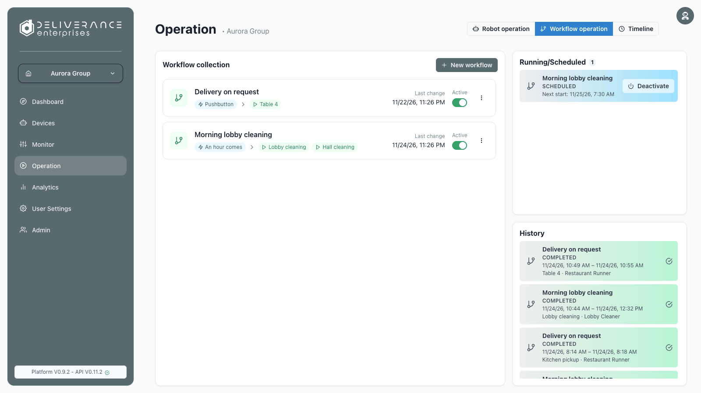
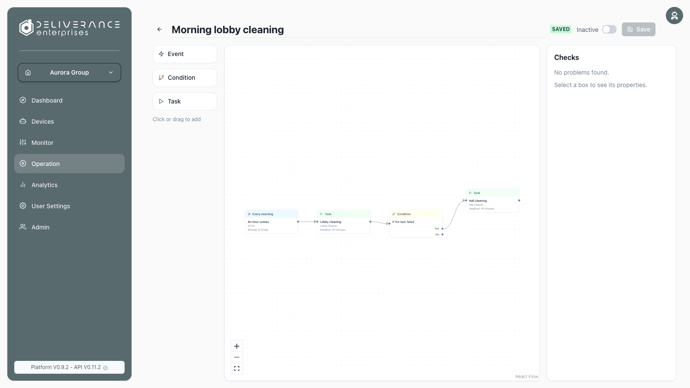
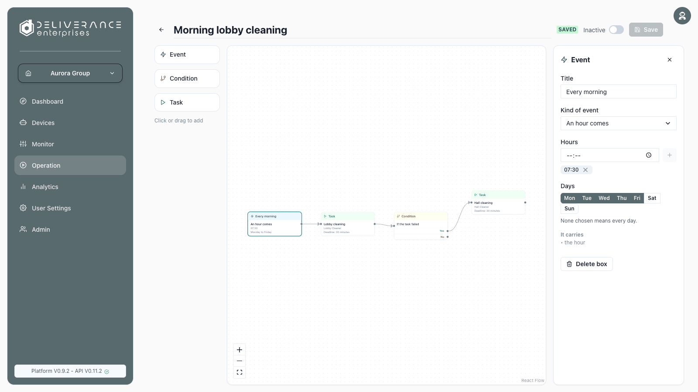
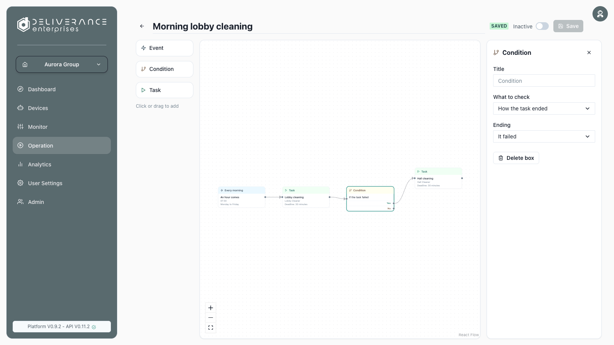
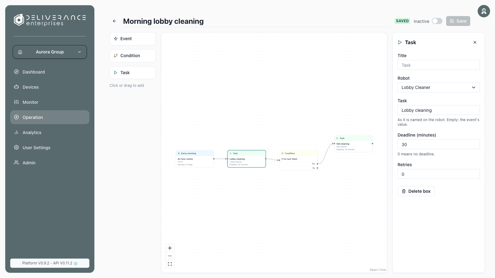

# Workflows: Automatizaciones {#workflows-automations}

Un workflow da tareas a los robots cuando ocurre algo. Se gestiona en **Operation → Workflow operation** (administradores) y **siempre pertenece a la propia organización**, aunque se esté viendo otra.

- **Workflow collection**: los workflows, con **New workflow**, un interruptor **Active** y un menú para abrir, duplicar o borrar. Para borrarlo hay que desactivarlo antes.
- **Running/Scheduled**: lo que está en marcha y los próximos arranques por hora. Una ejecución se puede pausar, reanudar o cancelar.
- **History**: las últimas ejecuciones.

Al **pausar**, el robot termina la tarea que tiene en curso. Al **cancelar**, se le pide que la pare. Un workflow con ejecuciones en curso no se puede desactivar.

## Editor {#editor}

Se añaden cajas desde la paleta (clic o arrastrando) y se unen con flechas. *Supr* o *Retroceso* borra lo seleccionado. El panel **Checks** muestra los problemas. Solo se puede activar si está guardado y sin problemas, y mientras está activo es de solo lectura.

### Evento {#event}

Lo que pone en marcha el workflow: **Kind of event** y, si se quiere, qué dispositivo lo envía (**Sent by**).

| Origen | Eventos |
| --- | --- |
| Horario | Llega una hora, en los días elegidos (ninguno = todos) |
| Señales | Pulsador, derrame detectado, pedido del almacén, aviso de una cámara |
| Tareas | Empieza, termina bien, falla, se cancela, caduca, lanzada a mano |
| Robot | Sin conexión, avería, parada de emergencia, empieza a cargar, se recupera, batería baja |
| Alarmas | Salta o se apaga una alarma |

### Condición {#condition}

Decide por **Yes** o **No**:

- **What the event carries**: compara un dato del evento.
- **How the task ended**: si terminó bien, falló o se canceló. Solo justo después de una tarea.
- **Whether the robot has more tasks**.

### Tarea {#task}

- **Robot**: el del evento, el de la tarea anterior, uno concreto o cualquiera de un modelo (el primero libre, o el libre con más batería).
- **Task**: el nombre de la tarea tal como está en el robot. Vacío: el valor del evento.
- **Deadline**: minutos para empezar antes de caducar (0 = sin plazo).
- **Retries**: reintentos si falla, y la espera entre ellos.

### Reglas {#rules}

- Nada puede entrar en una caja de evento.
- Después de una tarea solo puede ir una condición.
- No puede haber ciclos.
