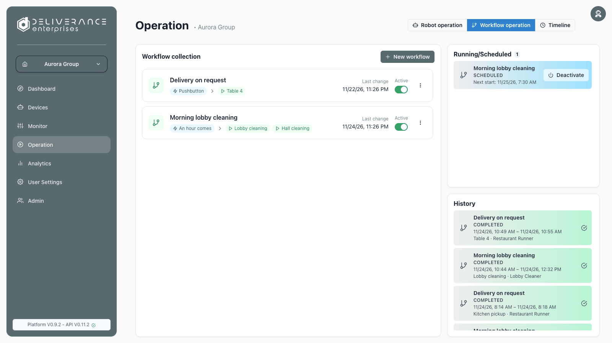
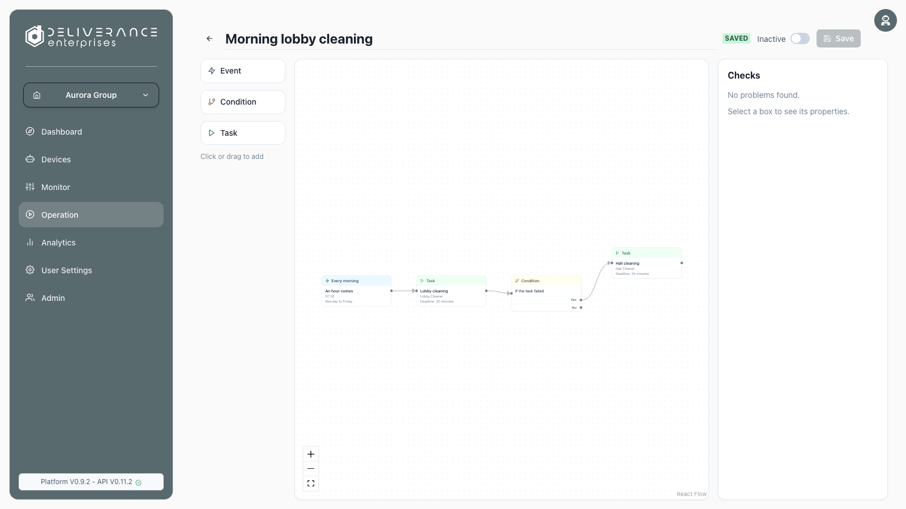
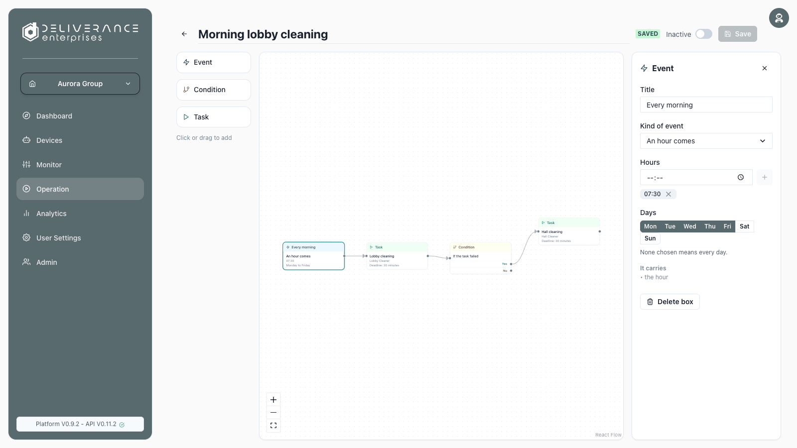
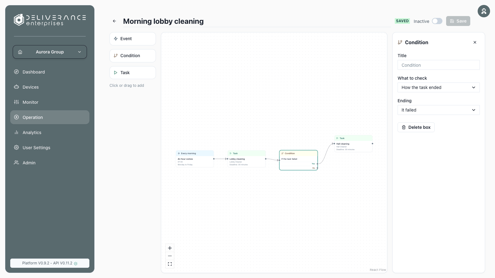
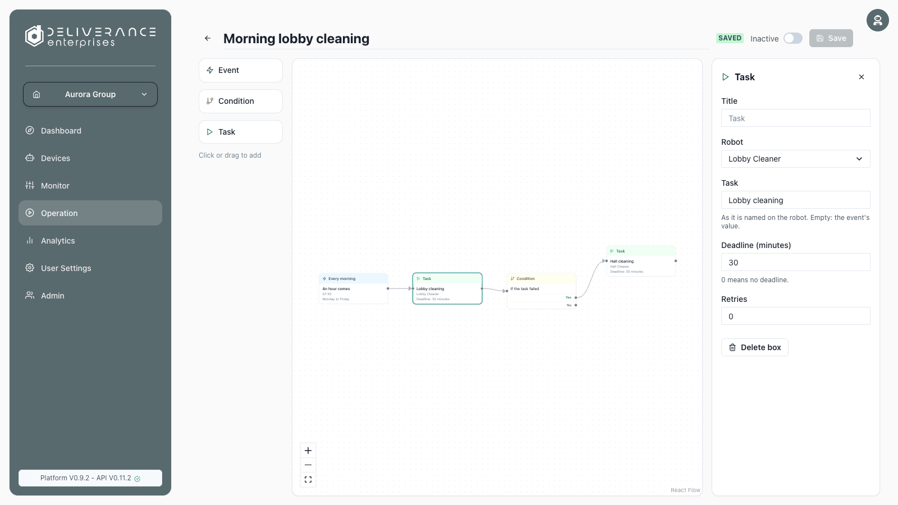

# 工作流（Workflows）：自动化 {#workflows-automations}

工作流在某件事发生时向机器人下达任务。在 **运行 → 工作流运行**（**Operation → Workflow operation**）中管理（管理员），并且 **始终属于所属组织**，即使正在查看其他组织。

- **工作流列表**（**Workflow collection**）：各工作流，带有 **新建工作流**（**New workflow**）、**启用**（**Active**）开关以及用于打开、复制或删除的菜单。删除之前必须先停用。
- **进行中/已排程**（**Running/Scheduled**）：正在进行的内容和即将按时间启动的内容。运行可以暂停、恢复或取消。
- **历史记录**（**History**）：最近的运行。

**暂停** 时，机器人会完成当前正在执行的任务。**取消** 时，会请求机器人停止该任务。有正在进行的运行的工作流不能停用。

## 编辑器 {#editor}

从工具面板添加方框（点击或拖动），并用箭头连接。*Delete* 键或 *Backspace* 键删除所选内容。**检查**（**Checks**）面板显示存在的问题。只有已保存且没有问题时才能启用，启用期间为只读。

### 事件 {#event}

启动工作流的内容：**事件类型**（**Kind of event**），以及可选的发送设备（**发送者**，**Sent by**）。

| 来源 | 事件 |
| --- | --- |
| 时间 | 到达指定时间，在所选日期（不选 = 每天） |
| 信号 | 按钮、检测到溢洒、仓库订单、摄像头提示 |
| 任务 | 开始、成功完成、失败、被取消、过期、手动启动 |
| 机器人 | 离线、故障、急停、开始充电、恢复、电量低 |
| 告警 | 告警触发或解除 |

### 条件 {#condition}

按 **是**（**Yes**）或 **否**（**No**）判断：

- **事件携带的内容**（**What the event carries**）：比较事件中的某项数据。
- **任务的结果**（**How the task ended**）：任务成功完成、失败或被取消。仅可紧接在任务之后。
- **机器人是否还有任务**（**Whether the robot has more tasks**）。

### 任务 {#task}

- **机器人**（**Robot**）：事件中的机器人、上一个任务的机器人、指定的一台，或某型号的任意一台（第一个空闲的，或电量最多的空闲机器人）。
- **任务**（**Task**）：任务名称，与机器人上的名称完全一致。留空：事件的值。
- **期限**（**Deadline**）：在过期之前必须开始的分钟数（0 = 无期限）。
- **重试次数**（**Retries**）：失败时的重试次数，以及两次重试之间的等待时间。

### 规则 {#rules}

- 任何内容都不能连入事件方框。
- 任务之后只能是条件。
- 不能存在循环。
