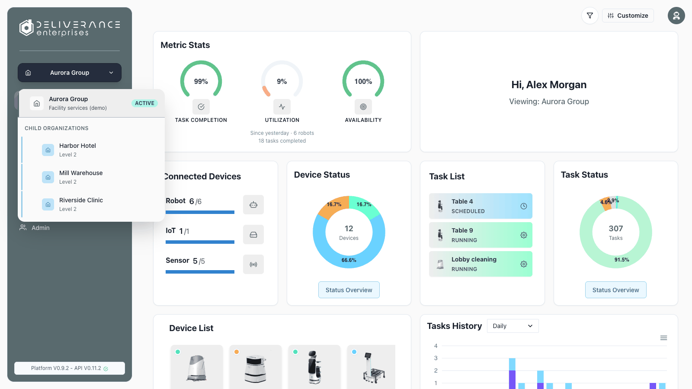

# Getting started

## Accessing the platform

Users sign in from the login page with their email and password. The **Sign up** link lets you create an account, but it shows no data until an administrator assigns it to an organization.

More details in [Login](../guia-de-uso/login.md).

## General navigation

Once inside, every screen of the platform is laid out the same way:

- **Left side menu**: access to the main sections. *Operation* and *Admin* only appear to administrators.
- **Organization selector**, at the top of the side menu: your own organization and, below it, its child organizations. It changes the data you see, not the organization you belong to. When you log in you always start in your own.
- **User menu**, top right: *My profile* and *Log out*.
- **Version**, at the bottom of the side menu: the deployed versions of the platform and the API.

The Dashboard also includes the data of the child organizations; Devices, Monitor and Analytics show only the selected organization.

## Quick map of sections

| Section | What it is for |
| --- | --- |
| [Dashboard](../guia-de-uso/dashboard.md) | Configurable control panel with indicators, devices and tasks. |
| [Devices](../guia-de-uso/devices.md) | Enabling, editing and assigning devices between organizations. |
| [Monitor](../guia-de-uso/monitor.md) | Real-time operating status of each device. |
| [Operation](../guia-de-uso/operation.md) | Giving tasks to robots, workflows and timeline (administrators). |
| [Analytics](../guia-de-uso/analytics.md) | Operation and event reports, exportable. |
| [User Settings](../guia-de-uso/user-settings.md) | Profile, password, appearance, language and notifications. |
| [Admin](../guia-de-uso/admin.md) | Users, organizations and tiers (administrators). |
