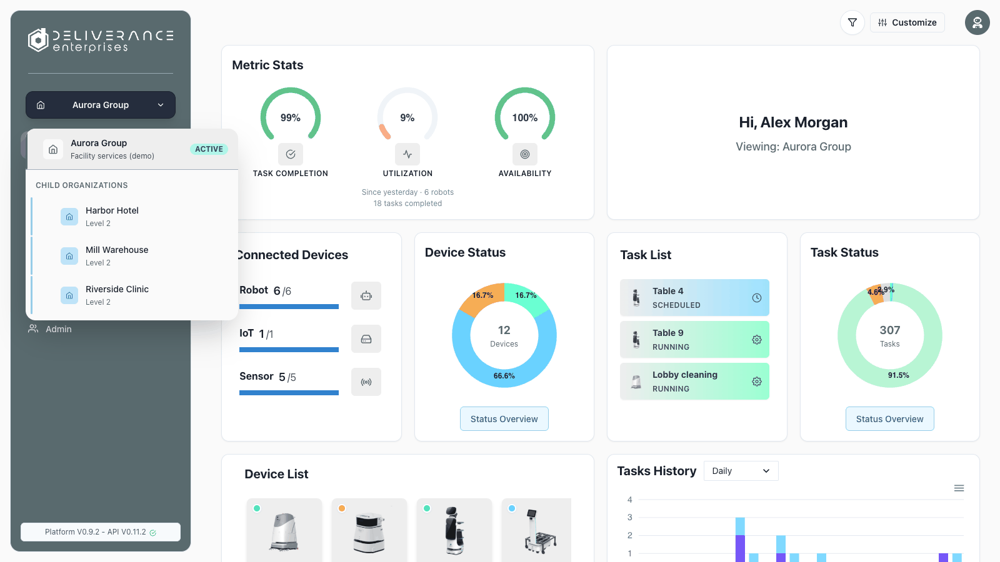

# Primeros pasos

## Acceso a la plataforma

El acceso se realiza desde la página de login con email y contraseña. Desde el enlace **Sign up** se puede crear una cuenta, pero no muestra datos hasta que un administrador la asigna a una organización.

Más detalle en [Login](../guia-de-uso/login.md).

## Navegación general

Una vez dentro, la plataforma se organiza siempre igual en todas las pantallas:

- **Menú lateral izquierdo**: acceso a las secciones principales. *Operation* y *Admin* solo aparecen a los administradores.
- **Selector de organización**, arriba del menú lateral: la organización propia y, debajo, sus organizaciones hijas. Cambia los datos que se ven, no la organización a la que se pertenece. Al iniciar sesión se empieza siempre en la propia.
- **Menú de usuario**, arriba a la derecha: *My profile* y *Log out*.
- **Versión**, abajo del menú lateral: versión de la plataforma y de la API desplegadas.

El Dashboard incluye también los datos de las organizaciones hijas; Devices, Monitor y Analytics muestran solo la organización seleccionada.

## Mapa rápido de secciones

| Sección | Para qué sirve |
| --- | --- |
| [Dashboard](../guia-de-uso/dashboard.md) | Panel de control configurable con indicadores, dispositivos y tareas. |
| [Devices](../guia-de-uso/devices.md) | Activación, edición y asignación de dispositivos entre organizaciones. |
| [Monitor](../guia-de-uso/monitor.md) | Estado operativo en tiempo real de cada dispositivo. |
| [Operation](../guia-de-uso/operation.md) | Dar tareas a los robots, workflows y cronograma (administradores). |
| [Analytics](../guia-de-uso/analytics.md) | Informes de operación y eventos, exportables. |
| [User Settings](../guia-de-uso/user-settings.md) | Perfil, contraseña, apariencia, idioma y notificaciones. |
| [Admin](../guia-de-uso/admin.md) | Usuarios, organizaciones y tiers (administradores). |
