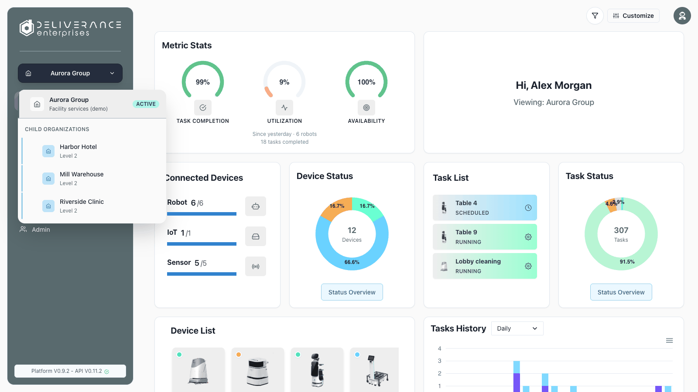

# 入门 {#getting-started}

## 访问平台 {#accessing-the-platform}

在登录页面使用电子邮箱和密码访问平台。通过 **注册**（**Sign up**）链接可以创建账户，但在管理员将其分配到某个组织之前，该账户不会显示任何数据。

详情见[登录](../guia-de-uso/login.md)。

## 基本导航 {#general-navigation}

登录后，平台所有页面的布局都相同：

- **左侧菜单**：进入各主要版块。*运行*（*Operation*）和 *管理*（*Admin*）仅对管理员显示。
- **组织选择器**，位于侧边菜单顶部：所属组织及其下方的下级组织。它改变所查看的数据，不改变所属的组织。登录时总是从所属组织开始。
- **用户菜单**，位于右上角：*我的资料*（*My profile*）和 *退出登录*（*Log out*）。
- **版本**，位于侧边菜单底部：已部署的平台版本和 API 版本。

仪表板（Dashboard）还包含下级组织的数据；设备（Devices）、监控（Monitor）和分析（Analytics）只显示所选组织。

## 版块速览 {#quick-map-of-sections}

| 版块 | 用途 |
| --- | --- |
| [仪表板](../guia-de-uso/dashboard.md) | 可配置的控制面板，包含指标、设备和任务。 |
| [设备](../guia-de-uso/devices.md) | 启用、编辑设备，并在组织之间分配设备。 |
| [监控](../guia-de-uso/monitor.md) | 每台设备的实时运行状态。 |
| [运行](../guia-de-uso/operation.md) | 向机器人下达任务、工作流和时间线（管理员）。 |
| [分析](../guia-de-uso/analytics.md) | 运营和事件报告，可导出。 |
| [用户设置](../guia-de-uso/user-settings.md)（User Settings） | 个人资料、密码、外观、语言和通知。 |
| [管理](../guia-de-uso/admin.md) | 用户、组织和等级（管理员）。 |
